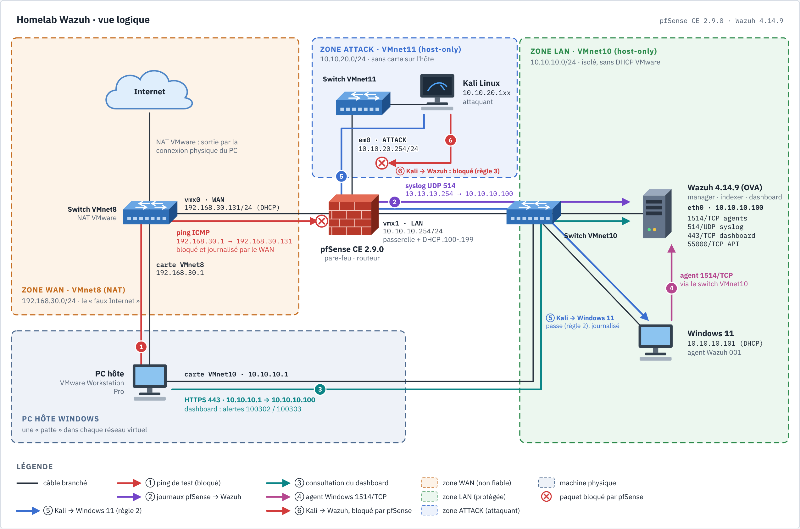

# SIEM_PROJECT : évaluer Wazuh en conditions réelles

Site de documentation : **https://drien95.github.io/SIEM_PROJECT/**

## Le projet en une minute

**Le problème.** Un SIEM promet de tout voir. Avant de le croire, il faut savoir ce qu'il
détecte vraiment, ce qu'il rate et ce qu'il coûte à régler.

**Ce que j'ai construit.** Un lab isolé de 4 machines (pare-feu pfSense avec IDS Suricata,
Wazuh 4.14.9, Windows 11 avec Sysmon, Kali sur un réseau séparé), 14 attaques jouées contre mes
propres machines, 26 règles locales écrites, des tickets de triage et une boucle de réglage des
faux positifs.

**Les résultats.** **17 techniques MITRE ATT&CK détectées en live, sur 13 des 14 tactiques** ;
2 sources de bruit éliminées sur leur cause (une 3e en validation), dont une règle native qui
sonnait 93 fois par jour au niveau critique ; un verdict argumenté sur Wazuh, limites comprises.

Trois documents pour juger sur pièces :

| Document | Ce qu'il montre |
|---|---|
| [Scénario 11 : archive puis exfiltration](docs/writeup/22-scenario-collection-exfiltration.md) | une attaque jouée, une règle native qui ne voit rien, une corrélation maison qui sonne au niveau 14 |
| [Ticket de triage 01](docs/triage/ticket-01-exfiltration-100282.md) | la même alerte, qualifiée à l'aveugle à partir des seules données du SIEM |
| [Writeup 26 : du triage au tuning](docs/writeup/26-du-triage-au-tuning.md) | les manques du ticket deviennent des règles ; deux hypothèses sur quatre étaient fausses |

Selon ce que vous cherchez :

- **Conformité, GRC, audit** : [chaque détection reliée à PCI DSS v4, SOC 2 et CIS](docs/conformite.md).
- **Data, BI** : [volumes d'alertes et faux positifs, chiffres à l'appui](docs/analyse-alertes.md).
- **Le verdict sur l'outil** : [rapport d'évaluation de Wazuh](docs/evaluation-wazuh.md).

**Ce que ce lab ne prouve pas** : pas d'Active Directory, une seule machine Windows, pas de
volume réel, et l'attaquant (moi) connaît les règles. Détail dans le
[rapport d'évaluation, section 5](docs/evaluation-wazuh.md#5-ce-que-ce-lab-ne-prouve-pas).

> Toute affirmation non testée dans le lab est marquée « à valider » ou « déduit ».

## Le lab en un coup d'œil

| Machine | Rôle | Adresse |
|---|---|---|
| pfSense CE 2.9.0 | pare-feu, passerelle, source de journaux (syslog) | LAN `10.10.10.254`, ATTACK `10.10.20.254` |
| Wazuh 4.14.9 (OVA) | manager, indexer, dashboard | `10.10.10.100` |
| Windows 11 (SIEM-Win11) | poste supervisé : agent Wazuh, Sysmon | `10.10.10.101` |
| Kali Linux | attaquant, sur son propre réseau | `10.10.20.10` |

## Résultats

Vue d'ensemble : chaque ligne relie une technique MITRE ATT&CK à la règle Wazuh qui la détecte,
avec la date de validation en live et le document qui la prouve.

| # | Scénario | MITRE ATT&CK | Chaîne de règles (niveau) | Validé en live | Writeup | Fiche |
|---|---|---|---|---|---|---|
| 1 | Brute force SMB sur Windows 11 | T1110, T1110.001, T1078 | 60122 (5) par essai → 60204 (10) → **réponse active**, IP bloquée 180 s → **100400** (12) si un compte est ensuite ouvert ; 92652 (6) | 2026-10-22 | [06](docs/writeup/06-scenario-brute-force-smb.md), [07](docs/writeup/07-regles-et-reponse-active.md) | [brute-force-smb.md](docs/scenarios/brute-force-smb.md) |
| 2 | Scan de ports nmap à travers pfSense | T1046 | 100302 (5) par paquet bloqué → **100303** (10) | 2026-10-22 | [08](docs/writeup/08-scenario-scan-nmap.md) | [scan-nmap.md](docs/scenarios/scan-nmap.md) |
| 3 | Fichier malveillant déposé (EICAR) | T1105 (déduit ; T1203 natif écarté) | FIM 554 (5) → VirusTotal **87105** (12, 66 moteurs) en ~6 s | 2026-10-22 | [09](docs/writeup/09-scenario-fim-virustotal.md) | [malware-fim-virustotal.md](docs/scenarios/malware-fim-virustotal.md) |
| 4 | Scan vu par l'IDS Suricata sur pfSense | T1046 | ET SCAN → 86601 (3) → **100210** (10), via syslog et un décodeur local | 2026-10-22 | [10](docs/writeup/10-scenario-suricata-nids.md) | [suricata-nids.md](docs/scenarios/suricata-nids.md) |
| 5 | Accès à LSASS (Sysmon EID 10) | T1003.001 | 61612 (0) → **100220** (12) | 2026-10-25 | [15](docs/writeup/15-detection-acces-identifiants-lsass.md) (EN COURS) | à écrire (configuration et règle dans [`configs/`](configs/)) |
| 5b | Persistance par clé Run (Sysmon EID 13) | T1547.001 | 92300 native (0) → **100230** (12) | 2026-10-25 | [11](docs/writeup/11-scenario-persistance-run-key.md) | [persistance-run-key.md](docs/scenarios/persistance-run-key.md) |
| 6 | Mouvement latéral SMB vers les partages d'administration | T1021.002 | 4624 → 92657 (6) ; 5140 refusé sur `C$` → 60104 (5) ; 5140 `IPC$` → 67017 (3) → **100240** (12) | 2026-10-28 | [16](docs/writeup/16-scenario-mouvement-lateral-smb.md) | [mouvement-lateral-smb.md](docs/scenarios/mouvement-lateral-smb.md) |
| 7 | Effacement du journal Security | T1070.001 | 1102 → 63103 (5) → **100250** (12) | 2026-10-28 | [17](docs/writeup/17-scenario-effacement-journaux.md) (à rédiger par l'auteur) | à écrire (règle dans [`configs/`](configs/)) |
| 8 | Suppression des clichés instantanés (précurseur rançongiciel) | T1490 | Sysmon EID 1 → 61603 (0) → **100260** (12) ; aucune règle native | 2026-10-29 | [19](docs/writeup/19-scenario-suppression-cliches.md) | — (règle dans [`configs/`](configs/)) |
| 9 | PowerShell à commande encodée (Base64) | T1059.001, T1027 | Sysmon EID 1 → 61603 (0) → **100101** (12) ; natives 92057/92071 limitées au parent ; ancienne 100100 supprimée car elle les masquait | 2026-10-29 | [20](docs/writeup/20-scenario-powershell-encode.md) | — (règle dans [`configs/`](configs/)) |
| 10 | Tâche planifiée créée pour tourner en SYSTEM | T1053.005 | Sysmon EID 1 → **100270** (12) ; 4698 → 60228 (4) → **100271** (12)  | 2026-10-29 | [21](docs/writeup/21-scenario-tache-planifiee-system.md) | — (règles dans [`configs/`](configs/)) |
| 11 | Archive (`tar.exe`) puis exfiltration HTTP (`curl.exe`) vers Kali | T1560.001, T1048.003 | **100280** (8) ; **100281** (10) ; corrélation **100282** (14) même poste en 5 min ; native 92067 hors champ | 2026-10-29 | [22](docs/writeup/22-scenario-collection-exfiltration.md) | — (règles dans [`configs/`](configs/)) |
| 12 | Scan de vulnérabilités `nmap --script vuln` sur le SMB de Win11 | T1595.002 | signature Suricata **locale** sid 1000010 (SMBv1 depuis l'extérieur) → 86601 (3) → **100211** (10) ; ET Open muettes ; alertes EVE allégées pour passer en syslog | 2026-10-29 | [23](docs/writeup/23-scenario-reconnaissance-vuln-scan.md) | — (règles dans [`configs/`](configs/)) |
| 13 | Téléchargement d'outil `certutil -urlcache` depuis Kali | T1105 | Defender bloque (`Ceprolad.A`) ; canal Defender ajouté à `agent.conf` → 62123 (12, description vide) → **100290** (12) ; Sysmon 92075 muette (processus jamais créé) | 2026-10-29 | [24](docs/writeup/24-scenario-telechargement-certutil.md) | — (règles dans [`configs/`](configs/)) |
| — | Conformité : SCA, benchmark CIS Windows 11 | (posture) | 482 checks, score 24 %, check 26003 corrigé Failed → Passed | 2026-10-25 | [12](docs/writeup/12-sca-cis-windows11.md) | [integrations/sca.md](docs/integrations/sca.md) |

Remédiation CIS outillée par familles (dry-run, sauvegarde, garde-fou anti-verrouillage, rollback, rescan SCA), validée sur la VM le 2026-10-25 (retour arrière validé le 2026-10-28) : [scripts/hardening/](scripts/hardening/README.md), récit et faux échec SCA lié à la langue dans le [writeup 13](docs/writeup/13-durcissement-cis-automatise.md).

Couverture complète par tactique : [docs/mitre.md](docs/mitre.md).

## Lire le projet dans l'ordre

| Writeup | Sujet |
|---|---|
| [01 · Homelab](docs/writeup/01-homelab.md) | Montage VMware : pfSense, Wazuh, Windows 11 ; incidents et leçons |
| [02 · Syslog pfSense](docs/writeup/02-syslog-pfsense.md) | Journaux du pare-feu vers Wazuh, décodeur et règles locales |
| [03 · Durcissement SSH](docs/writeup/03-durcissement-ssh.md) | SSH par clé vers Wazuh et pfSense, mot de passe interdit (OVA en mode FIPS) |
| [04 · Agent Windows et Sysmon](docs/writeup/04-agent-windows-sysmon.md) | Agent Wazuh, incident « API Offline », Sysmon en configuration centralisée |
| [05 · Réseau d'attaque](docs/writeup/05-segment-attaque-kali.md) | Kali sur VMnet11 derrière pfSense, règles de l'interface ATTACK |
| [06 · Scénario 1 : brute force SMB](docs/writeup/06-scenario-brute-force-smb.md) | Première détection : 4625, 60122, 60204, pièges de préparation |
| [07 · Règles et réponse active](docs/writeup/07-regles-et-reponse-active.md) | Cours sur les règles, réponse active testée en live, règle locale 100400 |
| [08 · Scénario 2 : scan nmap](docs/writeup/08-scenario-scan-nmap.md) | pfSense comme témoin, 100302 et 100303, angle mort d'une règle |
| [09 · Scénario 3 : FIM + VirusTotal](docs/writeup/09-scenario-fim-virustotal.md) | EICAR détecté en ~6 s : 554 puis 87105, pièges Defender, `-NoNewline` et quota |
| [10 · Scénario 4 : Suricata NIDS](docs/writeup/10-scenario-suricata-nids.md) | IDS sur pfSense, piège `HOME_NET`, en-tête RFC 5424 et décodeur `json`, règle 100210 |
| [11 · Scénario 5b : persistance par clé Run](docs/writeup/11-scenario-persistance-run-key.md) | Règle native 92300 muette (niveau 0), règle sœur jamais évaluée, diagnostic par `logall_json`, règle 100230 |
| [12 · SCA et CIS Windows 11](docs/writeup/12-sca-cis-windows11.md) | Posture : score CIS de 24 %, anatomie d'un check, mapping PCI DSS / ISO 27001 / SOC 2, boucle mesurer, corriger, re-mesurer |
| [13 · Durcissement CIS automatisé](docs/writeup/13-durcissement-cis-automatise.md) | Scripts par familles (dry-run, garde-fou, sauvegarde, vérification, rollback) ; faux « Failed » du SCA sur un Windows en français |
| [14 · Vulnerability Detection](docs/writeup/14-vulnerability-detection.md) | Module évalué jusqu'à sa limite : flux incrémental en échec en 4.14.9, contournement hors ligne (10 Go chargés), Inventory pourtant vide ; diagnostic maillon par maillon |
| [15 · Détection d'un accès aux identifiants (LSASS)](docs/writeup/15-detection-acces-identifiants-lsass.md) (EN COURS, à rédiger par l'auteur) | Squelette : télémétrie Sysmon, règle 100220, faux positif, protection LSA |
| [16 · Mouvement latéral SMB](docs/writeup/16-scenario-mouvement-lateral-smb.md) | Accès refusé par le filtrage UAC à distance, vu par quatre règles ; libellé « RDP » trompeur de 92657 ; exclusion `IPC$` inopérante dans la native 67017 ; règle locale 100240 |
| [17 · Effacement du journal Security](docs/writeup/17-scenario-effacement-journaux.md) (EN COURS, à rédiger par l'auteur) | Squelette : détection native 63103, règle locale 100250, valeur d'une collecte centralisée |
| [18 · Tuning des faux positifs](docs/writeup/18-tuning-faux-positifs.md) | Liste blanche 100231 (Edge) sous 100230 ; logtest non fidèle pour EventChannel ; une action, plusieurs événements ; fille de niveau 0 sous une native |
| [19 · Scénario 8 : suppression des clichés instantanés](docs/writeup/19-scenario-suppression-cliches.md) | Trou du ruleset natif (aucune règle sur `vssadmin delete shadows`), règle 100260 sous 61603, détection de l'intention plutôt que du résultat |
| [20 · Scénario 9 : PowerShell encodé](docs/writeup/20-scenario-powershell-encode.md) | Natives conditionnées au parent ; parent perdu par Sysmon ; une règle locale large (100100) masquait les natives sœurs, supprimée ; règle étroite 100101 |
| [21 · Scénario 10 : tâche planifiée en SYSTEM](docs/writeup/21-scenario-tache-planifiee-system.md) | Native 60228 trop large ; deux capteurs (Sysmon, 4698) ; exclusion des tâches créées par SYSTEM ; recherche vide ≠ absence |
| [22 · Scénario 11 : archive puis exfiltration](docs/writeup/22-scenario-collection-exfiltration.md) | Outils livrés avec Windows ; native 92067 hors champ ; niveaux gradués ; première corrélation (`frequency`, `same_field`) et sa limite |
| [23 · Scénario 12 : scan de vulnérabilités](docs/writeup/23-scenario-reconnaissance-vuln-scan.md) | ET Open muettes ; signature Suricata maison ; alerte levée mais trop lourde pour syslog ; profil réseau Windows passé en Public |
| [24 · Scénario 13 : téléchargement certutil](docs/writeup/24-scenario-telechargement-certutil.md) | Defender bloque, Wazuh aveugle tant que le canal Defender n'est pas collecté ; description native vide (noms de champs) ; règle 100290 |
| [25 · Dashboard de couverture MITRE](docs/writeup/25-dashboard-couverture-mitre.md) | 4 visualisations ; pic de 489 alertes LSASS = artefact de mise au point ; liste blanche 100221 ; archives coupées depuis le 25/10 |
| [26 · Du triage au tuning](docs/writeup/26-du-triage-au-tuning.md) | 100120 (svchost sans parent, Sysmon démarre après services.exe), 100251 (retrait d'audit, T1562.002), corrélation 100273 (tâche SYSTEM éclair) |
| [Annexe · Simulateur de paquets](docs/writeup/annexe-simulateur-paquets.md) | Simulateur façon Packet Tracer (ARP, DHCP, NAT, syslog, agent, Kali), avec vidéos |

## Documents de référence

| Document | Sujet |
|---|---|
| [docs/architecture.md](docs/architecture.md) | Composants Wazuh, `ossec.conf` et chaîne des démons (cours), flux de données, ports, matrice des flux du lab |
| [docs/installation.md](docs/installation.md) | Prérequis, installation (OVA / all-in-one), agents, dépannage |
| [docs/roadmap.md](docs/roadmap.md) | Roadmap en trois phases (largeur, profondeur, livrable), compétence SOC visée et statut de chaque étape |
| [mkdocs.yml](mkdocs.yml) | Site de documentation (MkDocs Material), page d'accueil [docs/index.md](docs/index.md), déployé sur GitHub Pages par `.github/workflows/deploy-docs.yml` |
| [docs/evaluation-wazuh.md](docs/evaluation-wazuh.md) | Rapport d'évaluation de Wazuh 4.14.9 : grille, forces, limites, ce que le lab ne prouve pas, à qui le recommander |
| [docs/conformite.md](docs/conformite.md) | Lecture conformité : détections reliées à PCI DSS v4.0.1, SOC 2 et CIS Controls v8, constats pour un auditeur |
| [docs/analyse-alertes.md](docs/analyse-alertes.md) | Lecture data : volumes d'alertes, sources de bruit, méthode de tuning, pièges de données |
| [docs/portfolio/README.md](docs/portfolio/README.md) | Squelette de portfolio : pitch, lab, scénarios, règles locales, constats, limites, compétences |
| [docs/mitre.md](docs/mitre.md) | Couverture MITRE ATT&CK : règle → technique → tactique, couverture des 14 tactiques et trous, pistes, étiquettes natives à corriger |
| [docs/detection.md](docs/detection.md) | Capacités de détection, intégrations, règles personnalisées, scénarios de test |
| [docs/sources.md](docs/sources.md) | Sources utilisées, ce qu'on en retient, limites |
| [docs/homelab/plan.md](docs/homelab/plan.md) | Plan du homelab VMware : réseau, VM, ordre de montage, images |
| [docs/homelab/screenshots/](docs/homelab/screenshots/README.md) | Captures d'écran du montage, numérotées |
| [docs/diagrams/](docs/diagrams/README.md) | Schémas : réseau du lab façon Packet Tracer, règles pare-feu ATTACK, flux de détection du brute force SMB, couverture MITRE, chaîne des démons et carte complète de Wazuh, matrice des flux, chaîne Suricata vers Wazuh, arbre des règles de la clé Run, anatomie d'un check SCA, cycle de durcissement et faux échec SCA, pipeline Wazuh annoté, règle et réponse active, modèle de scénario (sources HTML et PNG) |
| [docs/integrations/](docs/integrations/) | Un guide par intégration : Windows/Sysmon, FIM, VirusTotal, Suricata, pfSense, SCA (CIS) |
| [docs/triage/](docs/triage/README.md) | Tickets de triage sur des alertes réelles du lab : chronologie, qui / quoi / où, verdict, actions, améliorations de détection |
| [docs/scenarios/](docs/scenarios/README.md) | Index des scénarios : joués (brute force SMB, scan nmap, FIM + VirusTotal, Suricata, clé Run), prévus, modèle de fiche |
| [configs/](configs/) | Configurations du lab : règles et décodeur locaux, syslog, réponse active (`block-ip-win`), agent Windows (dont la configuration Sysmon `sysmon-lab.xml`), pfSense, VirusTotal, Suricata |
| [scripts/hardening/](scripts/hardening/README.md) | Scripts PowerShell de durcissement CIS Windows 11 par famille (mots de passe, verrouillage, audit), orchestrateur avec rapport et rescan SCA (validés sur la VM, writeup 13) |
| [docs/lab-marxgoo.md](docs/lab-marxgoo.md) | Notes de lecture des PDF du lab marxgoo, avec les erreurs corrigées |
| [CLAUDE.md](CLAUDE.md) | Objectif, conventions et règles de contribution (humains et Claude) |

## Version de référence

Wazuh **4.14** (branche documentée sur `documentation.wazuh.com/current` au
2026-10-20). Les commandes sont à revérifier si la version change.

## Reproduire le lab

1. [docs/homelab/plan.md](docs/homelab/plan.md) et [docs/architecture.md](docs/architecture.md) : réseau, VM, matrice des flux.
2. [docs/installation.md](docs/installation.md) puis les writeups 01 à 05 : serveur, agents, sources de journaux.
3. Les fiches de [docs/scenarios/](docs/scenarios/README.md) : jouer un scénario, comparer attendu et observé, consigner les résultats.

Sécurité : aucun secret dans le dépôt (mots de passe, `client.keys`, clés API, certificats) ;
les attaques ne visent que les machines du lab, sur des réseaux host-only.
