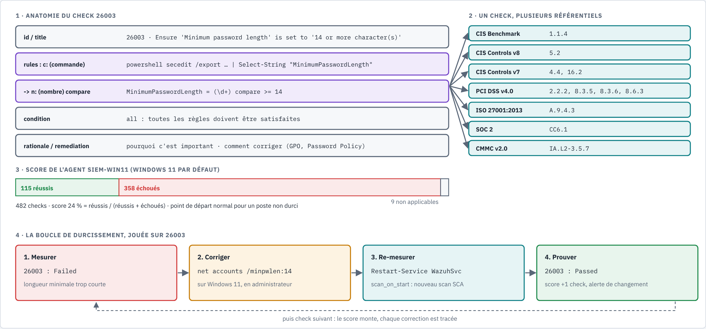

# SCA : évaluation de la configuration (CIS)

Sources :
https://documentation.wazuh.com/current/user-manual/capabilities/sec-config-assessment/index.html,
https://documentation.wazuh.com/current/user-manual/capabilities/sec-config-assessment/how-it-works.html,
https://documentation.wazuh.com/current/user-manual/capabilities/sec-config-assessment/creating-custom-policies.html,
https://documentation.wazuh.com/current/user-manual/reference/ossec-conf/sca.html,
https://github.com/wazuh/wazuh/blob/v4.14.0/ruleset/sca/windows/cis_win11_enterprise.yml,
https://www.cisecurity.org/cis-benchmarks/.

Joué dans le lab le 2026-10-25 : [writeup 12](../writeup/12-sca-cis-windows11.md).
Remédiation par scripts (familles CIS, validés sur la VM le 2026-10-25) : [scripts/hardening/](../../scripts/hardening/README.md), [writeup 13](../writeup/13-durcissement-cis-automatise.md).



*Source : [`sca-check-cis.html`](../diagrams/sca-check-cis.html).*

## 1. Ce que fait le SCA

Le **SCA** (*Security Configuration Assessment*) compare la configuration réelle d'un poste à
une **politique** écrite en YAML : fichiers, clés de registre, processus, sorties de commandes.
C'est du **durcissement** mesuré : on ne cherche pas une attaque, on cherche les réglages qui
la rendraient plus facile.

- Il tourne **sur l'agent**, dans `wazuh-modulesd` (voir la [carte des démons](../architecture.md)).
- Wazuh fournit des politiques prêtes, surtout tirées des **benchmarks CIS** (Center for
  Internet Security).
- L'agent garde l'état de chaque check dans une base locale et n'envoie au manager que les
  **différences** entre deux scans. Une alerte part quand un check **change d'état**.

## 2. Configuration par défaut

Bloc `<sca>` de l'`ossec.conf` (valeurs par défaut de la documentation) :

| Option | Défaut | Effet |
|---|---|---|
| `enabled` | `yes` | module actif |
| `scan_on_start` | `yes` | un scan au démarrage de l'agent (utile pour re-mesurer après une correction) |
| `interval` | `12h` | un scan toutes les 12 heures |
| `skip_nfs` | `yes` | ignore les partages réseau NFS |
| `policies` | aucune | sans cette section, l'agent applique toutes les politiques de son dossier de ruleset |

Dans le lab, rien n'a été configuré : l'agent Windows 11 a choisi seul la politique
**CIS Microsoft Windows 11 Enterprise Benchmark v3.0.0** (`cis_win11_enterprise.yml`, 482 checks,
vérifié dans le ruleset v4.14.0).

Détail amusant de cette politique : sa condition préalable (`requirements`) cherche
`ProductName` commençant par `Windows 10` dans le registre. Windows 11 garde en effet cette
valeur historique dans `HKLM\SOFTWARE\Microsoft\Windows NT\CurrentVersion` (déduction
cohérente avec le fait que la politique s'est appliquée sur notre Windows 11).

## 3. Anatomie d'un check

Exemple réel, le check **26003** (CIS 1.1.4) :

```yaml
- id: 26003
  title: "Ensure 'Minimum password length' is set to '14 or more character(s)'."
  rationale: "Types of password attacks include dictionary attacks ... and brute force attacks ..."
  remediation: "... Account Policies\\Password Policy\\Minimum password length."
  compliance:
    - cis: ["1.1.4"]
    - cis_csc_v8: ["5.2"]
    - cis_csc_v7: ["4.4", "16.2"]
    - cmmc_v2.0: ["IA.L2-3.5.7"]
    - iso_27001-2013: ["A.9.4.3"]
    - pci_dss_v4.0: ["2.2.2", "8.3.5", "8.3.6", "8.6.3"]
    - soc_2: ["CC6.1"]
  condition: all
  rules:
    - 'c:powershell secedit /export /cfg $env:TEMP\secpol.cfg; Get-Content $env:TEMP\secpol.cfg | Select-String "MinimumPasswordLength"; Remove-Item $env:TEMP\secpol.cfg -> n:MinimumPasswordLength = (\d+) compare >= 14'
```

*(Champs `description`, `impact` et `references` abrégés.)*

| Partie | Rôle |
|---|---|
| `id`, `title` | identifiant Wazuh et intitulé CIS |
| `rationale`, `impact`, `remediation` | pourquoi, ce que ça coûte, comment corriger : de quoi écrire un ticket |
| `compliance` | correspondances avec les référentiels (voir § 4) |
| `rules` | le test. Préfixe `c:` = exécuter une commande ; après `->`, `n:` extrait un **nombre** avec `(\d+)` et le compare (`compare >= 14`). Autres préfixes vus dans la doc : `f:` (fichier), `r:` (registre ou expression régulière selon la position) |
| `condition` | `all` : réussi si toutes les règles le sont ; `any` : si l'une l'est ; `none` : si aucune |

Résultats possibles : **Passed**, **Failed**, **Not applicable** (par exemple quand une règle ne
peut pas être évaluée sur ce système, sans qu'aucune n'échoue).

## 4. Pourquoi le mapping de conformité compte

Un même réglage (longueur minimale des mots de passe) répond à **sept** exigences de
référentiels différents. Pour une équipe sécurité :

- un audit PCI DSS, ISO 27001 ou SOC 2 demande des **preuves** : le SCA en fournit une par poste,
  horodatée ;
- on peut filtrer le tableau de bord par référentiel (« où en est-on sur PCI DSS 8.3 ? ») ;
- on priorise les corrections qui font avancer plusieurs référentiels à la fois.

Le SCA **mesure** ; il ne corrige rien lui-même. La correction passe par une GPO, un script
ou une action manuelle, puis un nouveau scan prouve le résultat.

## 5. Où regarder

Dashboard : **Endpoint security > Configuration Assessment**, choisir l'agent puis la politique.
Le tableau donne le score, chaque check, son résultat et ses détails (cible, condition,
remédiation, conformité).

## 6. Limites

- Politique écrite pour un système **en anglais** : la politique elle-même prévient que
  certains checks sont moins précis sur un système dans une autre langue. **Confirmé dans le lab**
  (2026-10-25) : les 27 checks d'audit 26139-26165 interrogent `auditpol` avec les noms anglais et
  cherchent `Success and Failure` ; sur notre Windows en français, ils restent « Failed » même
  une fois l'audit appliqué et vérifié par GUID. Détail : [writeup 13, § 4](../writeup/13-durcissement-cis-automatise.md).
- Benchmark **Enterprise** (poste en domaine) appliqué à un poste isolé : certaines
  recommandations (GPO de domaine) n'ont pas d'objet dans le lab.
- Les checks par commande (`c:`) des politiques **personnalisées** poussées depuis le manager
  demandent une autorisation explicite sur l'agent (`sca.remote_commands`, à valider avant
  d'écrire une politique maison).
