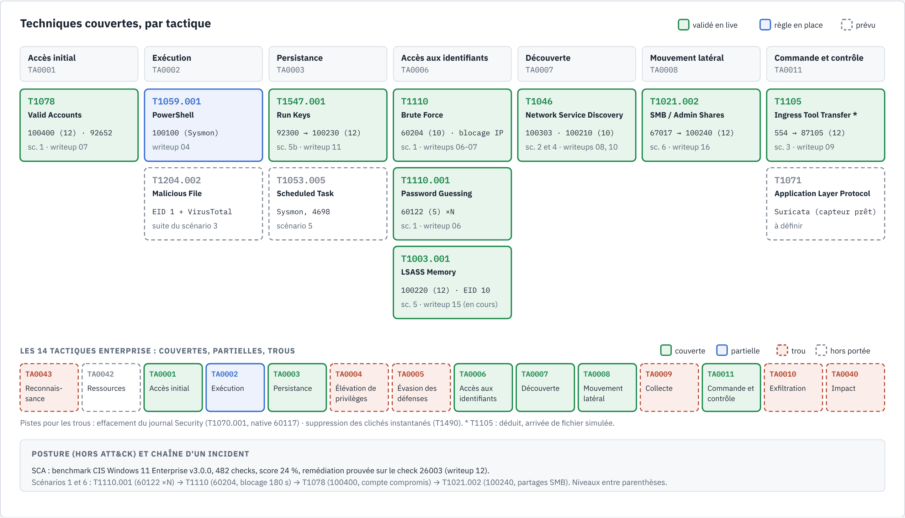

# Couverture MITRE ATT&CK

Ce document relie chaque détection du lab à sa **technique** et à sa **tactique** ATT&CK, avec
la règle Wazuh qui la voit et la preuve. C'est le point de départ de la phase 2 (voir la
[roadmap](roadmap.md)) : savoir ce qu'on voit, et surtout ce qu'on ne voit pas. Mis à jour le
2026-10-28.

*Source : [`mitre-couverture.html`](diagrams/mitre-couverture.html).*

## 1. Vocabulaire en deux lignes

- Une **tactique** est l'objectif de l'attaquant à une étape (« obtenir des identifiants »,
  « découvrir le réseau »). La matrice Enterprise en compte **14**, de TA0043 à TA0040.
- Une **technique** est la façon d'atteindre cet objectif (« brute force », « clé Run »). Une
  même technique peut servir plusieurs tactiques : on retient ici celle qui correspond à ce que
  le scénario montre.

Source : https://attack.mitre.org/tactics/enterprise/

## 2. Tableau récapitulatif

Statut : **validé** = scénario joué et alerte observée en live ; **règle en place** = règle
active et vue sur de l'activité normale, pas encore dans un scénario d'attaque ; **prévu** =
dans la roadmap. « Déduit » : correspondance établie par nous, absente des sources.

| Technique | Tactique | Scénario / writeup | Règle(s) Wazuh (niveau) | Source de télémétrie | Statut |
|---|---|---|---|---|---|
| **T1110** Brute Force | Credential Access (TA0006) | [scénario 1](scenarios/brute-force-smb.md), [writeups 06](writeup/06-scenario-brute-force-smb.md)-[07](writeup/07-regles-et-reponse-active.md) | 60204 (10) native → réponse active `block-ip-win` (IP bloquée 180 s) | journal Security Windows (4625), agent | ✅ validé 2026-10-22 |
| **T1110.001** Password Guessing (déduit) | Credential Access (TA0006) | idem | 60122 (5) native, une par essai | idem | ✅ validé 2026-10-22 |
| **T1078** Valid Accounts | Initial Access (TA0001) | [writeup 07, § 1.4](writeup/07-regles-et-reponse-active.md) | **100400** (12) locale « succès après rafale » ; 92652 (6) native | journal Security (4624 après 4625), agent | ✅ validé 2026-10-22 (capture 88) |
| **T1046** Network Service Discovery | Discovery (TA0007) | [scénario 2](scenarios/scan-nmap.md), [writeup 08](writeup/08-scenario-scan-nmap.md) | 100300 (0) → 100302 (5) → **100303** (10), locales | réseau : `filterlog` pfSense en syslog | ✅ validé 2026-10-22 |
| **T1046** Network Service Discovery | Discovery (TA0007) | [scénario 4](scenarios/suricata-nids.md), [writeup 10](writeup/10-scenario-suricata-nids.md) | 86601 (3) native → **100210** (10) locale, signatures ET SCAN | réseau : Suricata sur pfSense, EVE JSON en syslog | ✅ validé 2026-10-22 |
| **T1105** Ingress Tool Transfer (déduit, simulé) | Command and Control (TA0011) | [scénario 3](scenarios/malware-fim-virustotal.md), [writeup 09](writeup/09-scenario-fim-virustotal.md) | 554 (5) FIM → **87105** (12) VirusTotal, natives | FIM de l'agent + API VirusTotal | ✅ validé 2026-10-22 (voir § 3) |
| **T1003.001** OS Credential Dumping: LSASS Memory | Credential Access (TA0006) | scénario 5, [writeup 15](writeup/15-detection-acces-identifiants-lsass.md) (en cours) | 61612 (0) native → **100220** (12) locale | Sysmon EID 10, agent Windows | ✅ validé 2026-10-25 |
| **T1547.001** Registry Run Keys / Startup Folder | Persistence (TA0003) | [scénario 5b](scenarios/persistance-run-key.md), [writeup 11](writeup/11-scenario-persistance-run-key.md) | 92300 (0) native → **100230** (12) locale | Sysmon EID 13, agent Windows | ✅ validé 2026-10-25 (faux positif `RunNotification` connu) |
| **T1021.002** Remote Services: SMB/Windows Admin Shares | Lateral Movement (TA0008) | [scénario 6](scenarios/mouvement-lateral-smb.md), [writeup 16](writeup/16-scenario-mouvement-lateral-smb.md) | 67017 (3) native → **100240** (12) locale ; 60104 (5) pour le refus ; 92657 (6) pour la connexion | journal Security (4624, 5140), agent | ✅ validé 2026-10-28 (accès `C$` refusé par le filtrage UAC à distance) |
| **T1059.001** PowerShell | Execution (TA0002) | [writeup 04](writeup/04-agent-windows-sysmon.md) | **100100** (8) locale | Sysmon EID 1, agent Windows | 🔵 règle en place (9 alertes sur activité normale) |
| T1204.002 Malicious File (déduit) | Execution (TA0002) | suite du scénario 3 | Sysmon EID 1 sur un fichier signalé par VirusTotal | Sysmon, agent | ⏳ prévu |
| T1053.005 Scheduled Task | Persistence (TA0003) | scénario 5 (suite) | Sysmon, événement 4698 | Sysmon, journal Security | ⏳ prévu |
| T1071 Application Layer Protocol (déduit) | Command and Control (TA0011) | à définir | signatures Suricata de trafic C2 | réseau : Suricata | ⏳ prévu |

En chiffres : **8 techniques validées en live** (5 techniques et 3 sous-techniques, dont T1046
vue par deux capteurs indépendants), réparties sur **6 tactiques** ; 1 technique en règle
seule ; 3 prévues.

## 3. Le cas du scénario 3 (EICAR) : quelle technique ?

La règle native 87105 porte **T1203** Exploitation for Client Execution, pour tout fichier
signalé par VirusTotal. Ce n'est pas ce que le lab montre : ni exploitation, ni exécution.

| Candidat | Ce que décrit ATT&CK | Dans notre lab | Retenu ? |
|---|---|---|---|
| T1203 Exploitation for Client Execution | exploiter une faille d'un logiciel client pour exécuter du code | aucune exploitation | ❌ étiquette native écartée |
| **T1105** Ingress Tool Transfer | faire arriver un outil ou un fichier sur le poste | un fichier malveillant (de test) apparaît sur le disque | ✅ technique simulée (déduit) |
| T1204.002 Malicious File | l'utilisateur ouvre un fichier malveillant | le fichier n'est jamais exécuté | ⏳ étape suivante, prévue |

**Vérifié** : ce que fait le lab (fichier EICAR écrit sur le disque, FIM 554 puis VirusTotal
87105, writeup 09) et l'étiquette native T1203 (ruleset Wazuh). **Supposé** : le rattachement à
T1105. Dans le test, le fichier a été écrit **localement** par PowerShell (`Set-Content`), sans
transfert réseau : on simule le résultat d'un transfert (le fichier qui arrive), pas le
transfert lui-même. La détection est en fait **indépendante du vecteur** (téléchargement, clé
USB, pièce jointe) : c'est ce qui fait sa valeur. Le rôle de chaque brique est différent : le FIM
**détecte** le dépôt, VirusTotal **qualifie** le fichier (enrichissement).

Sources : https://attack.mitre.org/techniques/T1105/, https://attack.mitre.org/techniques/T1203/,
https://attack.mitre.org/techniques/T1204/002/.

## 4. Couverture et trous

| Tactique | ID | Couverte ? | Par |
|---|---|---|---|
| Reconnaissance | TA0043 | ❌ | — (voir la note sur T1046 ci-dessous) |
| Resource Development | TA0042 | — | hors de portée d'un SIEM interne (se passe chez l'attaquant) |
| Initial Access | TA0001 | ✅ | T1078 (100400) |
| Execution | TA0002 | 🔵 partielle | T1059.001 (100100), pas encore dans un scénario |
| Persistence | TA0003 | ✅ | T1547.001 (100230) |
| Privilege Escalation | TA0004 | ❌ | — |
| Defense Evasion | TA0005 | ❌ | — |
| Credential Access | TA0006 | ✅ | T1110, T1110.001, T1003.001 |
| Discovery | TA0007 | ✅ | T1046 (100303, 100210) |
| Lateral Movement | TA0008 | ✅ | T1021.002 (100240), depuis le 2026-10-28 |
| Collection | TA0009 | ❌ | — |
| Command and Control | TA0011 | ✅ (simulé) | T1105 (87105) |
| Exfiltration | TA0010 | ❌ | — |
| Impact | TA0040 | ❌ | — |

Bilan : **6 tactiques couvertes** sur 14, une partielle, **6 trous** (Reconnaissance, Privilege
Escalation, Defense Evasion, Collection, Exfiltration, Impact), Resource Development étant hors
de portée. La chaîne du scénario 1 se prolonge désormais jusqu'au mouvement latéral :
T1110 → T1078 → T1021.002.

Nuances, pour ne pas surestimer :

- **Une technique, plusieurs tactiques.** ATT&CK range aussi T1078 sous Persistence, Privilege
  Escalation et Defense Evasion, et T1547.001 sous Privilege Escalation. On ne compte pas ces
  tactiques comme couvertes : nos scénarios n'y montrent pas d'élévation ni d'évasion.
- **T1046 ou Reconnaissance ?** Kali scanne depuis un réseau séparé, à travers le pare-feu. Vu
  du lab, c'est un balayage venu de l'extérieur, ce qu'ATT&CK range plutôt en T1595 Active
  Scanning (Reconnaissance) ; T1046 décrit la découverte depuis l'intérieur. On garde T1046,
  cohérent avec les writeups ; le double rattachement est à discuter (déduit).
- **Couvert ne veut pas dire bien couvert.** Une tactique = souvent une seule technique, sur
  un seul poste, avec des faux positifs connus (100230, 100220 sur `wazuh-agent.exe`).

### Pistes pour combler les trous

| Priorité | Tactique visée | Scénario proposé | Télémétrie probable (à valider) |
|---|---|---|---|
| ✅ | **Lateral Movement** (TA0008) | fait : [scénario 6](scenarios/mouvement-lateral-smb.md) (T1021.002), 2026-10-28. Suite possible : exécution par service (T1569.002) avec le compte Administrateur intégré | 7045 (service créé), Sysmon EID 1 |
| 1 | **Defense Evasion** (TA0005) | effacement du journal Security (T1070.001, `wevtutil cl Security`) et désactivation de Defender (T1562.001) | événement 1102 : règle native 60117 (niveau 9, `0580-win-security_rules.xml`, à vérifier en live) ; journal Defender ; la famille 03 (audit, ligne de commande 4688) aide |
| 2 | **Impact** (TA0040) | précurseur de rançongiciel : suppression des clichés instantanés (T1490, `vssadmin delete shadows`) | Sysmon EID 1 et 4688 avec ligne de commande ; règle locale probable |

Le mouvement latéral a **prolongé une chaîne déjà jouée** (T1110 → T1078 → T1021.002) : un
incident complet, de la tentative à la propagation, est exactement ce qu'un analyste attend.

Sources : https://attack.mitre.org/techniques/T1021/002/, https://attack.mitre.org/techniques/T1569/002/,
https://attack.mitre.org/techniques/T1070/001/, https://attack.mitre.org/techniques/T1562/001/,
https://attack.mitre.org/techniques/T1490/, https://attack.mitre.org/techniques/T1595/,
https://attack.mitre.org/techniques/T1078/, https://attack.mitre.org/techniques/T1547/001/.

## 5. Étiquettes MITRE à ne pas reprendre telles quelles

| Règle | MITRE du ruleset | Problème | Ce qu'on retient |
|---|---|---|---|
| 60122 (native) | T1531 Account Access Removal (Impact) | un échec de connexion ne supprime aucun accès | T1110 / T1110.001 |
| 87702 (native pfSense) | T1110 Brute Force | des blocages répétés signalent surtout un scan | T1046 (notre 100303) |
| 92657 (native) | T1550.002, T1078.002, **T1021.001** (RDP) ; libellé « possible RDP » | se déclenche sur toute connexion réseau NTLM avec un nom de poste, quel que soit le protocole | selon les champs : ici SMB, donc T1021.002 (scénario 6) |
| 67017 (native) | T1021.002, commentaire « sans IPC$ et NetLogon » | l'exclusion `IPC$` ne fonctionne pas (`$` = ancre de fin en OS_Regex, déduction) | à corriger dans nos enfants (`IPC\$`, à valider) |
| 87105 (native VirusTotal) | T1203 Exploitation for Client Execution | même étiquette pour tout fichier détecté, sans exploitation ni exécution | T1105 puis T1204.002 selon ce qu'on observe (§ 3) |

Sources : https://attack.mitre.org/ (matrice Enterprise),
https://github.com/wazuh/wazuh/tree/v4.14.0/ruleset/rules (étiquettes des règles natives),
writeups cités dans le tableau.
