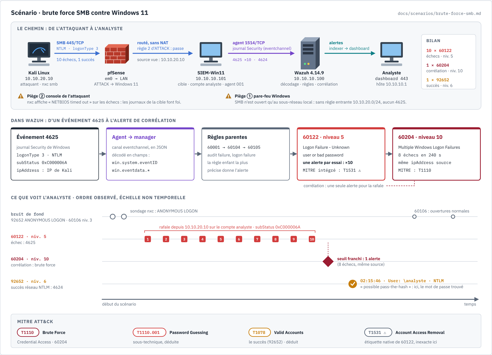

# Scénario — Brute force SMB contre Windows 11

MITRE ATT&CK : **T1110** (Brute Force, tactique Credential Access), sous-technique
**T1110.001** (Password Guessing, déduite), puis **T1078** (Valid Accounts) au moment du succès
(déduit).

Statut : **joué le 2026-10-22**, résultats observés dans le dashboard Wazuh 4.14.9.

Sources :
https://learn.microsoft.com/en-us/windows/security/threat-protection/auditing/event-4625 (champs
et codes de l'événement 4625),
https://github.com/wazuh/wazuh/blob/v4.14.0/ruleset/rules/0580-win-security_rules.xml (règles
60122 et 60204),
https://documentation.wazuh.com/current/proof-of-concept-guide/detect-brute-force-attack.html,
https://attack.mitre.org/techniques/T1110/, https://attack.mitre.org/techniques/T1531/.

> Joué **uniquement** contre une VM du lab (SIEM-Win11), depuis Kali, sur des réseaux
> host-only isolés. Aucun mot de passe réel ne figure dans cette fiche.



*Planche du scénario. Source : [`detection-brute-force-smb.html`](../diagrams/detection-brute-force-smb.html).
Le [modèle de planche](modele-scenario.md) suppose Kali sur VMnet10 ; depuis le writeup 05,
Kali est derrière pfSense, d'où une planche dédiée.*

## 1. Objectif

Vérifier que Wazuh détecte une attaque par **devinette de mot de passe** contre le poste
Windows 11, et voir **ce que l'analyste a réellement sous les yeux** : quelles alertes, à quel
niveau, dans quel ordre, et comment distinguer la tentative de la compromission.

## 2. Topologie

| Rôle | Machine | Adresse | Détail |
|---|---|---|---|
| Attaquant | Kali Linux | `10.10.20.10` (réservation DHCP, VMnet11) | outil `nxc` (NetExec), module SMB |
| Pare-feu | pfSense CE 2.9.0 | `em0` 10.10.20.254 → LAN 10.10.10.254 | règle 2 d'ATTACK : Kali → Windows 11 passe, journalisé |
| Cible | SIEM-Win11 | `10.10.10.101` | agent Wazuh 001, compte local `analyste` |
| SIEM | Wazuh 4.14.9 (OVA) | `10.10.10.100` | manager, indexer, dashboard |

Le trafic **traverse pfSense** (writeup 05) et n'est pas traduit (pas de NAT entre ATTACK et
LAN) : Windows voit l'adresse réelle de Kali. C'est ce qui permet à la corrélation 60204, qui
regroupe par `win.eventdata.ipAddress`, de fonctionner (déduction cohérente avec l'alerte
observée).

## 3. Prérequis

- Agent Wazuh actif sur Windows 11, journal **Security** collecté (writeup 04).
- Audit des échecs d'ouverture de session actif sur Windows (c'est le cas par défaut : les
  4625 sont arrivés sans réglage).
- **Accès réseau SMB depuis le réseau ATTACK** : voir le piège ① ci-dessous.
- Un compte cible dont on connaît le mot de passe, et une petite liste de mots de passe qui le
  contient (une dizaine d'entrées).

## 4. Attaque (vue d'ensemble)

1. Depuis Kali, `nxc smb 10.10.10.101 -u analyste -p <liste>` essaie chaque mot de passe de la
   liste sur SMB (445/TCP), avec une authentification **NTLM**, en ouverture de session
   **réseau** (`logonType 3`).
2. Les dix premiers essais échouent, le dernier réussit.

La commande exacte et la liste ne sont pas reprises ici : elles n'apportent rien à la
détection et la liste contient le mot de passe du lab.

## 5. Deux pièges de préparation

### Piège ① : le pare-feu Windows jette SMB venant d'un autre réseau

**Symptôme.** Premiers essais depuis Kali : aucune réponse, et **aucun 4625** dans Wazuh.

**Cause.** Sur Windows, les règles « Partage de fichiers et d'imprimantes (SMB-In) » limitent
par défaut la portée au **sous-réseau local**. Kali, sur `10.10.20.0/24`, n'est pas « local » pour
Windows (`10.10.10.0/24`) : ses paquets sont jetés **avant** toute authentification.

**Correction.** Une règle entrante autorisant 445/TCP depuis `10.10.20.0/24` uniquement, par
exemple :

```powershell
New-NetFirewallRule -DisplayName "LAB - SMB depuis ATTACK" -Direction Inbound `
  -Protocol TCP -LocalPort 445 -RemoteAddress 10.10.20.0/24 -Action Allow
```

(commande d'exemple : la règle a été créée dans le lab, la syntaxe exacte utilisée est à
valider.)

**Leçon SOC.** Un SIEM silencieux ne prouve pas que rien ne s'est passé : il prouve seulement
que **rien n'est arrivé jusqu'à la source de journaux**. Sans accès réseau, pas
d'authentification, pas de 4625, pas d'alerte. Avant de conclure « la détection ne marche
pas », vérifier que l'attaque atteint la cible.

### Piège ② : la console de l'attaquant n'est pas fiable

**Symptôme.** `nxc` n'affiche que le succès ; pour les échecs, il écrit « Connection Error » ou
« NETBIOS timed out ».

**Constat.** Wazuh a pourtant reçu **dix** événements 4625 : chaque mot de passe a bien été
présenté et refusé par Windows. Le timeout est côté outil (cause exacte à valider), pas côté
authentification.

**Leçon SOC.** Ce que l'outil d'attaque affiche ne dit pas ce que la cible a vécu. En
validation de détection, **les journaux défensifs font foi**. Un exercice de type purple team
compare toujours « ce que l'attaquant croit avoir fait » à « ce que la cible a enregistré ».

## 6. Détection : attendu contre observé

Agent `SIEM-Win11` (001). Recherche utilisée dans *Threat Hunting* :
`agent.id:001 AND rule.id:(60122 OR 60204 OR 92652)`.

| Étape | Trace Windows | Règle Wazuh | Niveau | Attendu | Observé |
|---|---|---|---|---|---|
| Chaque essai raté | 4625, `logonType 3`, NTLM | **60122** Logon Failure - Unknown user or bad password | 5 | oui (doc, ruleset) | ✅ **×10**, une par essai |
| Rafale d'échecs | plusieurs 4625, même source | **60204** Multiple Windows Logon Failures | 10 | oui | ✅ **×1** |
| Mot de passe trouvé | ouverture de session réseau réussie (4624, déduit) | **92652** Successful Remote Logon Detected - User:\analyste - NTLM authentication, possible pass-the-hash | 6 | à identifier | ✅ ×1, à **02:15:46**, juste après la rafale |
| Passage dans pfSense | `filterlog` pass, règle 2 | 100301 (règle locale) | 3 | oui | non relevé pendant ce scénario, à valider |

Bruit présent dans la même fenêtre, à savoir écarter :

- **92652 avec ANONYMOUS LOGON** : sondage anonyme de `nxc` avant les essais (ouverture de
  session nulle SMB). Même règle que le succès, mais sans compte réel : pas une compromission.
- **60106** (Windows Logon Success, niveau 3) : ouvertures de session normales du poste.

### Comment fonctionne la corrélation 60204

D'après le ruleset v4.14.0 (`0580-win-security_rules.xml`) :

```xml
<rule id="60204" level="10" frequency="$MS_FREQ" timeframe="240">
  <if_matched_group>authentication_failed</if_matched_group>
  <same_field>win.eventdata.ipAddress</same_field>
  <description>Multiple Windows Logon Failures</description>
  ...
  <mitre><id>T1110</id></mitre>
</rule>
```

avec `<var name="MS_FREQ">8</var>`. En clair : quand assez d'événements du groupe
`authentication_failed` (dont 60122) arrivent **en 240 secondes** depuis **la même adresse
source**, Wazuh lève **une** alerte de niveau 10. Les dix 60122 n'ont donné qu'**une** 60204 :
la corrélation résume la rafale au lieu d'en ajouter dix de plus. Le numéro exact de l'échec
qui déclenche l'alerte n'a pas été relevé (à valider).

60122 est elle-même au bout d'une chaîne : `60001` (événement Windows) → `60104` (échec d'audit)
→ `60105` (échec d'ouverture de session) → `60122` (version précise pour 4625). Wazuh n'émet que
l'alerte de la règle la plus précise.

## 7. Lecture de l'analyste SOC

1. **La 60204 (niveau 10) est le point d'entrée.** Un analyste ne lit pas dix alertes de niveau 5
   une par une ; il part de la corrélation, puis ouvre les 60122 pour le détail.
2. **Le `subStatus` dit si le compte existe.** Dans chaque 4625 :
   `data.win.eventdata.subStatus` = **`0xC000006A`** = compte valide, mauvais mot de passe.
   `0xC0000064` voudrait dire « utilisateur inconnu ». Ici, l'attaquant visait un **compte
   réel** : l'attaque est ciblée, pas un balayage de noms au hasard.
3. **La question décisive : y a-t-il un succès après ?** La 92652 pour `\analyste`, juste après
   la rafale et depuis la même source, fait passer le dossier de « tentative » à
   **« compte compromis »**. Réflexes : désactiver ou réinitialiser le compte, chercher ce qu'a
   fait cette session (créations de processus via Sysmon, accès aux partages), élargir la
   recherche à la même IP sur les autres machines.
4. **Lire la description d'une règle avec recul.** « possible pass-the-hash » décrit une
   ouverture de session réseau NTLM : c'est la même trace qu'un pass-the-hash, mais ici le mot
   de passe a simplement été deviné. Le contexte (la rafale juste avant) tranche.
5. **Écarter le bruit** : 92652 en ANONYMOUS LOGON et 60106 ne sont pas des indicateurs à eux
   seuls.
6. **Conformité** : les alertes 60122 et 60204 portent d'office les étiquettes PCI DSS
   10.2.4 et 10.2.5, HIPAA 164.312.b, NIST 800-53 AU.14 et AC.7, GDPR IV 35.7.d et 32.2 (vu dans
   le dashboard et dans le ruleset). Utile pour un rapport d'audit : la tentative d'accès est
   tracée et horodatée.

### MITRE : une étiquette native à corriger

| Règle | MITRE dans le ruleset | Ce que l'attaque est réellement |
|---|---|---|
| 60122 | **T1531** Account Access Removal (tactique *Impact*) | T1110 / T1110.001 (Credential Access) |
| 60204 | T1110 Brute Force | T1110, correct |
| 92652 | non relevé | T1078 Valid Accounts (déduit) |

L'étiquette T1531 de 60122 ne correspond pas à un échec d'ouverture de session (T1531 désigne
le fait de **supprimer** l'accès légitime à un compte). Dans un rapport, ne pas reprendre la
colonne MITRE du dashboard sans la relire. Correction possible : une règle enfant locale
(`if_sid` 60122) qui ajoute T1110.001, à valider avec `wazuh-logtest`.

## 8. Remédiation et durcissement

| Mesure | Effet sur ce scénario | Statut |
|---|---|---|
| Retirer la règle « LAB - SMB depuis ATTACK » après chaque exercice | SMB à nouveau limité au sous-réseau local | à faire après le scénario |
| Stratégie de verrouillage de compte (ex. 10 essais / 10 min) | coupe la devinette avant la fin de la liste | à valider : Windows 11 récent l'active par défaut sur les nouvelles installations |
| Mot de passe long pour les comptes locaux, ou LAPS en entreprise | rend la liste inutile | recommandation |
| Limiter SMB entrant aux postes d'administration | réduit la surface d'attaque | recommandation |
| Réduire NTLM au profit de Kerberos (en domaine) | supprime la voie NTLM réseau | hors lab (pas de domaine) |
| Réponse active Wazuh sur 60204 (`block-ip-win` sur l'agent, 180 s) | bloque l'IP source dès la corrélation | ✅ testée le 2026-10-22 (writeup 07, § 4) |

### Règle locale 100400 : succès après une rafale

Wazuh ne relie pas d'office la 60204 et le succès qui la suit. La règle locale **100400**
(niveau 12) le fait. Elle se déclenche sur une connexion réussie (groupe
`authentication_success`) depuis une IP qui a déclenché une 60204 dans les 240 s. Elle est
écrite dans [`configs/manager/local_rules.xml`](../../configs/manager/local_rules.xml), expliquée
et accompagnée de sa procédure de test dans le
[writeup 07, § 1.4](../writeup/07-regles-et-reponse-active.md). Elle n'a pas encore été testée (à valider).

## Suite : la réponse active coupe l'attaquant (2026-10-22, 17:04 heure locale)

La règle 60204 déclenche désormais une **réponse active** (`block-ip-win`, `location` local,
`timeout` 180 s) : rejoué avec `smbclient`, le scénario a produit 8 × 60122 puis la 60204 à
17:03:49, et l'agent a aussitôt créé la règle pare-feu `Wazuh AR block 10.10.20.10`. L'essai
suivant de Kali a échoué en `NT_STATUS_IO_TIMEOUT` ; la règle s'est retirée seule après 180 s.
Windows 11 a en plus verrouillé le compte `analyste` (événement 4740). Détail, captures et
limites : [writeup 07, § 4](../writeup/07-regles-et-reponse-active.md#4-test-réel--la-réponse-active-coupe-lattaquant).

> **Correction du piège ②.** Lors de ce second test, `nxc` (impacket) n'envoyait **pas**
> l'identifiant : bannière SMB, puis `NETBIOS timed out`, et **aucun** 4625. Le rejeu a donc
> été fait avec `smbclient`, qui produit un 4625 par essai. L'origine exacte des dix 4625 du
> premier passage (§ 6) est à revérifier avant de réutiliser `nxc` pour ce scénario (à valider).

## 9. Captures à ajouter

À déposer dans `docs/homelab/screenshots/` puis à insérer ici (aucune ne doit montrer de mot
de passe, ni la liste utilisée) :

| Fichier prévu | Contenu |
|---|---|
| `78-win11-parefeu-smb-attack.png` | la règle entrante 445 depuis `10.10.20.0/24` |
| `79-kali-nxc-netbios-timeout.png` | la console `nxc` avec les « NETBIOS timed out » (masquer le mot de passe trouvé) |
| `80-wazuh-60122-x10.png` | Threat Hunting : les dix 60122 |
| `81-wazuh-60204-correlation.png` | le détail de l'alerte 60204 |
| `82-wazuh-4625-substatus.png` | le détail d'un 4625 avec `subStatus` 0xC000006A et `logonType` 3 |
| `83-wazuh-92652-succes.png` | l'alerte 92652 de 02:15:46 |

## Résultats dans notre lab

| Date | Cible | Règles observées | Délai de détection | Remarques |
|---|---|---|---|---|
| 2026-10-22 | SIEM-Win11 (001), compte `analyste`, SMB/NTLM depuis Kali 10.10.20.10 | 60122 ×10 (niv. 5), 60204 ×1 (niv. 10), 92652 ×1 (niv. 6, 02:15:46) | non mesuré (alertes visibles pendant l'exercice) | pièges : pare-feu Windows limité au sous-réseau local ; console `nxc` en timeout sur les échecs. MITRE natif de 60122 = T1531, inexact |
| 2026-10-22 17:04 | idem, rejoué avec `smbclient`, réponse active en place | 60122 ×8, 60204 (17:03:49) → règle `Wazuh AR block 10.10.20.10` | blocage en quelques secondes après 60204 (non mesuré) | Kali coupé (`NT_STATUS_IO_TIMEOUT`), levée après 180 s, compte verrouillé (4740) ; captures 84-86 |
