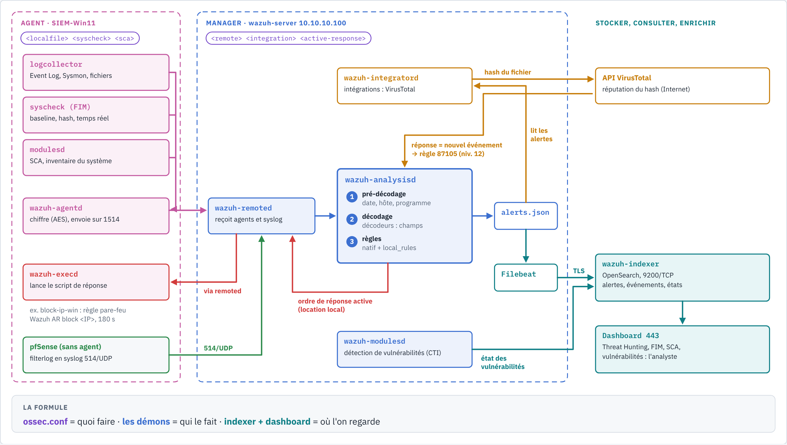
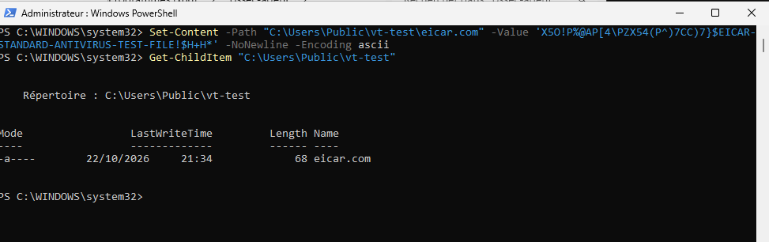
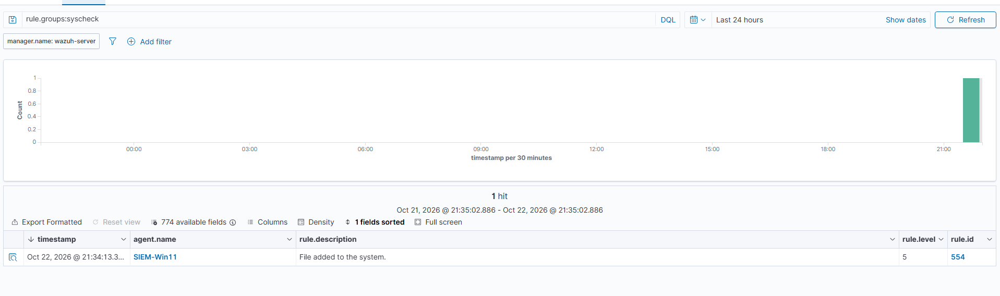
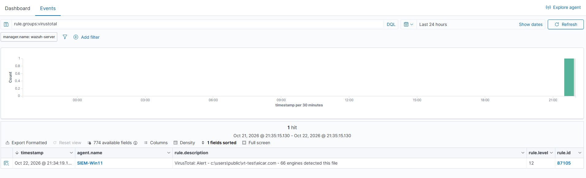

# Scénario — Dépôt d'un fichier malveillant : FIM + VirusTotal

MITRE ATT&CK : **T1203** (Exploitation for Client Execution), l'étiquette portée par la règle
native 87105. Notre lecture de ce que le scénario simule : un fichier malveillant déposé sur le
poste, **T1105** (Ingress Tool Transfer) en préparation de **T1204.002** (Malicious File)
(déduit).

Statut : **joué le 2026-10-22** (21:34 heure locale), résultats observés dans le dashboard
Wazuh 4.14.9.

Sources :
https://documentation.wazuh.com/current/user-manual/capabilities/malware-detection/virus-total-integration.html,
https://documentation.wazuh.com/current/user-manual/capabilities/file-integrity/index.html,
https://github.com/wazuh/wazuh/blob/v4.14.0/ruleset/rules/0490-virustotal_rules.xml (87103-87106),
https://github.com/wazuh/wazuh/blob/v4.14.0/ruleset/rules/0015-ossec_rules.xml (554),
https://www.eicar.org/download-anti-malware-testfile/ (fichier de test EICAR),
https://learn.microsoft.com/powershell/module/defender/add-mppreference.

> Le fichier EICAR n'est **pas** un malware : c'est une chaîne de test inoffensive que tous les
> antivirus reconnaissent par convention. Joué uniquement sur la VM de lab.



*Planche de référence : la branche orange (integratord → VirusTotal → nouvel événement 87105)
est exactement ce scénario. Source : [`demons-wazuh.html`](../diagrams/demons-wazuh.html).*

## 1. Objectif

Vérifier que Wazuh détecte un **fichier malveillant déposé** sur Windows 11. Deux capacités
travaillent ensemble :

- le **FIM** voit qu'un fichier est apparu et calcule son hash ;
- **VirusTotal** dit si ce hash est connu comme malveillant.

## 2. Topologie

| Rôle | Machine | Détail |
|---|---|---|
| Poste ciblé | SIEM-Win11 `10.10.10.101` (agent 001) | FIM temps réel sur `C:\Users\Public\vt-test` |
| SIEM | Wazuh 4.14.9 `10.10.10.100` | intégration `virustotal` (`wazuh-integratord`) |
| Service externe | API VirusTotal (Internet, via le NAT de pfSense) | reçoit le **hash**, pas le fichier |

Pas d'attaquant réseau ici : le dépôt est simulé sur le poste lui-même, comme le ferait un
téléchargement ou une pièce jointe enregistrée.

## 3. Prérequis

**Sur Windows 11 (PowerShell administrateur) :**

1. Créer le dossier de test : `New-Item -ItemType Directory C:\Users\Public\vt-test`.
2. **Exclure ce dossier de Microsoft Defender**, sinon Defender supprime EICAR avant que le FIM
   ait pu le voir (voir piège 1) :
   `Add-MpPreference -ExclusionPath "C:\Users\Public\vt-test"`.
3. Surveiller ce dossier en temps réel dans l'`ossec.conf` de l'agent (extrait dans
   [`configs/agent-windows/ossec-localfiles.xml`](../../configs/agent-windows/ossec-localfiles.xml)) :

   ```xml
   <syscheck>
     <directories realtime="yes">C:\Users\Public\vt-test</directories>
   </syscheck>
   ```

   puis `Restart-Service WazuhSvc` et vérifier `Get-Service WazuhSvc` (Running).

**Sur le manager :** le bloc `<integration>` de
[`configs/manager/virustotal-integration.xml`](../../configs/manager/virustotal-integration.xml)
dans `/var/ossec/etc/ossec.conf`, avec la vraie clé API **uniquement sur le serveur** (jamais
dans git : le dépôt garde `API_KEY`), puis
`sudo /var/ossec/bin/wazuh-analysisd -t && sudo systemctl restart wazuh-manager`.

## 4. Test

Écrire le fichier EICAR **canonique** dans le dossier surveillé :

```powershell
Set-Content -Path "C:\Users\Public\vt-test\eicar.com" -Value '<chaîne EICAR officielle>' -NoNewline -Encoding ascii
Get-ChildItem "C:\Users\Public\vt-test"     # attendu : eicar.com, 68 octets
```

La chaîne est sur le site d'EICAR. Elle n'est pas reproduite dans ce dépôt pour que les
antivirus ne signalent pas nos fichiers.



*Capture 91 : le fichier fait bien 68 octets, la taille du fichier EICAR officiel.*

## 5. Trois pièges

### Piège 1 : Defender gagne la course (échec silencieux)

Sans exclusion, Defender met EICAR en quarantaine immédiatement. Selon le moment, le FIM ne voit
rien ou voit un fichier qui disparaît : **pas de 87105**, et aucune erreur côté Wazuh. Dans le
lab, on exclut le dossier de test. En production, c'est l'inverse : l'antivirus du poste est la
première barrière, Wazuh est un second regard et une trace centralisée.

### Piège 2 : un retour à la ligne change le hash

Sans `-NoNewline`, PowerShell ajoute un retour à la ligne. Le fichier fait alors 70 octets au
lieu de 68 (déduction : CR+LF), et son hash n'est plus celui d'EICAR. VirusTotal répond
« inconnu » : règle **87103** (niveau 3) au lieu de 87105. C'est une bonne leçon sur les hash :
**un seul octet de différence donne une empreinte totalement différente**. C'est aussi pour cela
qu'un attaquant modifie légèrement un malware pour échapper aux listes de hash.

### Piège 3 : le quota de l'API gratuite

La clé publique de VirusTotal est limitée à **4 requêtes par minute** et 500 par jour. D'où
`<group>syscheck</group>` dans le bloc `<integration>` : seules les alertes FIM sont envoyées. Il
faut aussi garder la surveillance FIM temps réel sur peu de dossiers. Quota dépassé : règle
**87101**.

## 6. Détection : attendu contre observé

Recherches dans *Threat Hunting* : `rule.groups:syscheck` puis `rule.groups:virustotal`.

| Étape | Démon | Règle Wazuh | Niveau | Attendu | Observé |
|---|---|---|---|---|---|
| Fichier créé dans le dossier surveillé | `syscheck` sur l'agent | **554** File added to the system | 5 | oui | ✅ 21:34:13, SIEM-Win11 (capture 92) |
| Hash envoyé à VirusTotal, réponse « malveillant » | `wazuh-integratord` sur le manager | **87105** VirusTotal: Alert - c:\users\public\vt-test\eicar.com - 66 engines detected this file | 12 | oui | ✅ 21:34:19 (capture 93) |

Délai observé entre le dépôt et l'alerte de niveau 12 : environ **6 secondes**, dont l'appel à
l'API VirusTotal.





### Ce qui se passe entre les deux alertes

1. L'agent (module `syscheck`) détecte la création et calcule MD5, SHA1, SHA256.
2. Le manager lève la **554**. `wazuh-integratord` voit une alerte du groupe `syscheck` et envoie
   le hash à l'API VirusTotal.
3. La réponse revient dans `wazuh-analysisd` comme un **nouvel événement**. La règle 87100
   reconnaît les messages VirusTotal. Sa fille **87105** se déclenche si
   `virustotal.malicious` vaut 1, et affiche le nombre de moteurs (`virustotal.positives`).

## 7. Lecture de l'analyste SOC

1. **Les deux alertes vont ensemble.** La 554 seule (niveau 5) se noie dans le bruit : des
   fichiers apparaissent sans cesse. La 87105 (niveau 12) dit pourquoi celui-ci compte. Le FIM
   seul voit le mouvement, VirusTotal seul ne voit rien : **ensemble**, c'est une détection de
   malware par dépôt.
2. **Lire le score** : 66 moteurs, c'est une détection unanime. Un score de 1 ou 2 mérite une
   vérification (faux positif possible). Une 87103 (« inconnu ») n'est pas une preuve
   d'innocence : un malware récent ou modifié est souvent inconnu.
3. **Questions suivantes** : d'où vient le fichier (navigateur, messagerie, partage SMB) ? A-t-il
   été exécuté (Sysmon EID 1 avec le même hash) ? Est-il présent ailleurs (recherche du hash sur
   tous les agents) ?
4. **Confidentialité** : seul le hash part chez VirusTotal, pas le fichier. Mais tout fichier
   qu'on y **téléverse** soi-même devient consultable : ne jamais y envoyer un document interne.

### MITRE : l'étiquette native à relire

La 87105 porte **T1203** (Exploitation for Client Execution) quel que soit le fichier détecté.
Or ici, il n'y a ni exploitation ni exécution : un fichier a été déposé. T1105 (Ingress Tool
Transfer) puis T1204.002 (Malicious File) décrivent mieux la situation (déduit). Comme pour
60122 ([scénario 1](brute-force-smb.md)), on ne recopie pas la colonne MITRE sans la lire.

## 8. Remédiation et pistes

| Mesure | Effet | Statut |
|---|---|---|
| Réponse active de **suppression** du fichier sur 87105 | retire le malware dès la détection | ⏳ à construire pour Windows, sur le modèle de [`block-ip-win`](../writeup/07-regles-et-reponse-active.md) (la doc Wazuh propose un script `remove-threat`, avec une variante Windows à compiler en `.exe` ; à valider) |
| Retirer l'exclusion Defender après l'exercice | le poste retrouve sa protection | à faire après chaque test |
| Clé API premium ou cache local des hash | lève la limite de 4 requêtes par minute | hors lab |
| Étendre le FIM à `Downloads` et aux dossiers de démarrage | couvre les vrais points de dépôt | à étudier selon le bruit |

## Résultats dans notre lab

| Date | Cible | Règles observées | Délai de détection | Remarques |
|---|---|---|---|---|
| 2026-10-22 21:34 | SIEM-Win11, `C:\Users\Public\vt-test\eicar.com` (68 octets) | 554 (niv. 5) à 21:34:13 → 87105 (niv. 12, 66 moteurs) à 21:34:19 | ~6 s | exclusion Defender indispensable ; `-NoNewline` indispensable (sinon 87103) ; pas encore de suppression automatique |
