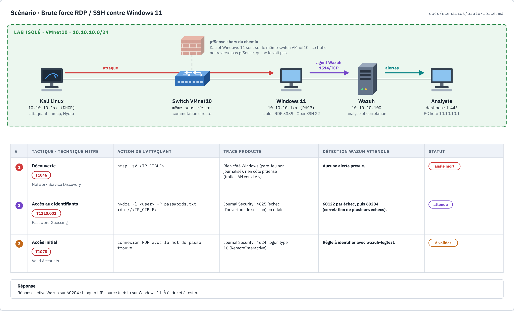

# Modèle de scénario d'attaque

Chaque scénario du lab suit la même trame, et chacun a sa **planche** (schéma) en tête de
fiche. La planche répond en un coup d'œil aux questions qu'un analyste SOC se pose avant de
jouer une attaque : qui attaque qui, par où passe le trafic, quelle technique MITRE ATT&CK,
quelle trace elle laisse, et quelle alerte Wazuh on attend.



## Lire la planche

- **Bandeau du haut** : les acteurs sur le réseau du lab. La flèche rouge est l'attaque, la
  violette la collecte (agent Wazuh, 1514/TCP), la turquoise les alertes vers l'analyste.
- **Encadré pfSense** : rappelle si le trafic traverse le pare-feu. Entre deux VM de VMnet10,
  il ne le traverse pas : pfSense ne voit rien, seule la cible (agent) peut témoigner.
- **Tableau** : une ligne par étape, dans l'ordre de l'attaque. Le statut dit où on en est :

| Statut | Sens |
|---|---|
| `attendu` | Détection documentée (doc officielle, ruleset, PDF), pas encore jouée |
| `à valider` | Déduction de notre part, à vérifier avec `wazuh-logtest` |
| `angle mort` | Aucune détection prévue : c'est une information, pas un échec |
| `observé` | Vu dans le dashboard ; noter l'heure et la règle dans « Résultats » |

## Créer la planche d'un nouveau scénario

1. Copier `docs/diagrams/scenario-modele.html` en `docs/diagrams/scenario-<nom>.html`.
2. Modifier **uniquement** l'objet `SCENARIO` en haut du script (titre, acteurs, étapes,
   règles, statut, réponse). Le schéma se redessine seul.
3. Ouvrir la page dans un navigateur et capturer l'élément `figure` en PNG
   (`docs/diagrams/scenario-<nom>.png`).
4. Créer la fiche `docs/scenarios/<nom>.md` avec la trame ci-dessous et y insérer la PNG.

## Trame d'une fiche

```markdown
# Scénario — <nom>

MITRE ATT&CK : **<Txxxx>** (<nom de la technique>).

Sources : <URL>

> À jouer **uniquement** contre des VM du lab, sur un réseau isolé.


## Préparation
## Attaque
## Détection attendue
## Réponse
## Résultats dans notre lab

| Date | Cible | Règles observées | Délai de détection | Remarques |
|---|---|---|---|---|
```
