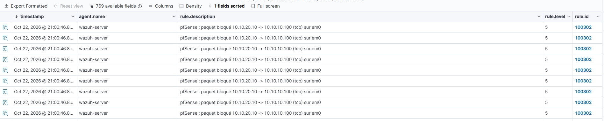
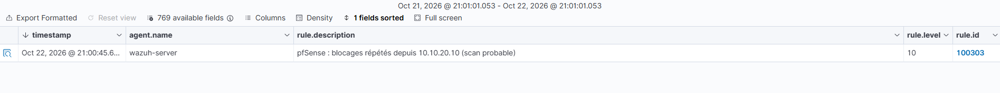

# Scénario — Scan de ports nmap à travers pfSense

MITRE ATT&CK : **T1046** (Network Service Discovery, tactique Discovery).

Statut : **joué le 2026-10-22** (21:00 heure locale), résultats observés dans le dashboard
Wazuh 4.14.9.

Sources :
https://nmap.org/book/man-host-discovery.html (découverte d'hôtes et `-Pn`),
https://nmap.org/book/man-port-scanning-techniques.html (scan SYN `-sS`),
https://docs.netgate.com/pfsense/en/latest/firewall/rule-methodology.html (ordre des règles),
https://attack.mitre.org/techniques/T1046/.

> Joué **uniquement** contre les VM du lab, depuis Kali, sur des réseaux host-only isolés.


*Planche de référence : les règles de l'interface ATTACK. Le scan de ce scénario est le
paquet B (vers Wazuh, règle 3 : bloqué, journalisé), répété 200 fois. Source :
[`regles-attack.html`](../diagrams/regles-attack.html).*

## 1. Objectif

Vérifier que Wazuh repère un **balayage de ports** venant du réseau d'attaque. Ici, ce n'est
pas un agent qui témoigne : c'est **pfSense**. Chaque paquet bloqué est journalisé
(`filterlog`), envoyé en syslog à Wazuh, puis corrélé.

## 2. Topologie

| Rôle | Machine | Adresse | Détail |
|---|---|---|---|
| Attaquant | Kali Linux | `10.10.20.10` (VMnet11, ATTACK) | `nmap` |
| Pare-feu, **témoin** | pfSense CE 2.9.0 | `em0` 10.10.20.254 | règle 3 d'ATTACK : bloque vers LAN net, journalisé |
| Cible | Wazuh 4.14.9 | `10.10.10.100` | une cible que pfSense **bloque** (voir § 5) |
| SIEM | Wazuh 4.14.9 | `10.10.10.100` | reçoit le syslog de pfSense sur 514/UDP (writeup 02) |

## 3. Prérequis

- Syslog pfSense vers Wazuh opérationnel, avec le décodeur local `pfsense-filterlog` et les
  règles 100300 à 100303 (writeup 02, `configs/manager/local_rules.xml`).
- Journalisation des blocages activée sur les règles 3 à 5 de l'interface ATTACK (writeup 05).

## 4. Attaque

```bash
sudo nmap -sS -Pn -T4 -p1-200 10.10.10.100
```

| Option | Rôle |
|---|---|
| `-sS` | scan SYN (« demi-ouvert ») : un SYN par port, sans terminer la connexion. Il faut les droits root, d'où `sudo` |
| `-Pn` | **ne pas** faire la découverte d'hôte : considérer la cible comme active et scanner directement (voir § 5, piège 2) |
| `-T4` | cadence rapide |
| `-p1-200` | 200 ports : largement assez pour dépasser le seuil de corrélation |

## 5. Deux pièges de conception

### Piège 1 : scanner Windows 11 ne déclenche pas l'alerte de scan

La 100303 compte des **blocages**. Or la règle 2 de l'interface ATTACK **laisse passer** Kali
vers Windows 11 (`10.10.10.101`) : c'est la cible prévue des attaques. Un scan de Windows 11
produit donc des **100301** (trafic autorisé, niveau 3) et pas de 100302. Sans 100302, pas de
100303.

**Leçon.** Une détection ne vaut que dans le chemin qu'elle observe. Ici, la corrélation de scan
repose sur les refus du pare-feu : elle voit un scan vers ce que pfSense interdit (Wazuh,
pfSense, LAN, WAN), pas vers ce qu'il autorise. Un scan de Windows 11 est un **angle mort**
de cette règle. Pistes (non testées, à valider) :
- une corrélation sur les 100301 (beaucoup de ports différents depuis la même IP en peu de
  temps) ;
- Suricata, qui voit le contenu du trafic autorisé ;
- la journalisation du pare-feu Windows sur la cible.

### Piège 2 : sans `-Pn`, nmap s'arrête avant de scanner

Par défaut, nmap commence par vérifier que l'hôte répond : ping ICMP, SYN sur 443, ACK sur 80,
requête *timestamp* ICMP (documentation nmap). pfSense bloque ces sondes sans répondre
(action Block, pas Reject). nmap conclut alors « *Host seems down* » et **ne scanne aucun
port**.

Il y a bien quelques blocages (les 100302 en `icmp` et `tcp` des sondes), mais trop peu pour
atteindre le seuil de 18. `-Pn` force le scan des 200 ports, donc 200 blocages.

**Leçon.** C'est aussi un enseignement défensif : un pare-feu qui **jette** sans répondre rend
la cible invisible à une découverte naïve. L'attaquant doit forcer le scan, et ce surcroît de
bruit est justement ce qui le fait repérer.

## 6. Détection : attendu contre observé

Recherches utilisées dans *Threat Hunting* :
`rule.id:100302 AND data.srcip:10.10.20.10` et `rule.id:100303`.

| Étape | Trace | Règle Wazuh | Niveau | Attendu | Observé |
|---|---|---|---|---|---|
| Chaque paquet bloqué | `filterlog` block, `em0`, 10.10.20.10 → 10.10.10.100 | **100302** pfSense : paquet bloqué | 5 | oui | ✅ rafale (`tcp` et `icmp`), capture 89 |
| Rafale depuis une même IP | 18 blocages en 45 s | **100303** blocages répétés (scan probable) | 10 | oui | ✅ **×1** à 21:00:45, capture 90 |

L'alerte 100303 est **une seule** pour tout le scan, alors que les 100302 continuent d'arriver.
C'est l'effet de `ignore="240"` : après un déclenchement, la règle se tait pendant 4 minutes.
L'analyste reçoit un signal, pas 200.

### Comment fonctionne la 100303

Extrait de [`configs/manager/local_rules.xml`](../../configs/manager/local_rules.xml) :

```xml
<rule id="100303" level="10" frequency="18" timeframe="45" ignore="240">
  <if_matched_sid>100302</if_matched_sid>
  <same_source_ip />
  <description>pfSense : blocages répétés depuis $(srcip) (scan probable)</description>
  <mitre>
    <id>T1046</id>
  </mitre>
  <group>multiple_blocks,</group>
</rule>
```

Elle se déclenche quand 18 alertes 100302 de la **même IP source** arrivent en 45 secondes.
Ici `same_source_ip` fonctionne, car notre décodeur pfSense remplit bien `srcip`. C'est
l'inverse des événements Windows (writeup 07, § 1.4). La règle native équivalente (87702)
porte T1110 (force brute). Nous avons choisi T1046, plus juste pour un balayage de ports.



*Capture 89 : la rafale de 100302, une par port sondé.*



*Capture 90 : la 100303, une seule pour tout le scan.*

## 7. Lecture de l'analyste SOC

1. **Partir de la 100303 (niveau 10)**, puis ouvrir les 100302 de la même source pour voir
   **ce qui est visé** : l'IP de destination, les ports, le protocole. Ici, 10.10.10.100, le
   SIEM lui-même : un attaquant qui cherche la console de supervision.
2. **Un scan est une phase de reconnaissance, pas une compromission.** C'est souvent le
   premier signe d'une attaque, donc un bon moment pour agir (bloquer la source, surveiller la
   suite), mais rien n'a encore été pris.
3. **D'où vient-il ?** 10.10.20.10, c'est le réseau ATTACK. En entreprise, la même alerte
   venant d'un poste interne serait plus grave : un poste du LAN qui scanne est peut-être déjà
   compromis (mouvement latéral, T1046 en phase Discovery).
4. **Ce que la règle ne voit pas** : un scan vers une cible autorisée (piège 1), ou un scan
   lent qui reste sous 18 blocages en 45 s (par exemple `nmap -T1`, déduction à valider).

## 8. Remédiation et pistes

| Mesure | Effet | Statut |
|---|---|---|
| Réponse active sur 100303 : bloquer la source sur pfSense | coupe le scan en cours | à étudier (la source est déjà bloquée vers ces cibles ; utile vers les cibles autorisées) |
| Corrélation sur les 100301 (beaucoup de ports, même source) | couvre le scan de Windows 11 | idée, à valider |
| Suricata sur pfSense | détection par signatures, y compris sur le trafic autorisé | prévu (`docs/integrations/`) |
| Seuil plus bas ou fenêtre plus longue pour 100303 | attrape les scans lents | à régler selon le bruit observé |

## Résultats dans notre lab

| Date | Cible | Règles observées | Délai de détection | Remarques |
|---|---|---|---|---|
| 2026-10-22 21:00 | Wazuh 10.10.10.100, ports 1-200, depuis Kali 10.10.20.10 | 100302 en rafale (niv. 5), 100303 ×1 (niv. 10) à 21:00:45 | quelques secondes (non mesuré) | `-Pn` indispensable ; un scan de Windows 11 ne déclenche pas 100303 (trafic autorisé → 100301) |
