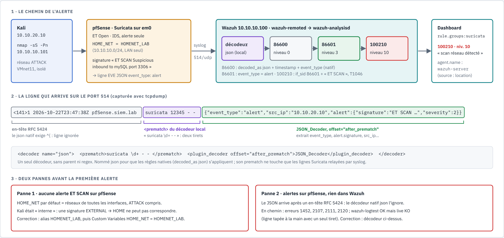
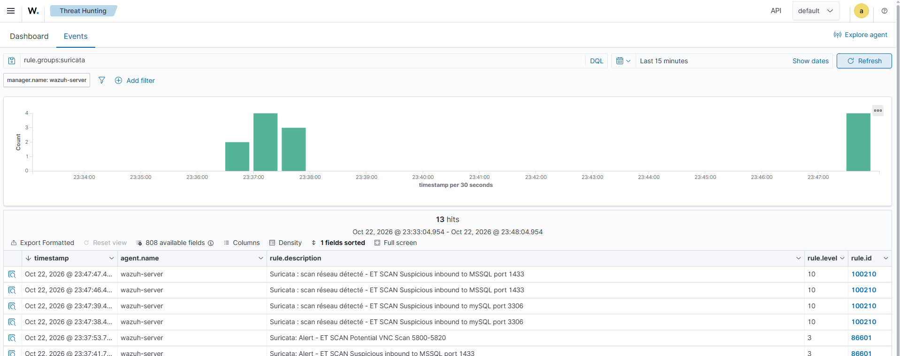

# Scénario — Scan réseau vu par un IDS : Suricata sur pfSense

MITRE ATT&CK : **T1046** (Network Service Discovery).

Statut : **joué le 2026-10-22** (alertes natives à 23:37, règle 100210 à 23:47, heure du
dashboard), résultats observés dans le dashboard Wazuh 4.14.9.

Sources :
https://github.com/wazuh/wazuh/blob/v4.14.0/ruleset/rules/0475-suricata_rules.xml (86600-86604),
https://github.com/wazuh/wazuh/blob/v4.14.0/ruleset/decoders/0006-json_decoders.xml (décodeur `json`),
https://documentation.wazuh.com/current/user-manual/ruleset/decoders/json-decoder.html,
https://documentation.wazuh.com/current/user-manual/ruleset/ruleset-xml-syntax/decoders.html,
https://documentation.wazuh.com/current/user-manual/ruleset/ruleset-xml-syntax/rules.html,
https://docs.suricata.io/en/latest/output/eve/eve-json-output.html,
https://docs.netgate.com/pfsense/en/latest/packages/suricata/index.html,
https://rules.emergingthreats.net/ (ET Open), RFC 5424 (https://www.rfc-editor.org/rfc/rfc5424).

> Le scan ne vise que Windows 11, machine du lab, depuis le réseau d'attaque isolé (VMnet11).



*Source : [`suricata-pipeline.html`](../diagrams/suricata-pipeline.html). Récit complet :
[writeup 10](../writeup/10-scenario-suricata-nids.md).*

## 1. Objectif

Vérifier qu'un **IDS réseau** placé sur le pare-feu détecte un scan de ports, et que l'alerte
arrive dans Wazuh avec un niveau qui attire l'attention. C'est aussi la réponse à l'**angle mort
du [scénario 2](scan-nmap.md)** : un scan vers une destination autorisée par pfSense ne produit
aucun blocage, donc aucune 100303.

## 2. Topologie

| Rôle | Machine | Détail |
|---|---|---|
| Attaquant | Kali `10.10.20.10` (VMnet11, ATTACK) | `nmap` |
| Capteur IDS | pfSense CE 2.9.0, paquet **Suricata**, interface ATTACK `em0` | ET Open, IDS alerte seule, EVE JSON vers syslog |
| Cible | SIEM-Win11 `10.10.10.101` | autorisée depuis ATTACK (règle 2), donc **pas** de blocage `filterlog` |
| SIEM | Wazuh 4.14.9 `10.10.10.100` | syslog `514/udp`, décodeur local `json`, règle 100210 |

## 3. Prérequis

**pfSense** (détail dans [integrations/suricata.md](../integrations/suricata.md)) :

1. Paquet Suricata, ruleset **ET Open**, interface **ATTACK**, *Block Offenders* désactivé.
2. `HOME_NET` = LAN seul : alias Network(s) `HOMENET_LAB` = `10.10.10.0/24`, puis *Variables >
   Custom Variables* : Type Server, Name `HOME_NET`, Value `HOMENET_LAB`.
3. Offloading matériel (checksum, TSO, LRO) désactivé, pfSense redémarré.
4. EVE JSON activé, sortie **Syslog** ; *Remote Syslog Contents* = **Everything**.

**Manager Wazuh** :

1. Décodeur `json` restreint de [`configs/manager/local_decoder.xml`](../../configs/manager/local_decoder.xml)
   dans `/var/ossec/etc/decoders/local_decoder.xml`.
2. Règle **100210** de [`configs/manager/local_rules.xml`](../../configs/manager/local_rules.xml)
   dans `/var/ossec/etc/rules/local_rules.xml`.
3. `sudo /var/ossec/bin/wazuh-analysisd -t && sudo systemctl restart wazuh-manager`.

Contrôle de la réception, avant toute règle :
`sudo tcpdump -i any -A -n udp port 514 | grep event_type`.

## 4. Attaque

```bash
sudo nmap -sS -Pn 10.10.10.101
```

`-sS` : scan SYN (demi-ouverture). `-Pn` : pas de ping préalable (Windows ne répond pas à
l'ICMP par défaut).

## 5. Détection : attendu contre observé

Recherche dans *Threat Hunting* : `rule.groups:suricata`.

| Étape | Où | Règle Wazuh | Niveau | Attendu | Observé |
|---|---|---|---|---|---|
| Signature ET SCAN sur `em0` | Suricata (pfSense) | — | — | alerte EVE `event_type: alert` | ✅ après correction de `HOME_NET` |
| Ligne reconnue comme Suricata | `wazuh-analysisd` | 86600 (native) | 0 | oui | ✅ (parent de 86601) |
| Alerte Suricata | `wazuh-analysisd` | **86601** « Suricata: Alert - ET SCAN … » | 3 | oui | ✅ 9 alertes à 23:37 (MSSQL 1433, mySQL 3306, PostgreSQL 5432, Oracle 1521, VNC 5800-5820) |
| Scan qualifié | `wazuh-analysisd` | **100210** « Suricata : scan réseau détecté - ET SCAN … » | 10 | oui | ✅ 23:47, capture 94 |
| Pare-feu | `filterlog` | 100301 (trafic autorisé) | 3 | pas de 100303 (destination autorisée) | conforme à la règle 2 (non recherché dans ce test) |



## 6. Deux pannes et leurs causes

| Symptôme | Cause | Correction |
|---|---|---|
| Aucune alerte ET SCAN sur pfSense | `HOME_NET` par défaut = réseaux de toutes les interfaces, **réseau d'attaque compris** : Kali était « interne » | alias `HOMENET_LAB` + variable personnalisée `HOME_NET` ; la liste *Home Net* ne propose pas les alias, le champ refuse un CIDR brut (« Only aliases are allowed ») |
| Alertes sur pfSense, rien dans Wazuh | pfSense enveloppe le JSON dans un en-tête RFC 5424 `<141>1 <ts> pfSense.siem.lab suricata <pid> - - {…}` ; le décodeur natif `json` exige une ligne qui **commence** par `{` | décodeur `json` restreint : `<prematch>suricata \d+ - - </prematch>` + `JSON_Decoder` en `after_prematch` |

Erreurs rencontrées en chemin (1452, 2107, 2111, 2120) et piège « `wazuh-logtest` OK, live KO » :
voir le [writeup 10, § 3.2](../writeup/10-scenario-suricata-nids.md#32-le-débogage--quatre-erreurs-instructives).

## 7. Lecture de l'analyste SOC

1. **Qui, quoi, vers où** : `src_ip` 10.10.20.10 (réseau d'attaque), `dest_ip` 10.10.10.101,
   `dest_port` et `alert.signature` disent quels services sont recherchés (bases de données,
   VNC : un attaquant qui cherche des données ou une prise en main à distance).
2. **`agent.name: wazuh-server`** : normal pour une source syslog. La source réelle est
   `location` (pfSense) ; le capteur est l'IDS, pas le manager.
3. **Croiser les témoins** : pfSense a laissé passer (règle 2), Suricata a reconnu un scan. Un
   scan **autorisé** est plus préoccupant qu'un scan bloqué : la cible est réellement exposée.
4. **Questions suivantes** : des ports ont-ils répondu (`flow` d'EVE, ou `filterlog`) ? Une
   connexion a-t-elle suivi (4624 sur Windows, [scénario 1](brute-force-smb.md)) ?
5. **Signature de sévérité 2** : ET SCAN n'est pas une compromission, c'est de la
   reconnaissance. Niveau 10 se justifie dans le lab, où aucun scan n'est légitime ; en
   production, il faudrait exclure les scanners de vulnérabilités autorisés (à étudier en
   phase 2).

## 8. Remédiation et pistes

| Mesure | Effet | Statut |
|---|---|---|
| Réponse active sur 100210 (blocage de `src_ip` sur Windows ou sur pfSense) | coupe l'attaquant dès la reconnaissance | ⏳ à étudier (risque de blocage sur faux positif) |
| Retirer de la règle 2 les ports inutiles vers Windows 11 | réduit la surface exposée | ⏳ |
| Option B : rsyslog retire l'en-tête, Wazuh lit un fichier JSON natif | plus de décodeur local à maintenir | ⏳ à valider ([intégration](../integrations/suricata.md#option-b--rsyslog-et-fichier-json-à-valider)) |
| Mode IPS (*Block Offenders*) | Suricata bloque lui-même | hors périmètre (IDS volontairement) |
| Signatures `local.rules` du lab ([`configs/suricata/local.rules`](../../configs/suricata/local.rules)) | détections propres au lab | ⏳ à adapter à pfSense |

## Résultats dans notre lab

| Date | Source → cible | Règles observées | Délai de détection | Remarques |
|---|---|---|---|---|
| 2026-10-22 (premier essai) | Kali → Win11 | aucune | — | `HOME_NET` contenait le réseau d'attaque |
| 2026-10-22 (deuxième essai) | Kali → Win11 | aucune dans Wazuh | — | alertes sur pfSense ; en-tête RFC 5424 non décodé par le natif `json` |
| 2026-10-22 23:37 | Kali `10.10.20.10` → Win11 `10.10.10.101` | 86601 ×9 (niv. 3) | quelques secondes (non mesuré précisément) | décodeur `json` restreint en place |
| 2026-10-22 23:47 | idem | **100210** ×4 (niv. 10), MSSQL 1433 et mySQL 3306 | quelques secondes (non mesuré précisément) | règle 100210 déployée ; aucun doublon `fast.log` |
