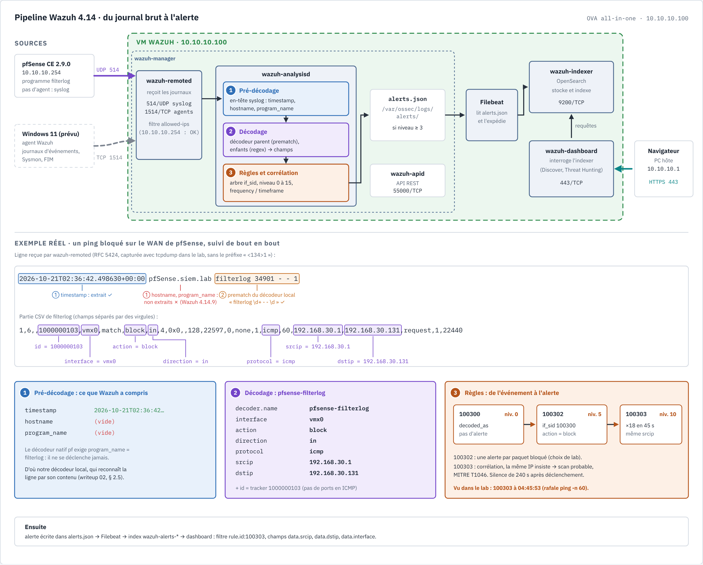
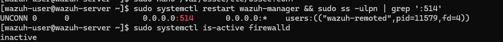
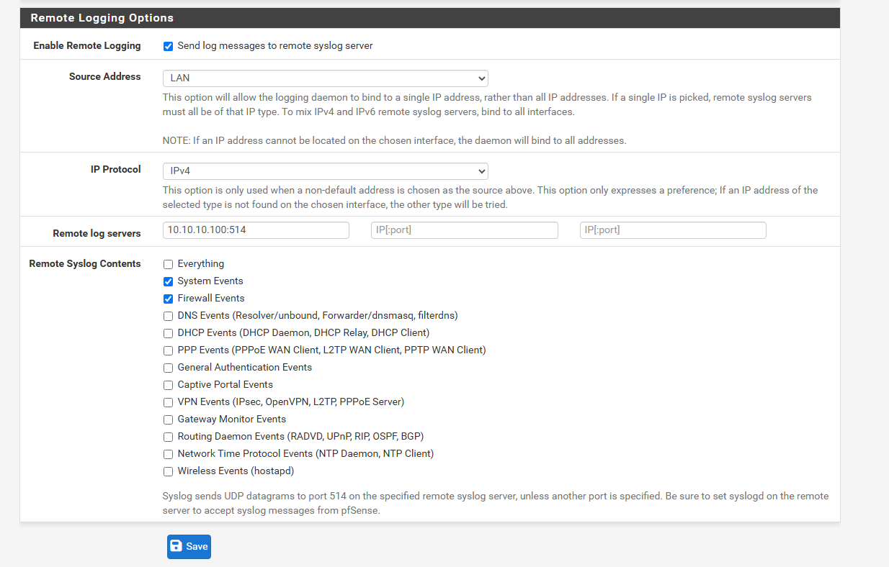
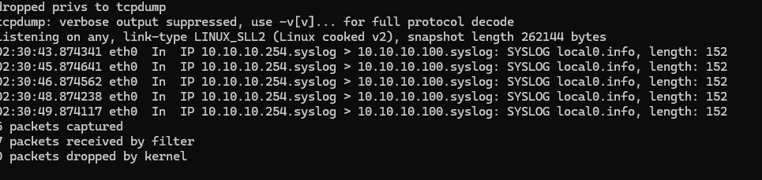
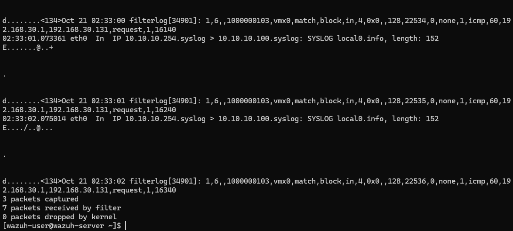
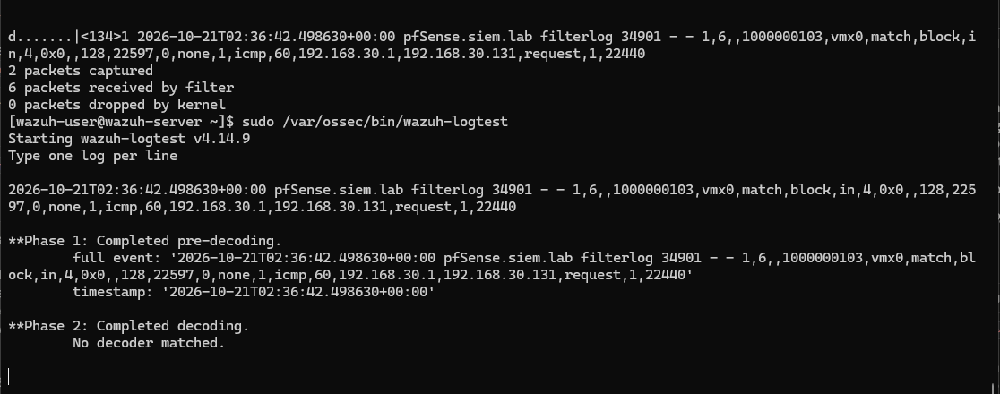
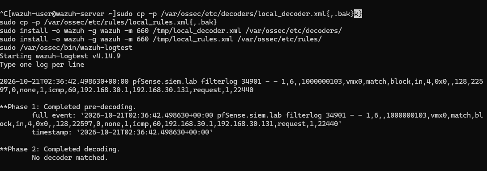
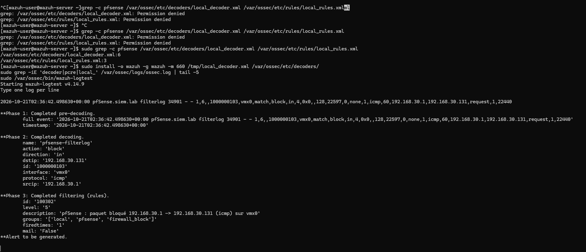
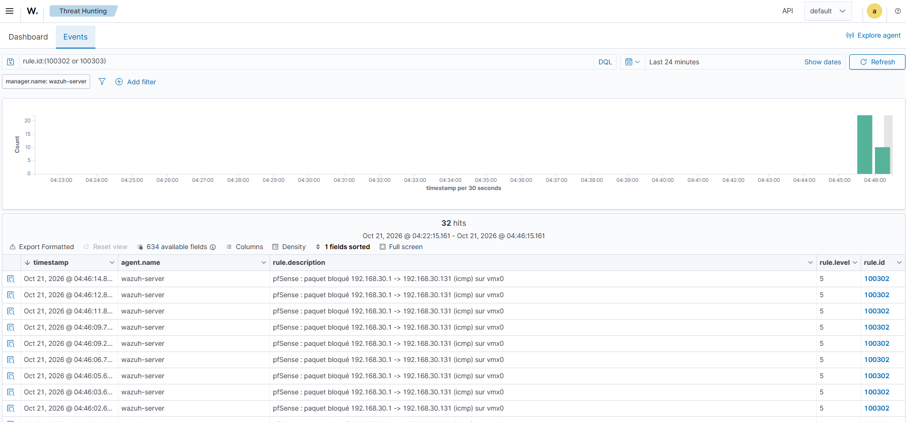
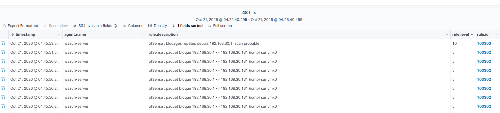

# Writeup 02 : envoyer les journaux de pfSense vers Wazuh

> Deuxième étape du lab : le pare-feu pfSense envoie ses journaux (syslog) au manager Wazuh,
> qui les décode et lève des alertes. Document vivant : la partie « Résultats » se remplit au
> fil des tests.
>
> Version : Wazuh 4.14.9, pfSense CE 2.9.0. Prérequis : [writeup 01](01-homelab.md).

## 1. Comprendre

### 1.1 Le chemin d'un événement dans Wazuh



*En haut, les processus de la VM Wazuh et leurs ports. En bas, la vraie ligne `filterlog` du lab :
ce que le pré-décodage en tire (seulement le timestamp, voir § 2.5), les champs extraits par
notre décodeur `pfsense-filterlog`, puis l'enchaînement 100300 → 100302 → 100303. Source
éditable : [`docs/diagrams/pipeline-wazuh.html`](../diagrams/pipeline-wazuh.html).*

La même chose en version texte :

```
 Source            Collecte              Analyse (manager)                  Stockage / vue
┌────────┐  syslog  ┌──────────────┐  ┌─────────┐  ┌────────┐  ┌───────┐  ┌──────────┐  ┌──────────┐
│pfSense │ ───────▶ │ wazuh-remoted│─▶│décodeur │─▶│ règles │─▶│alerte │─▶│ Filebeat │─▶│ Indexer  │─▶ Dashboard
└────────┘ UDP 514  │   (manager)  │  │(champs) │  │(niveau)│  │(JSON) │  │          │  │(OpenSearch)
┌────────┐  agent   │              │  └─────────┘  └────────┘  └───────┘  └──────────┘  └──────────┘
│Windows │ ───────▶ │ TCP 1514     │
└────────┘          └──────────────┘
```

1. **Collecte.** Deux façons de faire entrer un journal dans Wazuh :
   - par un **agent** installé sur la machine (Windows, Linux) : il lit les journaux
     localement et les envoie chiffrés au manager sur TCP 1514 ;
   - en **syslog** (*agentless*) : l'équipement envoie lui-même ses journaux. C'est le cas
     des pare-feu, routeurs et switchs, où l'on ne peut pas installer d'agent.
2. **Décodage.** Un journal brut n'est qu'une ligne de texte. Le **décodeur** la découpe en
   champs nommés : `srcip`, `dstip`, `dstport`, `action`… Sans ces champs, on ne peut ni
   filtrer ni corréler.
3. **Règles.** Chaque règle teste des champs décodés et attribue un **niveau** de 0 à 15.
   Les règles s'enchaînent en arbre : une règle enfant (`if_sid`) précise une règle parent.
4. **Alerte.** Seuls les événements qui atteignent un niveau suffisant (3 par défaut)
   deviennent des alertes. Filebeat les expédie à l'**indexer**, et le **dashboard** les
   affiche.

### 1.2 Syslog en deux minutes

- Protocole historique (RFC 3164, puis RFC 5424) pour envoyer des journaux sur le réseau,
  généralement en **UDP 514**.
- Chaque message porte une *facility* (qui émet : kernel, auth…), une *severity* (0 =
  urgence, 7 = debug), une date, un nom d'hôte, un programme et le texte.
- UDP n'a ni accusé de réception ni chiffrement : un message perdu est perdu, et le trafic
  peut être lu. On l'accepte dans un lab isolé. En production, on préfère TCP, voire TLS.

### 1.3 Ce que pfSense envoie

Le pare-feu journalise chaque paquet qui touche une règle avec l'option *log*. Par défaut,
c'est le cas de la règle « default deny » : **tout ce qui est bloqué est journalisé**. Chaque
ligne vient du programme `filterlog` et contient, en CSV, l'interface, l'action
(`pass`/`block`), le protocole, les IP et les ports.

### 1.4 Ce que Wazuh en fait (ruleset natif 4.14)

| ID | Niveau | Ce qu'elle détecte |
|---|---|---|
| 87700 | 0 | Groupe pfSense : tout événement `filterlog` décodé (aucune alerte) |
| 87701 | 5 | Un paquet bloqué, mais avec `no_log` : pas d'alerte individuelle |
| **87702** | **10** | **18 blocages depuis la même IP en 45 s** : scan ou force brute probable (MITRE T1110) |

Conséquence importante pour un analyste : un paquet bloqué isolé **ne fait pas d'alerte**,
c'est du bruit normal sur un pare-feu. Wazuh alerte sur le **motif** : une même source qui
insiste. C'est la *corrélation* (`frequency` + `timeframe` + `same_source_ip`).

### 1.5 Ce qu'un analyste SOC en retire

- **Visibilité réseau** : qui tente d'entrer, depuis où, vers quels ports.
- **Détection de reconnaissance** : un scan de ports produit des dizaines de blocages en
  quelques secondes, donc la règle 87702.
- **Contexte pour l'enquête** : une alerte sur Windows (par exemple une connexion suspecte)
  se recoupe avec les journaux du pare-feu pour la même IP et la même heure.

### 1.6 Comprendre le réseau du lab : WAN, LAN et chemin d'un paquet

Un pare-feu sépare deux mondes :

- le **WAN** (*Wide Area Network*) : le côté « extérieur », d'où viennent les menaces. Par
  défaut, pfSense **bloque tout** ce qui y entre sans avoir été demandé de l'intérieur ;
- le **LAN** (*Local Area Network*) : le côté « intérieur », nos machines protégées. Par
  défaut, le LAN peut sortir vers le WAN.

Dans notre lab, ces deux côtés sont deux **réseaux virtuels VMware**, comme deux switchs
virtuels. Le schéma ci-dessous les montre façon Cisco Packet Tracer, avec les interfaces, les
adresses et les flux numérotés dans l'ordre où ils se produisent :


*Flux ① ping de test bloqué sur le WAN, ② syslog UDP 514 de pfSense vers Wazuh, ③ consultation
du dashboard en HTTPS, ④ futur agent Windows en 1514/TCP. Source éditable :
[`docs/diagrams/topologie-lab.html`](../diagrams/topologie-lab.html).*

La même chose en version texte :

```
                         PC hôte (Windows)
             ┌───────────────────┴───────────────────┐
     carte VMnet8 192.168.30.1            carte VMnet10 10.10.10.1
             │                                       │
 ════════ VMnet8 (NAT) ════════          ════════ VMnet10 (host-only) ═════════════
  192.168.30.0/24 : le « WAN »            10.10.10.0/24 : le « LAN » du lab
  sortie Internet via le NAT              pas de sortie directe vers Internet
             │                                       │                    │
     vmx0 = WAN 192.168.30.131           vmx1 = LAN 10.10.10.254    Wazuh 10.10.10.100
             └──────────── pfSense ──────────────────┘              (Win11, Kali ensuite)
```

- **VMnet8 (NAT)** : VMware fait office de box Internet. Les VM de ce réseau sortent sur
  Internet en partageant l'adresse du PC, comme les appareils derrière une box. pfSense y
  branche son WAN et reçoit `192.168.30.131` du DHCP de VMware.
- **VMnet10 (host-only)** : un switch privé entre les VM et le PC, sans accès Internet direct.
  C'est pfSense qui y distribue les adresses (DHCP `.100`-`.199`) et qui sert de passerelle
  (`10.10.10.254`) : pour sortir, une VM du LAN passe par pfSense.
- Le **PC hôte** a une « patte » dans chaque réseau (`192.168.30.1` et `10.10.10.1`). C'est
  pour cela qu'il peut ouvrir le dashboard Wazuh, et aussi jouer l'attaquant côté WAN.

**Pourquoi le ping de test déclenche une alerte.** `ping 192.168.30.131` part de la carte
VMnet8 du PC (`192.168.30.1`) et arrive sur le **WAN** de pfSense. Personne ne l'a demandé
depuis le LAN, donc la règle par défaut du WAN le **bloque** et le **journalise**. Vu de
pfSense, c'est exactement ce que ferait un attaquant venu d'Internet qui sonde le pare-feu.

**Chemin d'un journal, de pfSense au dashboard :**

```
1. pfSense bloque le ping sur vmx0 (WAN)
2. filterlog écrit une ligne : "...,vmx0,match,block,in,4,...,icmp,...,192.168.30.1,192.168.30.131,..."
3. syslogd de pfSense l'emballe en syslog (RFC 5424) et l'envoie en UDP
      source 10.10.10.254:514 (vmx1, LAN)  ──▶  destination 10.10.10.100:514
4. le datagramme traverse le switch VMnet10 et arrive sur eth0 de Wazuh
5. wazuh-remoted écoute UDP 514, vérifie allowed-ips (10.10.10.254 : accepté)
6. wazuh-analysisd : pré-décodage → décodeur pfsense-filterlog → règles 100300/100302/100303
7. l'alerte est écrite dans /var/ossec/logs/alerts/alerts.json
8. Filebeat la lit et l'envoie à l'indexer (OpenSearch, port 9200)
9. le dashboard (443) interroge l'indexer ; le navigateur du PC l'affiche via 10.10.10.1
```

Points à retenir :

- Le ping arrive sur le **WAN**, mais le journal part par le **LAN** : pfSense choisit la
  carte qui mène à la destination (`10.10.10.100` est sur le LAN). Nous avons aussi fixé
  *Source Address* = `LAN`.
- Le PC joint le dashboard **directement** sur VMnet10, sans passer par pfSense : ils sont
  dans le même sous-réseau `10.10.10.0/24`, donc sur le même « switch ».
- UDP n'attend pas de réponse : pfSense envoie sans savoir si Wazuh écoute. D'où l'intérêt de
  `tcpdump` pour vérifier la réception.

## 2. Mise en œuvre

### 2.1 Côté Wazuh : ouvrir l'écoute syslog

Dans `/var/ossec/etc/ossec.conf`, ajouter un bloc `<remote>` **en plus** de celui qui existe
déjà (le bloc `secure` sur 1514, utilisé par les agents) :

```bash
sudo nano /var/ossec/etc/ossec.conf
```

```xml
<remote>
  <connection>syslog</connection>
  <port>514</port>
  <protocol>udp</protocol>
  <allowed-ips>10.10.10.254</allowed-ips>
</remote>
```

Fichier de référence : [configs/manager/ossec-remote-syslog.xml](../../configs/manager/ossec-remote-syslog.xml).

- `allowed-ips` est **obligatoire** : sans lui, le manager rejette le syslog. C'est aussi
  une protection, car seul pfSense peut injecter des journaux.
- `10.10.10.254` est l'IP LAN de pfSense, celle par laquelle il joint Wazuh.

```bash
sudo /var/ossec/bin/wazuh-control restart        # ou : sudo systemctl restart wazuh-manager
sudo ss -ulpn | grep ':514'                      # attendu : wazuh-remoted à l'écoute en UDP 514
```



Si `firewalld` est actif sur la VM (`sudo systemctl is-active firewalld`), ouvrir le port.
Sur l'OVA, il n'est a priori pas installé (à vérifier) :

```bash
sudo firewall-cmd --permanent --add-port=514/udp && sudo firewall-cmd --reload
```

### 2.2 Côté pfSense : activer l'envoi

*Status > System Logs > Settings*, section *Remote Logging Options* :

| Champ | Valeur |
|---|---|
| Enable Remote Logging | coché |
| Source Address | `LAN` |
| IP Protocol | IPv4 |
| Remote log servers | `10.10.10.100:514` |
| Remote Syslog Contents | `Firewall Events` (puis `System Events` si besoin) |

Garder le format de message par défaut (BSD / RFC 3164), attendu par le décodeur natif (à
valider). Puis *Save*.



> Résultat : le format BSD par défaut ne convient pas, voir 2.5. Réglage final : **RFC 5424**.

### 2.3 Générer du trafic bloqué et vérifier

Depuis l'hôte Windows, viser le **WAN** de pfSense : tout trafic entrant y est bloqué et
journalisé par défaut.

```powershell
ping -n 60 -w 200 192.168.30.131
```

Piège rencontré : sans `-w`, chaque ping bloqué attend 4 s de timeout, soit environ 11 paquets
en 45 s, sous le seuil de 87702 (18 en 45 s). Avec `-w 200` (200 ms de timeout), le rythme
dépasse le seuil.

Vérifications, de la source vers l'alerte :

1. pfSense : *Status > System Logs > Firewall* montre les blocages ICMP sur WAN.
2. Wazuh reçoit le syslog (si `tcpdump` est présent sur la VM) :
   `sudo tcpdump -ni any udp port 514 -c 5`

   
3. Le décodage fonctionne : `sudo /var/ossec/bin/wazuh-logtest`, puis coller une ligne
   `filterlog` copiée depuis pfSense. Attendu : décodeur `pf`, règle 87700 ou 87701.
4. Dashboard, *Threat Hunting* : filtre `rule.groups:pfsense` ou `rule.id:87702`.

### 2.4 Dépannage : « je ne vois aucune alerte »

Vérifié dans le ruleset 4.14 (`0540-pfsense_rules.xml`) : 87700 est de niveau 0 et 87701
porte `<options>no_log</options>`. Un blocage isolé n'apparaît donc **jamais** dans le
dashboard. Seule 87702 s'y affiche, et elle se tait ensuite 4 minutes (`ignore="240"`). Un
*Threat Hunting* vide ne prouve rien : on remonte le chemin depuis la source.

1. **Réseau** : `sudo tcpdump -ni any udp port 514 -c 5` pendant la rafale de pings.
   - Rien : côté pfSense, *Log Message Format* = BSD (RFC 3164), *Log packets matched from
     the default block rules* coché, *Source Address* = `LAN`.
2. **Décodage** : `sudo /var/ossec/bin/wazuh-logtest`, puis coller une ligne de test :

   ```
   Oct 21 04:30:00 pfSense filterlog: 5,,,1000000103,vmx0,match,block,in,4,0x0,,64,1234,0,none,1,icmp,60,192.168.30.1,192.168.30.131,datalength=40
   ```

   Attendu : décodeur `pf`, `action: block`, `srcip: 192.168.30.1`, règle 87701.
3. **Archives** : `<logall>yes</logall>` dans `<global>`, redémarrer le manager, puis
   `sudo grep filterlog /var/ossec/logs/archives/archives.log | tail -3`. Remettre à `no`
   après le test, car l'archive grossit vite (cf. disque plein du writeup 01).

Le décodeur natif `pf` reconnaît la ligne par son `program_name` (`filterlog`). Il faut donc
un en-tête syslog BSD, que Wazuh sait découper.

### 2.5 Piège rencontré : pas de hostname dans le syslog BSD de pfSense 2.9

Vraie ligne capturée avec `tcpdump -A` (format BSD / RFC 3164, réglage par défaut) :



```
<134>Oct 21 02:33:00 filterlog[34901]: 1,6,,1000000103,vmx0,match,block,in,4,0x0,,128,22534,0,none,1,icmp,60,192.168.30.1,192.168.30.131,request,1,16140
```

`wazuh-logtest` sur cette ligne (sans `<134>`) :

```
**Phase 1: Completed pre-decoding.
        timestamp: 'Oct 21 02:33:00'
        hostname: 'filterlog[34901]:'
**Phase 2: Completed decoding.
        No decoder matched.
```

**Cause** : un en-tête syslog BSD attend `date hostname programme:`. pfSense envoie
`date programme[pid]:` sans hostname : le pré-décodeur prend donc le programme pour l'hôte,
`program_name` reste vide, et le décodeur natif `pf` (qui exige `program_name` = `filterlog`)
ne s'applique pas. Aucune règle pfSense ne se déclenche, sans aucun message d'erreur.

**Leçon** : toujours tester `wazuh-logtest` avec une **vraie** ligne capturée, pas avec
l'exemple de la documentation. Ici, l'exemple contenait un hostname et passait.

**Correctif 1 : pfSense en RFC 5424.** Échec. La ligne contient bien le hostname et le
programme :

```
<134>1 2026-10-21T02:36:42.498630+00:00 pfSense.siem.lab filterlog 34901 - - 1,6,,1000000103,vmx0,match,block,in,4,0x0,,128,22597,0,none,1,icmp,60,192.168.30.1,192.168.30.131,request,1,22440
```

Mais le pré-décodeur Wazuh 4.14.9 ne reconnaît que le timestamp : pas de hostname, pas de
`program_name`, « No decoder matched ».



**Correctif 2 : décodeur et règles locaux.** On garde le format RFC 5424, où le nom du
programme apparaît en clair, et on reconnaît la ligne par son contenu.

### 2.6 Comprendre : écrire un décodeur personnalisé

Un décodeur répond à deux questions :

1. **« Cette ligne est-elle pour moi ? »** : le décodeur parent, avec `<prematch>`. Il doit
   être assez précis pour ne pas capturer d'autres journaux. Ici : `filterlog \d+ - - \d`
   (moteur OS_Regex par défaut), la signature d'une ligne pfSense en RFC 5424.
2. **« Quels champs extraire ? »** : les décodeurs enfants (`<parent>`), avec `<regex>` et
   `<order>`. Chaque groupe entre parenthèses alimente le champ de même rang dans `<order>`.
   Plusieurs enfants portant le même nom s'appliquent tous : un pour les champs communs, un
   pour les ports, qui n'existent qu'en TCP/UDP.

`type="pcre2"` active les expressions régulières PCRE2. Le moteur historique d'OSSEC ne
connaît ni `{n}` ni les groupes non capturants `(?:…)`, utiles pour sauter N champs CSV.

Les **noms de champs** comptent : `srcip`, `dstip`, `action`, `protocol`, `srcport`,
`dstport` sont des champs standard. Les règles les testent directement (`<action>`,
`<same_source_ip />`), et le dashboard les indexe en `data.srcip`, etc.

Les règles natives 87700-87702 exigent `<decoded_as>pf</decoded_as>` : elles ne verront
jamais notre décodeur. On écrit donc des règles locales qui reprennent leur logique sur
`decoded_as pfsense-filterlog`. Le ruleset natif ne se modifie jamais : il serait écrasé à la
prochaine mise à jour.

Fichiers : [configs/manager/local_decoder.xml](../../configs/manager/local_decoder.xml) et
[configs/manager/local_rules.xml](../../configs/manager/local_rules.xml).

| ID | Niveau | Équivalent natif | Rôle |
|---|---|---|---|
| 100300 | 0 | 87700 | Base : toute ligne `filterlog` décodée |
| 100301 | 3 | — | Trafic autorisé (règles pfSense avec journalisation) |
| 100302 | 5 | 87701 | Paquet bloqué, **visible** (pas de `no_log`, choix de lab) |
| 100303 | 10 | 87702 | 18 blocages de la même IP en 45 s ; MITRE T1046 |

Expressions régulières testées hors lab (Python `re`) sur la ligne ICMP réelle, une ligne UDP
et une ligne TCP, puis dans `wazuh-logtest`.

**Faux départ.** La première version du parent utilisait
`<prematch type="pcre2">\sfilterlog \d+ - - \d*,</prematch>`. Résultat dans logtest :
« No decoder matched », sans erreur au chargement. Avec le moteur par défaut
(`<prematch>filterlog \d+ - - \d</prematch>`), la ligne est décodée. Cause probable :
PCRE2 dans le `prematch` d'un décodeur parent. On a changé deux choses à la fois (moteur et
`\s` initial), donc la cause exacte reste à confirmer. Les enfants, eux, fonctionnent bien en
PCRE2.

| Prematch PCRE2 (échec) | Prematch OS_Regex (succès) |
|---|---|
|  |  |

### 2.7 Déploiement du correctif

Depuis l'hôte (PowerShell, à la racine du dépôt) :

```powershell
scp configs\manager\local_decoder.xml configs\manager\local_rules.xml wazuh-user@10.10.10.100:/tmp/
```

Sur la VM Wazuh : sauvegarde, installation avec les bons droits, test, **puis** redémarrage.

```bash
sudo cp -p /var/ossec/etc/decoders/local_decoder.xml{,.bak}
sudo cp -p /var/ossec/etc/rules/local_rules.xml{,.bak}
sudo install -o wazuh -g wazuh -m 660 /tmp/local_decoder.xml /var/ossec/etc/decoders/
sudo install -o wazuh -g wazuh -m 660 /tmp/local_rules.xml /var/ossec/etc/rules/
sudo /var/ossec/bin/wazuh-logtest          # coller une vraie ligne RFC 5424, sans « <134>1 »
sudo systemctl restart wazuh-manager
```

On teste avant de redémarrer : un XML invalide dans `local_rules.xml` empêche le manager de
démarrer.

### 2.8 Récapitulatif du débogage

| # | Hypothèse | Test | Résultat |
|---|---|---|---|
| 1 | Les paquets n'arrivent pas | `tcpdump` UDP 514 | ❌ hypothèse fausse : ils arrivent (~1/s) |
| 2 | Pas assez de blocages pour 87702 | `ping -w 200` | rythme suffisant, toujours rien |
| 3 | Le décodeur natif ne lit pas la ligne | logtest, ligne d'exemple | ✅ décodée : l'exemple a un hostname |
| 4 | La vraie ligne diffère | logtest, ligne capturée (BSD) | ❌ pas de hostname, « No decoder matched » |
| 5 | RFC 5424 règle le problème | logtest, ligne RFC 5424 | ❌ seul le timestamp est pré-décodé |
| 6 | Décodeur local (PCRE2 dans le prematch) | logtest | ❌ « No decoder matched » |
| 7 | Décodeur local (prematch OS_Regex) | logtest | ✅ décodée, règle 100302 |

Méthode : remonter le chemin de l'événement **dans l'ordre** (réseau, pré-décodage, décodage,
règle, index), et ne changer qu'une chose à la fois quand c'est possible.

## 3. Résultats dans notre lab

| Test | Attendu | Obtenu |
|---|---|---|
| `remoted` écoute en UDP 514 | ligne `wazuh-remoted` dans `ss` | ✅ OK |
| Syslog reçu par Wazuh (`tcpdump`) | `10.10.10.254 > 10.10.10.100.syslog` | ✅ OK : `local0.info`, ~1 paquet/s pendant la rafale |
| `wazuh-logtest` sur la ligne d'exemple | décodeur `pf`, règle 87701 | ✅ OK : `action: block`, `srcip: 192.168.30.1`, 87701 niveau 5 (logtest affiche « Alert to be generated » ; il n'applique probablement pas `no_log`, déduit) |
| `wazuh-logtest` sur une vraie ligne pfSense 2.9 (BSD) | idem | ❌ `hostname: 'filterlog[34901]:'`, « No decoder matched » (voir 2.5) |
| `wazuh-logtest`, décodeur local, ligne RFC 5424 réelle | `pfsense-filterlog`, règle 100302 | ✅ OK : `action: block`, `direction: in`, `interface: vmx0`, `protocol: icmp`, `srcip: 192.168.30.1`, `dstip: 192.168.30.131`, 100302 niveau 5 |
| Rafale `ping -n 60 -w 200` | alertes 100302, puis **100303** (niveau 10) dans le dashboard | ✅ OK : 100302 par paquet, puis **100303** à 04:45:53 (niveau 10, « blocages répétés depuis 192.168.30.1 ») |

Sources : https://documentation.wazuh.com/current/user-manual/capabilities/log-data-collection/syslog.html,
ruleset Wazuh 4.14 (`0455-pfsense_decoders.xml`, `0540-pfsense_rules.xml`), voir
[docs/integrations/pfsense.md](../integrations/pfsense.md).

### Preuve finale





La chaîne complète fonctionne : pfSense, syslog UDP 514, décodeur local `pfsense-filterlog`,
règles 100302 / 100303, indexer, dashboard. Remarque de lecture : la liste est triée par
date décroissante, et l'alerte 100303 (04:45:53) apparaît sous les 100302 plus récentes. Il
faut faire défiler, ou filtrer `rule.id:100303`.
