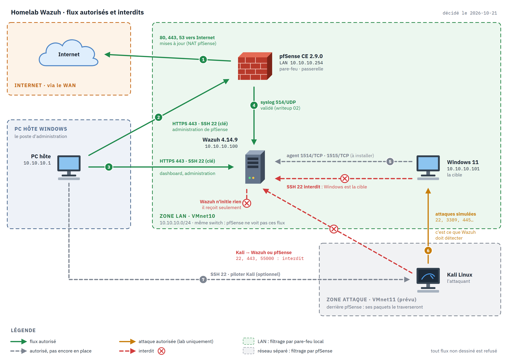

# Writeup 03 : SSH par clé vers Wazuh et pfSense

> Remplacer les connexions par mot de passe (console, SSH) par des clés SSH, puis interdire
> le mot de passe. Document vivant.
>
> Versions : Wazuh OVA 4.14.9 (Amazon Linux 2023, OpenSSH), pfSense CE 2.9.0.

## 1. Comprendre

- **Mot de passe** : un secret qu'on envoie au serveur. S'il est faible, réutilisé ou vu (ce qui
  nous est arrivé dans le writeup 01), n'importe qui peut se connecter, et la force brute
  marche.
- **Clé SSH** : une paire. La **clé privée** reste sur le poste et ne circule jamais. La **clé
  publique** est déposée sur le serveur (`~/.ssh/authorized_keys`). Le serveur envoie un défi,
  que seul le détenteur de la clé privée sait signer. Rien de réutilisable ne passe sur le
  réseau.
- **ed25519** : algorithme de clé moderne, court et rapide. On protège la clé privée par une
  **phrase de passe** : volée seule, elle ne suffit pas.
- Une fois les clés en place, on **désactive le mot de passe** côté serveur : la force brute
  SSH devient inutile. C'est exactement l'attaque que le scénario brute force simulera ensuite.

**Qui se connecte à quoi** (aligné sur la [matrice des flux](../architecture.md#matrice-des-flux-du-lab-moindre-privilège),
schéma : [`docs/diagrams/flux-lab.png`](../diagrams/flux-lab.png)) :

| Client | Clé | Vers | Usage |
|---|---|---|---|
| Hôte (PC, `10.10.10.1`) | `id_ed25519_siemlab` | Wazuh `wazuh-user@10.10.10.100`, pfSense `admin@10.10.10.254` | administration |
| VM Windows 11 (`10.10.10.101`) | aucune | — | poste **cible** : il parle à Wazuh par l'agent (1514/1515), jamais en SSH |



- **Seul l'hôte administre.** Une première version de ce plan donnait aussi une clé SSH à la VM
  Windows vers Wazuh. On l'a retirée : Windows 11 est la machine qu'on va attaquer. Si elle
  tombe, une clé SSH vers le SIEM offrirait à l'attaquant un accès direct à l'outil qui doit le
  détecter (mouvement latéral, MITRE T1021.004). La clé déjà déposée est supprimée au § 2.3.
- **Une clé dédiée au lab** sur l'hôte, distincte des clés personnelles existantes (GitLab…) :
  `IdentitiesOnly yes` dans `~/.ssh/config` empêche SSH de proposer les autres clés.
- Chaque ligne de `authorized_keys` porte un commentaire (`-C`) qui dit à qui elle appartient.

## 2. Wazuh (Amazon Linux 2023)

### 2.1 Générer les clés (PowerShell)

Sur l'**hôte** :

```powershell
ssh-keygen -t ed25519 -f $env:USERPROFILE\.ssh\id_ed25519_siemlab -C "adrien@hote-siemlab"
```

Phrase de passe recommandée. La clé privée (sans `.pub`) ne se copie ni ne se versionne jamais.

Alias ajoutés au `~/.ssh/config` de l'hôte (sauvegarde `config.bak-siemlab`) :

```
Host siem-wazuh
    HostName 10.10.10.100
    User wazuh-user
    IdentityFile ~/.ssh/id_ed25519_siemlab
    IdentitiesOnly yes

Host siem-pfsense
    HostName 10.10.10.254
    User admin
    IdentityFile ~/.ssh/id_ed25519_siemlab
    IdentitiesOnly yes
```

Ensuite `ssh siem-wazuh` suffit.

### 2.2 Déposer la clé publique

Windows n'a pas `ssh-copy-id`. Équivalent, depuis l'hôte (le mot de passe est encore
accepté à ce stade) :

```powershell
type $env:USERPROFILE\.ssh\id_ed25519_siemlab.pub | ssh wazuh-user@10.10.10.100 "mkdir -p ~/.ssh && chmod 700 ~/.ssh && cat >> ~/.ssh/authorized_keys && chmod 600 ~/.ssh/authorized_keys"
```

Contrôle, une ligne par clé (le 3e champ est le commentaire `-C`) :

```bash
cut -d' ' -f3 ~/.ssh/authorized_keys
```

Les droits comptent : OpenSSH refuse une clé si `~/.ssh` ou `authorized_keys` est accessible en
écriture par d'autres (`StrictModes`).

Test, qui ne doit plus demander que la phrase de passe de la clé :

```powershell
ssh siem-wazuh
```

### 2.3 Retirer la clé de la VM Windows 11

À faire **depuis l'hôte**, une fois `ssh siem-wazuh` validé (sinon on se couperait l'accès) :

```bash
cp ~/.ssh/authorized_keys ~/.ssh/authorized_keys.bak
sed -i '/adrien@siem-win11$/d' ~/.ssh/authorized_keys
cut -d' ' -f3 ~/.ssh/authorized_keys      # ne doit plus lister que adrien@hote-siemlab
```

Depuis la VM Windows, `ssh wazuh-user@10.10.10.100` doit alors échouer. La paire de clés peut
aussi être supprimée dans la VM (`del $env:USERPROFILE\.ssh\id_ed25519*`).

### 2.4 Interdire le mot de passe

**Garder une session SSH ouverte** pendant toute l'opération : en cas d'erreur, elle permet de
corriger sans repasser par la console.

```bash
sudo tee /etc/ssh/sshd_config.d/00-durcissement.conf >/dev/null <<'EOF'
PasswordAuthentication no
KbdInteractiveAuthentication no
PermitRootLogin no
PubkeyAuthentication yes
EOF
sudo sshd -t && sudo systemctl reload sshd
sudo sshd -T | grep -Ei '^(passwordauthentication|kbdinteractiveauthentication|permitrootlogin|pubkeyauthentication) '
```

Pourquoi le préfixe `00-` : `sshd_config` inclut `sshd_config.d/*.conf` **au début**, et pour
OpenSSH c'est la **première** valeur lue qui gagne. Un fichier livré par la distribution (par
exemple un `50-*.conf` avec `PasswordAuthentication yes`) l'emporterait sinon. `sshd -T`
affiche la configuration réellement appliquée. C'est elle qui fait foi. (Ordre des fichiers sur
cette OVA : à vérifier avec `ls /etc/ssh/sshd_config.d/`.)

Test depuis une **nouvelle** fenêtre, la première restant ouverte :

```powershell
ssh -o PubkeyAuthentication=no wazuh-user@10.10.10.100
```

Attendu : `Permission denied (publickey…)`. Le mot de passe est bien refusé.

## 3. pfSense

1. *System > User Manager > admin* : coller le contenu de `id_ed25519_siemlab.pub` (sur l'hôte : `type $env:USERPROFILE\.ssh\id_ed25519_siemlab.pub`) dans
   **Authorized SSH Keys**, puis *Save*.
2. *System > Advanced > Admin Access*, section *Secure Shell* : cocher **Enable Secure Shell**,
   *SSHd Key Only* = **Public Key Only**, puis *Save*.
3. Test depuis l'hôte : `ssh siem-pfsense`, qui ouvre le menu console de pfSense.

Constaté le 2026-10-21 : le port 22 de pfSense est **fermé** (`Test-NetConnection 10.10.10.254
-Port 22` → `False`) ; SSH est désactivé par défaut. La règle LAN par défaut (« Default allow LAN
to any ») laisse passer l'hôte, et l'« anti-lockout rule » protège l'accès d'administration
depuis le LAN.

L'interface web garde son mot de passe : ce réglage ne concerne que SSH.

## 4. Résultats dans notre lab

| Test | Attendu | Obtenu |
|---|---|---|
| Hôte sur VMnet10 | `10.10.10.1` | ✅ |
| Port 22 Wazuh depuis l'hôte | ouvert | ✅ |
| Port 22 pfSense depuis l'hôte | ouvert après activation | ❌ fermé (SSH désactivé par défaut) |
| Clé VM Windows → Wazuh | retirée (hors matrice des flux) | à faire |
| Clé hôte `id_ed25519_siemlab` → Wazuh | session sans mot de passe | à faire |
| Mot de passe refusé sur Wazuh | `Permission denied (publickey)` | à faire |
| Connexion par clé à pfSense | menu console pfSense | à faire |

Sources : `man sshd_config` (OpenSSH, règle « first obtained value »),
https://docs.netgate.com/pfsense/en/latest/recipes/ssh-access.html
