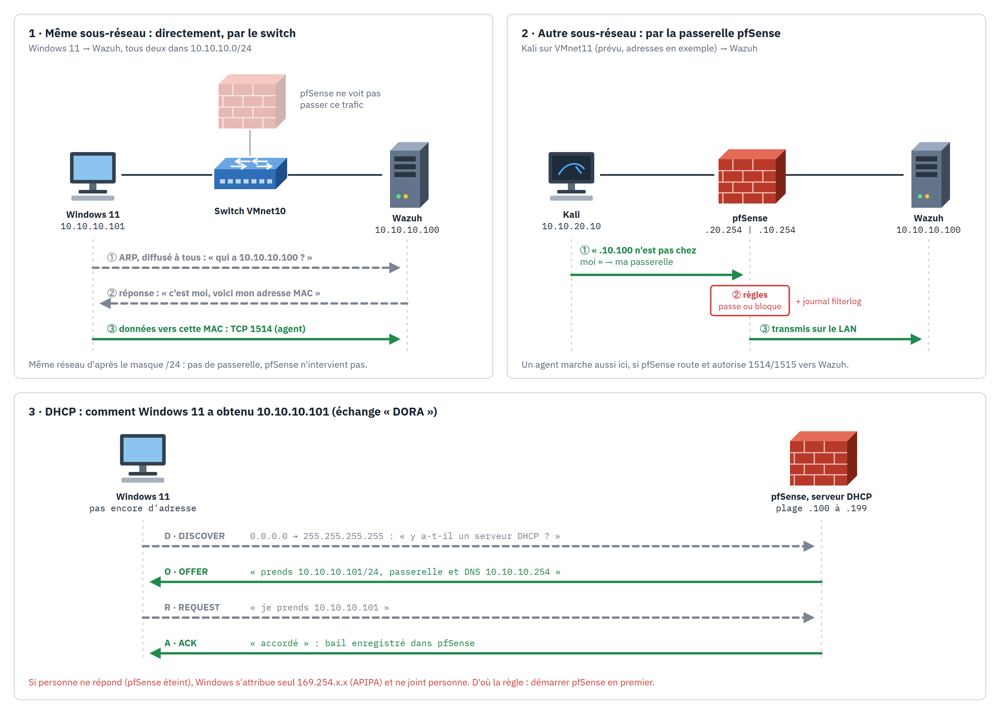
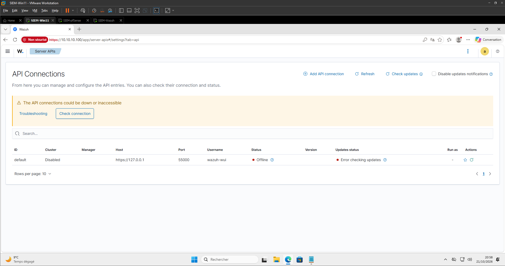
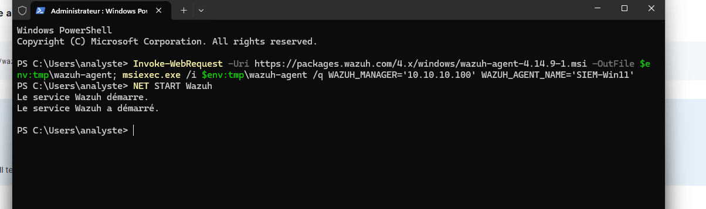
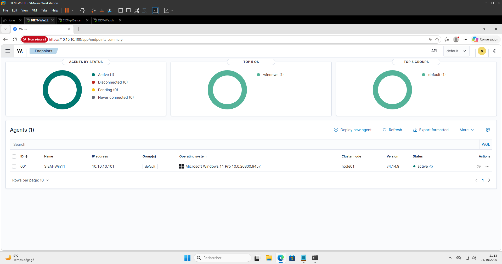

# Writeup 04 : agent Wazuh sur Windows 11, puis Sysmon

> Enrôler la VM Windows 11 comme agent Wazuh, puis enrichir ce qu'elle remonte avec Sysmon.
> Document vivant.
>
> Versions : Wazuh 4.14.9 (manager OVA et agent Windows), Windows 11 Pro 10.0.26300.

## 1. Comprendre

### 1.1 L'agent

Jusqu'ici, Wazuh ne recevait que le syslog de pfSense : ce qu'on lui **envoie**. Un **agent**
est un petit programme installé sur la machine surveillée, qui **va chercher** les
informations lui-même : journaux Windows, intégrité des fichiers (FIM), inventaire, état de
configuration (SCA).

Deux ports, côté manager (voir la [matrice des flux](../architecture.md)) :

| Port | Démon du manager | Rôle |
|---|---|---|
| 1515/TCP | `wazuh-authd` | **enrôlement** : l'agent se présente, le manager lui attribue un ID et une clé |
| 1514/TCP | `wazuh-remoted` | **événements** : l'agent envoie ce qu'il collecte, chiffré avec cette clé |

La clé d'agent est stockée dans `client.keys`, des deux côtés. C'est un secret : jamais dans
git.

### 1.2 Le réseau : qui voit passer quoi



**Switch ou routeur.** VMnet10 est un **switch** virtuel : il relie les machines d'un même
sous-réseau et livre chaque trame d'après l'**adresse MAC** du destinataire. Quand Windows 11
(`10.10.10.101`) parle à Wazuh (`10.10.10.100`), il applique son **masque** `/24` : les trois
premiers nombres sont identiques, la cible est donc « chez lui ». Il demande la MAC de
`10.10.10.100` à tout le réseau (**ARP**), puis envoie directement. pfSense, branché sur le même
switch, ne voit **rien** de ce trafic : il n'est pas sur le chemin (scène 1).

**Passer par la passerelle.** Si la cible est sur un autre réseau, la machine envoie le paquet
à sa **passerelle**, ici pfSense. pfSense est un **routeur** : il reçoit sur une interface,
applique ses règles (passer, bloquer, journaliser dans `filterlog`) et ressort par une autre
(scène 2). C'est pourquoi on prévoit de mettre Kali sur son propre réseau VMnet11 : ses
attaques traverseront pfSense, qui pourra les filtrer et les journaliser.

**Et l'agent sur un autre réseau ?** Il fonctionne, à deux conditions : une route existe
(pfSense relie les deux réseaux) et les règles autorisent **TCP 1514 et 1515** vers Wazuh.
L'agent ne dépend pas du sous-réseau, seulement de pouvoir joindre ces ports. C'est le cas
réel d'une entreprise, où les postes et le SIEM sont rarement sur le même réseau.

**DHCP : comment Windows 11 a obtenu son adresse.** Au démarrage, la VM n'a pas d'adresse. Elle
diffuse un **DISCOVER** ; le serveur DHCP de pfSense (plage `.100` à `.199`) répond par une
**OFFER** (adresse, masque, passerelle et DNS `10.10.10.254`) ; la VM la **REQUEST** ; pfSense
confirme par un **ACK** et enregistre le **bail** (scène 3). Plus tôt, pfSense était éteint :
personne n'a répondu et Windows s'est attribué seul une adresse **APIPA** `169.254.x.x`, qui ne
permet de joindre personne. Règle du lab : démarrer pfSense en premier.

**Ce qui reste à faire côté pfSense** : le syslog (writeup 02) et le SSH par clé (writeup 03)
sont faits. Restent le segment VMnet11 pour Kali (3ᵉ interface et règles) et les règles qui
font respecter la [matrice des flux](../architecture.md) pour ce qui traverse pfSense.

### 1.3 Pourquoi Sysmon

Les journaux Windows natifs (Security, System, Application) disent surtout **qui** s'est
connecté. Ils disent mal **ce qui s'est exécuté**. **Sysmon** (System Monitor, Microsoft
Sysinternals) est un service qui journalise finement l'activité du système dans un canal
dédié, `Microsoft-Windows-Sysmon/Operational` :

| ID | Ce que Sysmon voit | Exemple d'attaque |
|---|---|---|
| 1 | processus créé, avec ligne de commande, hash et processus parent | `powershell -enc …` lancé par Word |
| 3 | connexion réseau sortante | reverse shell vers Kali |
| 10 | accès à un processus | dump de `lsass.exe` (vol de mots de passe) |
| 11 | fichier créé | dépôt d'un exécutable dans `%TEMP%` |
| 13 | valeur de registre modifiée | persistance par clé `Run` |

Sysmon ne fait que **produire** les événements. L'agent Wazuh les **lit** (format
`eventchannel`), le manager les **décode** (décodeur Windows natif) et les **évalue** avec
ses règles (61600 et suivantes pour Sysmon, 92000 et suivantes pour les détections ciblées).
Le détail est dans [integrations/windows-logs-sysmon.md](../integrations/windows-logs-sysmon.md).

La **configuration** de Sysmon décide quoi journaliser. Sans configuration, Sysmon voit peu ;
avec une configuration trop large, il inonde le SIEM. On part de celle de SwiftOnSecurity,
une référence reconnue qui filtre le bruit Windows connu.

## 2. Incident préalable : API « Offline »

Au moment de déployer l'agent, le dashboard affichait l'API `https://127.0.0.1:55000`
**Offline**.



Diagnostic depuis l'hôte, par `ssh siem-wazuh` (writeup 03) :

```bash
systemctl is-active wazuh-manager wazuh-indexer wazuh-dashboard   # inactive / active / active
systemctl is-enabled wazuh-manager                                # disabled
```

Le **manager** était arrêté et **désactivé au démarrage** : après le redémarrage de la VM, il
ne s'était pas relancé. L'indexer et le dashboard tournaient, d'où une interface qui
s'affiche mais une API muette. Correction :

```bash
sudo systemctl enable --now wazuh-manager
sudo ss -ltnp | grep -E ':(55000|1514|1515) '   # API, événements, enrôlement en écoute
```

Conséquence à retenir : tant que le manager est arrêté, **rien n'est analysé**, pas même le
syslog pfSense. Pourquoi le service était désactivé : **à valider** (livré ainsi dans l'OVA,
ou désactivé lors d'une manipulation antérieure). Réflexe après chaque démarrage du lab :
`systemctl is-active wazuh-manager wazuh-indexer wazuh-dashboard`.

## 3. Installer l'agent (Windows 11)

Dashboard : *Agents management > Deploy new agent*, **Windows MSI**, serveur `10.10.10.100`,
nom `SIEM-Win11`. Le dashboard génère la commande, lancée dans un **PowerShell
administrateur** de la VM :

```powershell
Invoke-WebRequest -Uri https://packages.wazuh.com/4.x/windows/wazuh-agent-4.14.9-1.msi -OutFile $env:tmp\wazuh-agent; msiexec.exe /i $env:tmp\wazuh-agent /q WAZUH_MANAGER='10.10.10.100' WAZUH_AGENT_NAME='SIEM-Win11'
NET START Wazuh
```

- `WAZUH_MANAGER` : l'adresse que l'agent contactera sur 1515 puis 1514.
- `/q` : installation silencieuse ; l'enrôlement se fait au premier démarrage du service.
- `NET START Wazuh` : `Wazuh` est le nom **affiché** du service, dont le nom interne est
  `WazuhSvc`. `NET START` accepte les deux, constaté dans notre lab.



## 4. Vérifier

Côté manager :

```bash
sudo /var/ossec/bin/agent_control -l
#   ID: 001, Name: SIEM-Win11, IP: any, Active
```

`IP: any` est normal : l'agent est enregistré sans adresse fixe, il peut donc se reconnecter
depuis une autre IP. Le dashboard affiche l'adresse vue à la connexion.



L'agent est dans le groupe **`default`**. C'est ce groupe qu'on utilisera pour lui pousser
la configuration Sysmon depuis le manager (§ 5.2).

## 5. Sysmon

### 5.1 Installer Sysmon (Windows 11, PowerShell administrateur)

```powershell
New-Item -ItemType Directory -Force C:\Sysmon | Out-Null
Invoke-WebRequest https://download.sysinternals.com/files/Sysmon.zip -OutFile C:\Sysmon\Sysmon.zip
Expand-Archive C:\Sysmon\Sysmon.zip -DestinationPath C:\Sysmon -Force
Invoke-WebRequest https://raw.githubusercontent.com/SwiftOnSecurity/sysmon-config/master/sysmonconfig-export.xml -OutFile C:\Sysmon\sysmonconfig.xml
C:\Sysmon\Sysmon64.exe -accepteula -i C:\Sysmon\sysmonconfig.xml
```

`-accepteula` accepte la licence Sysinternals, `-i` installe le service avec la
configuration. Vérification :

```powershell
Get-Service Sysmon64
Get-WinEvent -LogName Microsoft-Windows-Sysmon/Operational -MaxEvents 5 | Format-Table TimeCreated, Id, Message -Wrap
```

### 5.2 Faire lire Sysmon par l'agent : configuration centralisée

Plutôt que de modifier `ossec.conf` dans la VM, on utilise la **configuration centralisée** :
un fichier `agent.conf` sur le manager, par groupe d'agents, que chaque agent du groupe
télécharge automatiquement. Une seule modification, sur le manager, s'applique à tous les
postes Windows du groupe, présents et futurs.

Fichier versionné : [configs/manager/shared/default/agent.conf](../../configs/manager/shared/default/agent.conf),
à copier dans `/var/ossec/etc/shared/default/agent.conf` :

```xml
<agent_config os="Windows">
  <localfile>
    <location>Microsoft-Windows-Sysmon/Operational</location>
    <log_format>eventchannel</log_format>
  </localfile>
</agent_config>
```

`os="Windows"` : seuls les agents Windows appliquent ce bloc. Contrôle de syntaxe puis
redémarrage, côté manager :

```bash
sudo /var/ossec/bin/verify-agent-conf
sudo systemctl restart wazuh-manager
```

L'agent récupère la nouvelle configuration et redémarre ses collecteurs ; si rien ne bouge
après quelques minutes, `Restart-Service WazuhSvc` dans la VM.

### 5.3 Tester

Dans la VM : lancer `powershell.exe`, ce qui crée un événement Sysmon 1. La règle locale
**100100** (enfant de 61603) le fait remonter au niveau 8 :
[configs/manager/local_rules.xml](../../configs/manager/local_rules.xml). Dashboard, *Threat
Hunting* : `rule.id:100100`, ou `data.win.system.channel:"Microsoft-Windows-Sysmon/Operational"`.

## 6. Résultats dans notre lab

| Test | Attendu | Obtenu |
|---|---|---|
| API Wazuh `55000` | Online | ❌ Offline (manager désactivé) ; ✅ après `enable --now` |
| Agent 001 `SIEM-Win11` | Active, v4.14.9 | ✅ `agent_control -l` et dashboard |
| Premières alertes de l'agent | présentes | ✅ 490 lignes d'alertes de l'agent 001 dans `alerts.json` dans la première heure (comptage `grep`) |
| Sysmon installé | service `Sysmon64` en cours | à faire |
| Événements Sysmon dans Wazuh | canal `Microsoft-Windows-Sysmon/Operational` | à faire |
| Règle 100100 (PowerShell) | alerte niveau 8 | à faire |

Sources :
https://documentation.wazuh.com/current/installation-guide/wazuh-agent/wazuh-agent-package-windows.html,
https://documentation.wazuh.com/current/user-manual/reference/centralized-configuration.html,
https://learn.microsoft.com/sysinternals/downloads/sysmon,
https://github.com/SwiftOnSecurity/sysmon-config
