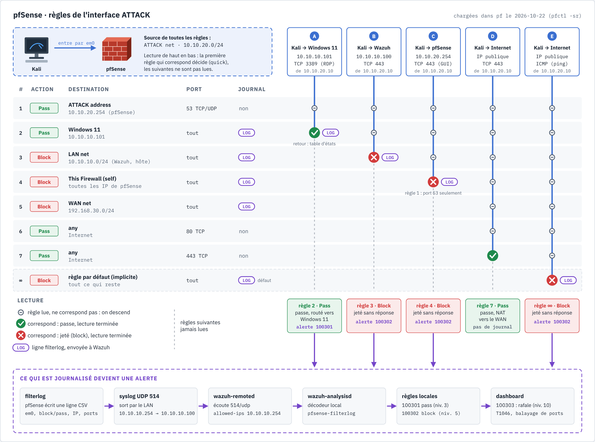
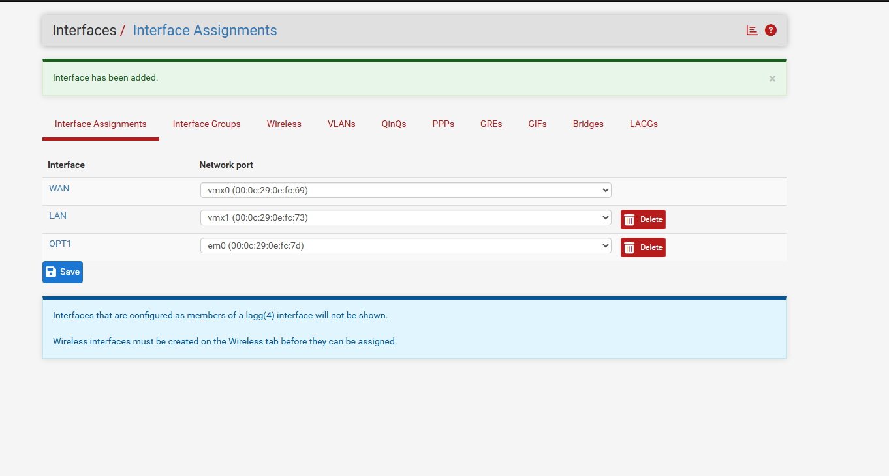
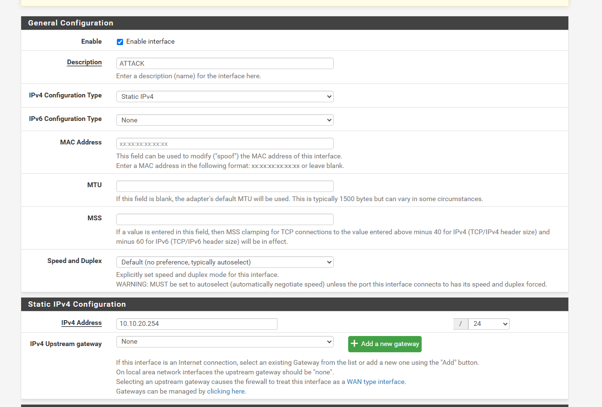
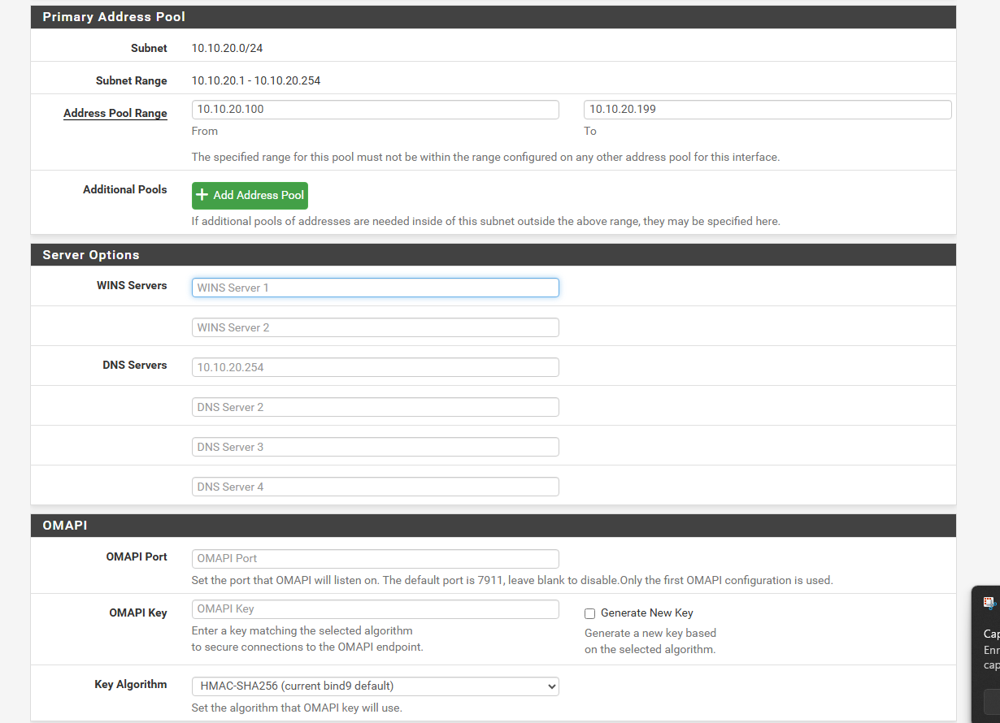

# Writeup 05 : un réseau d'attaque pour Kali, derrière pfSense

> Créer un troisième réseau virtuel, réservé à l'attaquant, que pfSense sépare du LAN. Les
> attaques de Kali traverseront alors le pare-feu, qui les filtrera et les journalisera.
> Document vivant : les étapes non encore réalisées sont marquées « à faire ».
>
> Versions : VMware Workstation 17.0.0, pfSense CE 2.9.0, Kali Linux (image VMware
> officielle), Wazuh 4.14.9.

## 1. Comprendre

### 1.1 Pourquoi un réseau à part

Si Kali était branché sur VMnet10, comme Windows 11 et Wazuh, ses paquets iraient directement
de machine à machine par le switch : pfSense ne verrait rien et ne pourrait rien bloquer
(cours du writeup 04, § 1.2, et [schéma des chemins](../diagrams/reseau-chemins.png)). En le
plaçant sur **son propre réseau**, `10.10.20.0/24`, chaque paquet vers le LAN doit passer par
sa **passerelle**, pfSense. On gagne trois choses :

- **filtrer** : la [matrice des flux](../architecture.md) devient applicable (Kali peut viser
  Windows 11, pas Wazuh ni pfSense) ;
- **journaliser** : chaque tentative passe par `filterlog`, donc par le syslog vers Wazuh
  (writeup 02) ;
- **ressembler au réel** : en entreprise, l'attaquant arrive d'un autre réseau (Internet, un
  VLAN invité, un poste compromis ailleurs), rarement du même switch que le SIEM.

### 1.2 Ce qu'on construit

| Élément | Valeur |
|---|---|
| Réseau VMware | **VMnet11**, host-only, `10.10.20.0/24`, **sans** carte sur l'hôte, **sans** DHCP VMware |
| pfSense | 3ᵉ carte `em0` → interface **OPT1** renommée **ATTACK**, `10.10.20.254/24` |
| DHCP | serveur DHCP de pfSense sur ATTACK, plage `10.10.20.100` à `.199` |
| Kali | carte réseau sur VMnet11, adresse reçue par DHCP |


*Le lab à trois réseaux : WAN (VMnet8), LAN (VMnet10) et ATTACK (VMnet11). Flux ⑤ : Kali vers
Windows 11, qui traverse pfSense ; flux ⑥ : Kali vers Wazuh, bloqué à l'entrée d'`em0`. Source :
[`topologie-lab.html`](../diagrams/topologie-lab.html).*

Pourquoi **sans carte sur l'hôte** : l'hôte n'a rien à faire sur le réseau de l'attaquant. Avec
une carte, Kali pourrait joindre l'hôte directement, sans passer par pfSense.
Pourquoi **sans DHCP VMware** : c'est pfSense qui distribue les adresses, et il annonce
`10.10.20.254` comme passerelle. Deux serveurs DHCP sur un même réseau se contrediraient.

### 1.3 Les règles du pare-feu

Sur pfSense, les règles d'une interface s'appliquent au trafic qui **entre** par cette
interface, de **haut en bas** : la première qui correspond décide. Une interface neuve
(OPT) n'a **aucune** règle, donc tout est bloqué par défaut. On autorise seulement ce qu'il
faut, et on journalise (*Log packets*) ce qui compte pour Wazuh.

Règles de l'interface **ATTACK**, dans cet ordre (une règle pfSense n'accepte qu'un port ou une
plage, d'où 6 et 7 ; un alias de ports les regrouperait) :

| # | Action | Source | Destination | Port | Log | Pourquoi |
|---|---|---|---|---|---|---|
| 1 | Pass | ATTACK net | ATTACK address (`10.10.20.254`) | 53 TCP/UDP | non | DNS, pour que Kali résolve les noms |
| 2 | Pass | ATTACK net | `10.10.10.101` (Windows 11) | any | **oui** | les scénarios d'attaque, journalisés |
| 3 | Block | ATTACK net | LAN net (`10.10.10.0/24`) | any | **oui** | Wazuh, l'hôte et le reste du LAN : interdit |
| 4 | Block | ATTACK net | This Firewall (self) | any | **oui** | administration de pfSense (443, 22) : interdite |
| 5 | Block | ATTACK net | WAN net (`192.168.30.0/24`) | any | **oui** | l'hôte côté NAT : interdit |
| 6 | Pass | ATTACK net | any | 80 TCP | non | mises à jour de Kali (HTTP) |
| 7 | Pass | ATTACK net | any | 443 TCP | non | mises à jour de Kali (HTTPS) |

Le sens retour (Windows 11 qui répond à Kali) est autorisé automatiquement : pfSense est
**stateful**, il mémorise chaque connexion ouverte et laisse passer ses réponses.

**Ordre** : la règle 2 doit précéder la règle 3, sinon le blocage du LAN entier masquerait
l'exception pour Windows 11.

#### Lire les règles avec des paquets



*Source : [`regles-attack.html`](../diagrams/regles-attack.html). Kali a l'adresse
réservée `10.10.20.10` (§ 2.7).*

Chaque colonne est un paquet de Kali qui **entre** par `em0`. pfSense descend la liste et
s'arrête à la **première** règle qui correspond :

| Paquet | Règles lues | Décision | Journal | Dans Wazuh |
|---|---|---|---|---|
| A · Windows 11 `10.10.10.101:3389` | 1, 2 | Pass (règle 2), routé vers le LAN | oui | 100301 (niveau 3) |
| B · Wazuh `10.10.10.100:443` | 1, 2, 3 | Block (règle 3, LAN net) | oui | 100302 (niveau 5) |
| C · pfSense `10.10.20.254:443` | 1 à 4 | Block (règle 4, This Firewall) | oui | 100302 |
| D · Internet, TCP 443 | 1 à 7 | Pass (règle 7), NAT sortant vers le WAN | non | rien |
| E · Internet, ping ICMP | toutes | Block (règle par défaut, implicite) | oui, par défaut | 100302 |

Trois points à retenir :

- **C** : la règle 1 vise bien `10.10.20.254`, mais seulement le port 53. Le port ne correspond
  pas, donc on continue. *This Firewall (self)* couvre **toutes** les adresses de pfSense, y
  compris `10.10.10.254` (même si, pour cette adresse, la règle 3 décide avant).
- **E** : aucune règle ne parle d'ICMP vers Internet, le paquet tombe dans la règle par défaut.
  pfSense journalise ses blocages par défaut (*Status > System Logs > Settings*, *Log packets
  matched from the default block rules*, coché d'origine).
- **D** : pas de journal, choix fait pour ne pas noyer Wazuh sous les mises à jour de Kali.
  C'est un **angle mort** connu : une exfiltration en HTTPS depuis Kali ne laisserait pas de
  trace dans Wazuh. Pour un scénario d'exfiltration, cocher *Log* sur les règles 6 et 7.

**Valeur pour l'analyste SOC** : chaque tentative de l'attaquant vers la supervision (B, C)
devient une alerte, et l'attaque autorisée (A) laisse aussi une trace horodatée. Une rafale de
blocages depuis `10.10.20.10` (balayage de ports) déclenche 100303 (T1046). Pour suivre ces
paquets un par un, avec les en-têtes, voir le scénario « Kali face aux règles ATTACK » du
[simulateur de paquets](annexe-simulateur-paquets.md).

## 2. Mise en œuvre

### 2.1 Créer VMnet11

*Edit > Virtual Network Editor > Change Settings* (droits administrateur), *Add Network…*
→ **VMnet11** :

- **Host-only** ;
- décocher *Connect a host virtual adapter to this network* ;
- décocher *Use local DHCP service to distribute IP address to VMs* ;
- *Subnet IP* `10.10.20.0`, *Subnet mask* `255.255.255.0` ;
- *Apply*.

Constaté le 2026-10-21 : VMnet11 existe dans le registre de VMware sans configuration (pas
de carte associée). Il faut donc bien le créer dans l'éditeur.

### 2.2 Ajouter la 3ᵉ carte à pfSense

pfSense **éteint** (*Shut Down*, pas *Suspend*) : *VM > Settings > Add… > Network Adapter*,
*Custom* : **VMnet11**. Démarrer pfSense.

Constaté le 2026-10-21 : la carte apparaît comme **`em0`**, pas `vmx2`. VMware ajoute une
nouvelle carte avec le modèle par défaut **e1000** (pilote FreeBSD `em`), alors que les deux
premières sont des **vmxnet3** (pilote `vmx`). Les deux fonctionnent ; vmxnet3 est plus
performant. Pour l'uniformité, on pourrait mettre `ethernet2.virtualDev = "vmxnet3"` dans
`SIEM-pfSense.vmx`, VM éteinte, avant l'affectation (la carte deviendrait alors `vmx2`). Choix
du lab : on garde `em0`, suffisant pour du trafic de test.

### 2.3 Interface ATTACK et DHCP

1. *Interfaces > Assignments* : ajouter `em0` → OPT1, *Save*.
2. *Interfaces > OPT1* : *Enable*, *Description* `ATTACK`, *IPv4 Configuration Type*
   **Static IPv4**, `10.10.20.254` / `24`, *Save*, *Apply Changes*.
3. *Services > DHCP Server > ATTACK* : *Enable*, plage `10.10.20.100` à `10.10.20.199`,
   *Save*.

Fait le 2026-10-22 : `em0` affecté en OPT1, renommé ATTACK, `10.10.20.254/24` sans passerelle
amont (c'est une interface LAN, pas une sortie Internet). *Block private networks* reste
**décoché** : ATTACK utilise lui-même des adresses privées (RFC 1918), qu'il ne faut pas
bloquer. DHCP actif, plage `.100` à `.199` ; pfSense s'annonce par défaut comme passerelle et
DNS (`10.10.20.254`).







**Block ou Reject** : *Block* jette le paquet en silence, l'attaquant attend jusqu'à
expiration ; *Reject* répond « refusé » tout de suite, ce qui lui confirme qu'un pare-feu est
là. Face à un attaquant, on choisit **Block**.

Accès Internet de Kali : en mode NAT sortant **automatique** (défaut de pfSense), le réseau
d'une nouvelle interface est traduit automatiquement vers le WAN. Rien à ajouter
(*Firewall > NAT > Outbound* pour le vérifier).

**Incident (2026-10-22) : Kali sans adresse.** Kali restait en « getting IP configuration »,
avec seulement une adresse IPv6 locale. Diagnostic par `ssh siem-pfsense` : `ifconfig em0`
ne montrait **ni le drapeau `UP` ni l'adresse `10.10.20.254`**. L'interface était enregistrée
dans la configuration, mais jamais **appliquée** (le bouton *Apply Changes* de la page
*Interfaces* n'avait pas pris). dhcpd écoutait, mais sur une carte éteinte : les DISCOVER de
Kali n'arrivaient nulle part. Correction, en appliquant la configuration enregistrée :

```bash
ssh siem-pfsense 'php -r "require_once(\"config.inc\"); require_once(\"interfaces.inc\"); require_once(\"services.inc\"); require_once(\"filter.inc\"); interface_configure(\"opt1\", true); services_dhcpd_configure(); filter_configure();"'
ssh siem-pfsense 'ifconfig em0'   # flags=…<UP,…,RUNNING…>  inet 10.10.20.254
```

Leçon : sur pfSense, « enregistré » (*Save*) n'est pas « appliqué » (*Apply Changes*). Une
capture d'écran de la page de configuration ne prouve pas l'état réel ; `ifconfig` si.

### 2.4 Règles : en ligne de commande

Deux voies possibles :

- **interface web** (la voie supportée) : *Firewall > Rules > ATTACK*, une règle à la fois,
  dans l'ordre du § 1.3, *Log packets* coché pour 2 à 5, puis *Apply Changes* ;
- **ligne de commande**, retenue le 2026-10-22 à la demande d'Adrien. pfSense n'a pas de
  commande officielle pour créer des règles. On passe par son **API PHP interne** : la même
  que l'interface web utilise pour lire et écrire `/cf/conf/config.xml`.

Le script versionné [configs/pfsense/regles-attack.php](../../configs/pfsense/regles-attack.php)
ajoute les 7 règles à l'interface `opt1`, enregistre la configuration (`write_config`, avec
historique dans *Diagnostics > Backup & Restore > Config History*) puis recharge le pare-feu
(`filter_configure`). Il refuse de s'exécuter si ATTACK a déjà des règles. Exécution depuis
l'hôte, grâce au SSH par clé (writeup 03) :

```bash
ssh siem-pfsense 'cp /cf/conf/config.xml /cf/conf/config.xml.avant-attack && php' < configs/pfsense/regles-attack.php
```

Pourquoi ça marche : l'utilisateur `admin` de pfSense est en réalité **root** (uid 0). Sa
« shell » est le menu console (`/etc/rc.initial`), mais une commande passée à `ssh` est
exécutée directement. Revers de la médaille : la clé de l'hôte donne les pleins pouvoirs sur
le pare-feu ; elle doit rester protégée.

**Vérification** : les règles réellement chargées dans le moteur `pf` :

```bash
ssh siem-pfsense 'pfctl -sr | grep em0'
```

```
pass in quick on em0 inet proto udp from <OPT1__NETWORK> to 10.10.20.254 port = domain … "DNS vers pfSense"
pass in log quick on em0 inet from <OPT1__NETWORK> to 10.10.10.101 … "Scenarios : Kali vers Windows 11"
block drop in log quick on em0 inet from <OPT1__NETWORK> to <LAN__NETWORK> … "Interdit : LAN (Wazuh, hote)"
block drop in log quick on em0 inet from <OPT1__NETWORK> to (self) … "Interdit : administration pfSense"
block drop in log quick on em0 inet from <OPT1__NETWORK> to <WAN__NETWORK> … "Interdit : reseau NAT de l hote"
pass in quick on em0 inet proto tcp from <OPT1__NETWORK> to any port = http … "Mises a jour Kali (HTTP)"
pass in quick on em0 inet proto tcp from <OPT1__NETWORK> to any port = https … "Mises a jour Kali (HTTPS)"
```

Lecture : `in` = trafic entrant par ATTACK ; `quick` = la première règle qui correspond
s'applique (d'où l'importance de l'ordre) ; `log` = journalisé, donc envoyé à Wazuh ;
`block drop` = jeté sans réponse. pfSense ajoute lui-même, avant nos règles, celles qui
autorisent le DHCP sur l'interface. Retour arrière : restaurer `config.xml.avant-attack` ou
une version de *Config History*.

### 2.5 Kali

- Image : la **machine virtuelle VMware** officielle, sur https://www.kali.org/get-kali/
  (section *Virtual Machines*). Vérifier le **SHA256** affiché sur la page avant
  d'extraire, comme pour les autres images (writeup 01).
- Emplacement : `C:\VM\SIEM_LAB\SIEM-Kali\`, sur le **SSD** (le disque `D:` mécanique a déjà
  fait échouer Windows 11, writeup 01, § 11).
- Mémoire : **2 Go**. L'hôte a 32 Go, et seulement 2,5 Go libres avec les trois VM
  allumées (mesuré le 2026-10-21) : fermer les applications lourdes de l'hôte avant de
  démarrer Kali.
- Réseau : *Network Adapter* → *Custom* **VMnet11**, avant le premier démarrage.
- Premier démarrage : changer le mot de passe par défaut (`passwd`). Il ne va jamais dans
  git.

### 2.6 Vérifier

Dans Kali :

```bash
ip -4 addr show eth0            # attendu : 10.10.20.1xx/24
ip route                        # attendu : default via 10.10.20.254
nc -zv -w 3 10.10.10.101 3389   # Windows 11 : la règle 2 laisse passer (le port peut être fermé)
nc -zv -w 3 10.10.10.100 443    # Wazuh : la règle 3 bloque, attendu « timed out »
```

Dans Wazuh, *Threat Hunting* : `rule.id:100302 and data.srcip:10.10.20.*`. Le blocage vers
Wazuh doit apparaître, avec l'interface ATTACK.

### 2.7 SSH de l'hôte vers Kali

C'est le flux optionnel « Hôte → Kali 22 » de la [matrice des flux](../architecture.md).

**Le chemin.** L'hôte n'a pas de carte sur VMnet11 (choix du § 1.2). Pour joindre
`10.10.20.0/24`, il doit donc passer par pfSense, son voisin sur VMnet10. On lui ajoute une
**route** : « pour `10.10.20.0/24`, passe par `10.10.10.254` ». Le paquet entre dans pfSense
par le LAN, où la règle par défaut *allow LAN to any* le laisse passer, et ressort par ATTACK
vers Kali. La réponse de Kali revient par l'**état** de la connexion (pfSense est stateful).
La règle ATTACK 3 (blocage vers le LAN) continue d'empêcher Kali **d'ouvrir** une connexion
vers l'hôte : la session ne peut venir que de l'hôte.

**Une adresse fixe pour Kali.** L'alias SSH a besoin d'une adresse stable. On réserve donc
`10.10.20.10` pour la carte de Kali (MAC `00:0c:29:89:a5:00`, lue dans le `.vmx`), hors de la
plage dynamique `.100`-`.199`. Fait en ligne de commande le 2026-10-22, avec
[configs/pfsense/dhcp-kali.php](../../configs/pfsense/dhcp-kali.php) (sauvegarde
`config.xml.avant-dhcp-kali`), puis vérifié dans `/var/dhcpd/etc/dhcpd.conf` :

```
host s_opt1_0 {
	hardware ethernet 00:0c:29:89:a5:00;
	fixed-address 10.10.20.10;
	option host-name "siem-kali";
}
```

**Côté hôte** :

```powershell
# PowerShell administrateur : route persistante (-p) vers le réseau d'attaque
route -p add 10.10.20.0 mask 255.255.255.0 10.10.10.254
```

Alias ajouté au `~/.ssh/config` (sauvegarde `config.bak-kali`), avec la clé ECDSA du lab
(writeup 03) :

```
Host siem-kali
    HostName 10.10.20.10
    User kali
    IdentityFile ~/.ssh/id_ecdsa_siemlab
    IdentitiesOnly yes
```

**Côté Kali**, dans un terminal de la VM :

```bash
passwd                                    # remplacer le mot de passe par défaut de l'image
sudo nmcli connection up "Wired connection 1"   # renouveler le bail : 10.10.20.10 attendu
sudo systemctl enable --now ssh           # SSH n'est pas démarré par défaut sur Kali
```

Puis, depuis l'hôte, déposer la clé (le mot de passe de Kali est demandé une dernière fois),
tester, et interdire le mot de passe comme sur Wazuh (writeup 03, § 2.4) :

```powershell
type $env:USERPROFILE\.ssh\id_ecdsa_siemlab.pub | ssh kali@10.10.20.10 "mkdir -p ~/.ssh && chmod 700 ~/.ssh && cat >> ~/.ssh/authorized_keys && chmod 600 ~/.ssh/authorized_keys"
ssh siem-kali
```

```bash
sudo tee /etc/ssh/sshd_config.d/00-durcissement.conf >/dev/null <<'EOF'
PasswordAuthentication no
KbdInteractiveAuthentication no
PermitRootLogin no
PubkeyAuthentication yes
EOF
sudo sshd -t && sudo systemctl reload ssh
```

## 3. Résultats dans notre lab

| Test | Attendu | Obtenu |
|---|---|---|
| VMnet11 créé, sans carte hôte ni DHCP | oui | ✅ Kali y fonctionne, scénarios joués (writeups 06 à 08) |
| pfSense ATTACK `10.10.20.254` | interface active, DHCP `.100`-`.199` | ✅ (captures 74-77) |
| Kali reçoit son adresse, passerelle `.254` | oui | ✅ réservation `10.10.20.10` |
| Kali → Windows 11 | autorisé, journalisé | ✅ SMB 445 joint Windows 11 à travers pfSense ([writeup 06](06-scenario-brute-force-smb.md)) ; journal pfSense à valider |
| 7 règles ATTACK chargées dans `pf` | oui | ✅ `pfctl -sr` (2026-10-22) |
| Kali → Wazuh | bloqué, alerte 100302 | ✅ scan des ports 1-200 bloqué, 100302 puis 100303 ([writeup 08](08-scenario-scan-nmap.md)) |
| Kali → administration pfSense | bloqué | à faire |
| Réservation DHCP Kali `10.10.20.10` | dans `dhcpd.conf` | ✅ |
| `ssh siem-kali` depuis l'hôte, par clé | session sans mot de passe | ✅ (2026-10-22) |

Sources :
https://docs.netgate.com/pfsense/en/latest/firewall/rule-methodology.html (ordre des règles,
première correspondance),
https://docs.netgate.com/pfsense/en/latest/interfaces/assign.html (affectation d'interfaces),
https://www.kali.org/docs/virtualization/import-premade-vmware/ (image VMware de Kali).
