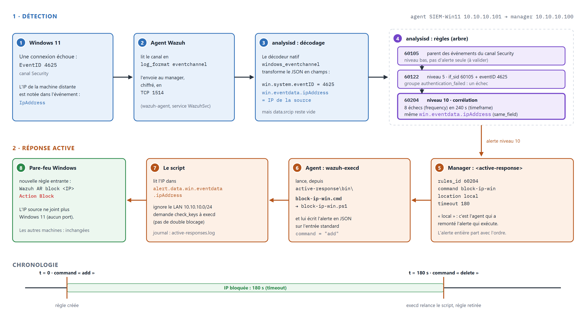
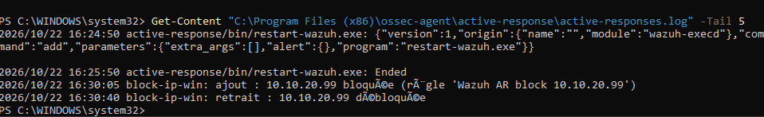
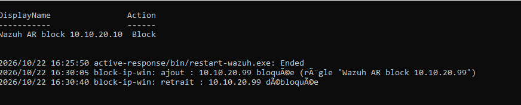
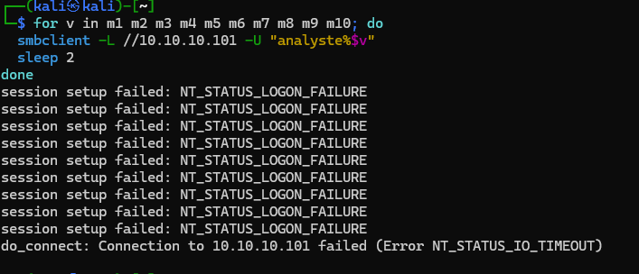

# Writeup 07 : comprendre les règles Wazuh, puis appliquer une mesure

> Cours en deux temps. D'abord **comment Wazuh détecte** (décodeurs, règles, niveaux,
> corrélation) et comment on **ajoute** une règle. Ensuite **comment il réagit** : la réponse
> active (*active response*), appliquée ici à la règle native 60204 pour bloquer l'IP source
> dans le pare-feu de Windows 11 pendant 180 s.
> Les alertes 60122 et 60204 utilisées ici sont celles observées dans le
> [writeup 06](06-scenario-brute-force-smb.md).
> Document vivant : les étapes non encore réalisées sont marquées « à faire ».
>
> Versions : Wazuh 4.14.9 (manager et agent Windows), Windows 11.



*Du journal Windows au blocage. Source : [`reponse-active.html`](../diagrams/reponse-active.html).*

## 1. Comprendre la détection

### 1.1 Trois étapes : décoder, comparer, noter

Tout journal reçu par le manager passe par `wazuh-analysisd`
([pipeline annoté](../diagrams/pipeline-wazuh.png), writeup 02) :

1. **Décodeur** : il transforme le texte brut en **champs nommés**. Pour un agent Windows, le
   décodeur natif `windows_eventchannel` découpe le JSON de l'événement en
   `win.system.eventID`, `win.eventdata.ipAddress`, `win.eventdata.targetUserName`, etc.
2. **Règles** : elles testent ces champs. Les règles forment un **arbre** : une règle enfant
   (`<if_sid>`) n'est évaluée que si son parent a correspondu. Wazuh retient la règle la plus
   profonde qui correspond.
3. **Niveau** : chaque règle a un niveau de 0 à 15. Niveau 0 : rien n'est écrit. À partir du
   seuil `log_alert_level` (3 par défaut), une alerte part dans `alerts.json`, donc dans le
   dashboard.

### 1.2 Lire une vraie règle : 60122 et 60204

Règles natives relues sur notre manager, dans
`/var/ossec/ruleset/rules/0580-win-security_rules.xml` :

```xml
<rule id="60122" level="5">
  <if_sid>60105</if_sid>
  <field name="win.system.eventID">^529$|^4625$</field>
  <description>Logon Failure - Unknown user or bad password</description>
  <group>authentication_failed,...</group>
</rule>

<rule id="60204" level="10" frequency="$MS_FREQ" timeframe="240">
  <if_matched_group>authentication_failed</if_matched_group>
  <same_field>win.eventdata.ipAddress</same_field>
  <description>Multiple Windows Logon Failures</description>
  <mitre><id>T1110</id></mitre>
</rule>
```

- **60122** est une règle **simple** : un événement 4625 (échec de connexion) = une alerte de
  niveau 5. Elle range l'alerte dans le groupe `authentication_failed`.
- **60204** est une règle de **corrélation** : elle ne regarde pas un événement mais une
  **série**. `frequency="$MS_FREQ"` (variable définie à `8` en tête du fichier) et
  `timeframe="240"` : 8 alertes du groupe `authentication_failed` en 240 secondes.
  `same_field` exige qu'elles portent **la même valeur** de `win.eventdata.ipAddress` : il faut
  8 échecs **venant de la même machine**, pas 8 échecs au total.

C'est le schéma classique d'un SIEM : un événement isolé est du bruit (un mot de passe mal tapé),
la répétition est le signal.

### 1.3 Ajouter une règle : la méthode

On ne modifie **jamais** les fichiers de `/var/ossec/ruleset/` : une mise à jour de Wazuh les
écrase. On écrit dans `/var/ossec/etc/rules/local_rules.xml` (notre version :
[`configs/manager/local_rules.xml`](../../configs/manager/local_rules.xml)).

1. **Trouver le parent** dans le ruleset natif : quelle règle correspond déjà à l'événement ?
   On l'étend par une règle enfant (`<if_sid>`) au lieu de la redéfinir.
2. **Choisir un ID** dans la plage locale **100000 à 120000** (règle du dépôt, `CLAUDE.md`).
3. **Écrire la condition** : `<field name="...">` (expression régulière sur un champ décodé),
   `<match>` (texte dans le journal brut), `<list>` (liste CDB), etc.
4. **Choisir le niveau** : il décide si l'alerte existe et sa gravité. Garder un niveau bas
   pour l'information, 10 et plus pour ce qui doit réveiller quelqu'un.
5. **Documenter** : `<description>` lisible, `<mitre><id>` pour la technique ATT&CK, un
   commentaire XML qui explique le pourquoi.
6. **Tester sans redémarrer** avec `sudo /var/ossec/bin/wazuh-logtest` : on colle une ligne de
   journal, l'outil affiche le décodeur et la règle retenus.
7. **Appliquer** : `sudo systemctl restart wazuh-manager`, puis vérifier qu'aucune erreur
   n'apparaît dans `/var/ossec/logs/ossec.log`.

Exemple déjà en place dans le lab : la règle **100100** (writeup 04) est enfant de 61603
(Sysmon EID 1, niveau 0) et monte au niveau 8 quand l'image lancée est `powershell.exe`.

*Exercice proposé (à faire, à valider)* : une règle enfant de 60122 qui monte au niveau 8 quand
le compte visé est `Administrateur`, avec `<field name="win.eventdata.targetUserName">`.

## 2. Comprendre la réponse active

### 2.1 Deux blocs dans `ossec.conf`

Une mesure se déclare sur le manager, dans `<ossec_config>` :

```xml
<command>                                <!-- QUOI exécuter -->
  <name>block-ip-win</name>
  <executable>block-ip-win.cmd</executable>   <!-- fichier dans active-response\bin de l'agent -->
  <timeout_allowed>yes</timeout_allowed>      <!-- la commande sait défaire ce qu'elle a fait -->
</command>

<active-response>                        <!-- QUAND, OÙ, COMBIEN DE TEMPS -->
  <command>block-ip-win</command>
  <location>local</location>
  <rules_id>60204</rules_id>
  <timeout>180</timeout>
</active-response>
```

- **Quand** : `rules_id` (une liste d'IDs), ou `level` (toute alerte à partir de ce niveau), ou
  `rules_group`. On vise étroit : une seule règle, celle de la corrélation.
- **Où** (`location`) : `local` = l'agent qui a produit l'alerte ; `server` = le manager
  lui-même ; `defined-agent` = un agent nommé par `<agent_id>` ; `all` = tous les agents. Ici
  `local` : c'est Windows 11 qui est visé, c'est lui qui se protège.
- **Combien de temps** (`timeout`) : après 180 s, l'agent relance le même script avec la commande
  `delete`. Un blocage temporaire limite le risque de se bloquer soi-même durablement.

### 2.2 Ce qui se passe sur l'agent

Depuis Wazuh 4.2, `wazuh-execd` lance le programme déclaré et lui écrit **l'alerte entière en
JSON** sur l'entrée standard, avec `"command": "add"`. Un script qui accepte un `timeout`
répond d'abord `check_keys` avec la clé du blocage (ici l'IP) : `execd` dit `continue` si cette
IP n'est pas déjà bloquée, `abort` sinon. À l'expiration, `execd` relance le script avec
`"command": "delete"`. Sous Windows, `execd` lance des `.exe` et des `.cmd`, d'où le petit
lanceur `block-ip-win.cmd` qui passe la main à PowerShell.

### 2.3 Pourquoi pas la commande `netsh` livrée avec Wazuh

Le manager déclare déjà une commande `netsh` (`netsh.exe`). Elle lit l'IP à bloquer dans le
champ `data.srcip`. Or, vérifié sur notre manager le 2026-10-22 : la dernière alerte 60204 n'a
**pas** de `srcip` ; ses données ne contiennent que `win`, et l'IP est dans
`data.win.eventdata.ipAddress` (le champ que 60204 compare avec `same_field`). Avec `netsh`, la
réponse partirait sans IP à bloquer.

D'où notre script [`block-ip-win.ps1`](../../configs/agent-windows/active-response/block-ip-win.ps1) :

- il lit l'IP dans `parameters.alert.data.win.eventdata.ipAddress` et vérifie que c'est une IPv4 ;
- il **refuse de bloquer** `10.10.10.0/24` (hôte, Wazuh, pfSense) et `127.0.0.0/8` : une
  erreur de détection ne doit pas couper l'administration du lab ;
- `add` crée une règle entrante `Wazuh AR block <IP>` (action Block), `delete` la retire ;
- chaque action est écrite dans `active-response\active-responses.log` de l'agent.

## 3. Mise en place

### 3.1 Sur le manager (Adrien) — fait le 2026-10-22

Le fichier à insérer : [`configs/manager/ossec-active-response.xml`](../../configs/manager/ossec-active-response.xml).
Depuis l'hôte, dans le dépôt :

```bash
scp configs/manager/ossec-active-response.xml siem-wazuh:/tmp/
```

Puis sur le manager (`ssh siem-wazuh`) :

```bash
sudo cp -p /var/ossec/etc/ossec.conf /var/ossec/etc/ossec.conf.avant-ar
sudo vi /var/ossec/etc/ossec.conf
```

Coller le contenu de `/tmp/ossec-active-response.xml` (`cat` dans un autre terminal) juste
**avant la dernière ligne** `</ossec_config>`, enregistrer. Puis vérifier et appliquer :

```bash
sudo /var/ossec/bin/wazuh-analysisd -t
sudo systemctl restart wazuh-manager
sudo grep -iE "error|critical" /var/ossec/logs/ossec.log | tail
```

`wazuh-analysisd -t` teste la configuration sans démarrer le service : s'il signale une erreur,
on restaure la sauvegarde (`sudo cp -p /var/ossec/etc/ossec.conf.avant-ar /var/ossec/etc/ossec.conf`).

### 3.2 Sur Windows 11 (Adrien) — fait le 2026-10-22

Copier `block-ip-win.cmd` et `block-ip-win.ps1` sur le bureau de la VM (glisser-déposer
VMware), puis dans un PowerShell **administrateur** :

```powershell
Copy-Item "$env:USERPROFILE\Desktop\block-ip-win.*" "C:\Program Files (x86)\ossec-agent\active-response\bin\"
Restart-Service -Name WazuhSvc
```

Le dossier `active-response\bin` n'est modifiable que par un administrateur : c'est voulu, ces
scripts s'exécutent avec les droits de l'agent (SYSTEM). Le redémarrage de l'agent lui fait
relire la configuration des réponses actives (à valider : il n'est peut-être pas indispensable).

### 3.3 Vérifier sans attaque — fait le 2026-10-22

On peut tester le script seul, avec une alerte fabriquée et une IP fictive du réseau ATTACK
(PowerShell administrateur, sur Windows 11) :

```powershell
$bin = "C:\Program Files (x86)\ossec-agent\active-response\bin\block-ip-win.cmd"
$alerte = '{"version":1,"command":"add","parameters":{"alert":{"data":{"win":{"eventdata":{"ipAddress":"10.10.20.99"}}}}}}'
"$alerte`n{`"command`":`"continue`"}" | & $bin
Get-NetFirewallRule -DisplayName "Wazuh AR block*" | Format-Table DisplayName, Action, Enabled
"$($alerte -replace '"add"', '"delete"')" | & $bin
Get-Content "C:\Program Files (x86)\ossec-agent\active-response\active-responses.log" -Tail 5
```

Attendu : la règle `Wazuh AR block 10.10.20.99` apparaît après `add`, disparaît après `delete`,
et le journal montre les deux lignes.

Obtenu (16:30 heure locale) : les deux lignes `ajout` puis `retrait` pour `10.10.20.99` sont
dans le journal (capture 86). Les accents y sont cassés (`bloquée`) : voir § 4.4.



## 4. Test réel : la réponse active coupe l'attaquant

Joué le 2026-10-22 vers 17:04 heure locale (15:04 UTC), contre le lab uniquement : Kali
`10.10.20.10` (réseau ATTACK) attaque le compte local `analyste` de SIEM-Win11
`10.10.10.101` (agent 001) en SMB.

### 4.1 Déroulé observé

| # | Où | Ce qui se passe |
|---|---|---|
| 1 | Kali | boucle `smbclient` : un essai toutes les 2 s, mots de passe faux (`m1` à `m10`) |
| 2 | Windows 11 | chaque essai refusé → événement **4625** ; Kali reçoit `NT_STATUS_LOGON_FAILURE` |
| 3 | Wazuh | **8 × 60122** (niveau 5), puis **60204** (niveau 10) à **17:03:49** : 8 échecs en 240 s depuis la même `ipAddress` |
| 4 | manager → agent | 60204 est dans `rules_id` : le manager envoie `block-ip-win` à l'agent qui a produit l'alerte (`location` local) |
| 5 | Windows 11 | `wazuh-execd` (compte SYSTEM) lance le script : règle entrante **`Wazuh AR block 10.10.20.10`**, action **Block** (capture 84) |
| 6 | Kali | l'essai suivant n'obtient même plus la bannière SMB : `do_connect: Connection to 10.10.10.101 failed (Error NT_STATUS_IO_TIMEOUT)` (capture 85) |
| 7 | Windows 11 | 180 s plus tard, `execd` relance le script avec `delete` : la règle disparaît d'elle-même |


*Capture 87, à ajouter : Threat Hunting, agent SIEM-Win11, les 60122 puis la 60204 de 17:03:49.*



*Capture 84 : la règle créée par la réponse active, pendant la fenêtre de 180 s.*



*Capture 85 : côté attaquant, les refus d'authentification puis le timeout. Les mots de passe
`m1`… sont des valeurs de test fausses.*

### 4.2 Lire la preuve

- **Le changement de message est la preuve que le blocage mord.** `NT_STATUS_LOGON_FAILURE`
  veut dire « Windows a reçu et refusé l'identifiant ». `NT_STATUS_IO_TIMEOUT` veut dire « plus
  rien ne répond » : le pare-feu jette les paquets de Kali avant même SMB. L'attaquant est coupé
  en pleine rafale.
- **Un essai passe encore après la 8ᵉ alerte.** Sur la capture 85, neuf refus précèdent le
  timeout, alors que la capture du dashboard relève 8 × 60122 (écart non expliqué, à valider :
fenêtre de recherche ou événement en cours de traitement). Entre le 8ᵉ échec et la règle pare-feu, il y a la remontée par l'agent, l'analyse, la
  corrélation, l'ordre au retour et le lancement de PowerShell : quelques secondes pendant
  lesquelles l'attaque continue. Une réponse active **réduit** la fenêtre, elle ne la ferme pas
  (déduction à partir des captures ; délai exact non mesuré).
- **Blocage ciblé et temporaire.** Seule `10.10.20.10` est bloquée, seulement sur la machine
  attaquée, pendant 180 s : assez pour casser une devinette automatisée, sans risque de couper
  durablement un poste légitime en cas de faux positif.

### 4.3 Trois pièges traversés

**① `nxc` (impacket) ne porte pas l'authentification jusqu'à ce Windows 11.** L'outil
récupère la bannière SMB puis affiche `NETBIOS timed out` **avant** d'envoyer l'identifiant :
aucune authentification n'atteint Windows, donc **aucun 4625**, donc rien à détecter. Avec
`smbclient` (`smbclient -L //10.10.10.101 -U 'analyste%<mot de passe>'`), chaque essai produit
bien `NT_STATUS_LOGON_FAILURE` et un 4625. Leçon : avant de juger une détection, vérifier que
l'outil d'attaque produit vraiment l'action attendue ; les journaux de la cible font foi.

**② Un agent arrêté est un angle mort silencieux.** Un `Restart-Service WazuhSvc` qui avait
échoué avait laissé l'agent à l'état *Stopped*. Les 4625 s'écrivaient bien dans le journal
Windows, mais plus rien n'arrivait à Wazuh : dashboard calme, poste aveugle. Leçon : l'absence
de journaux est un signal en soi. Wazuh lève une alerte quand un agent se déconnecte (règles
505/506, à valider dans le ruleset), et on vérifie avant chaque exercice :

```powershell
Get-Service WazuhSvc     # attendu : Status = Running
```

**③ Le ping vers Windows ne prouve rien.** Le pare-feu Windows refuse l'ICMP entrant par
défaut : un ping qui échoue ne dit rien de la connectivité ni du MTU. Tester le service visé
(ici 445/TCP) plutôt que le ping.

**En plus : Windows verrouille le compte tout seul.** Pendant les essais, Windows 11 a
verrouillé `analyste` (événement **4740**) : la stratégie de verrouillage de compte native est
une **deuxième couche** de défense, indépendante de Wazuh. Pour rejouer l'exercice, il faut
déverrouiller le compte, et ce 4740 mérite lui aussi d'être suivi dans Wazuh (règle à
identifier, à valider).

### 4.4 Limites à corriger

| Constat | Cause probable | Correction prévue |
|---|---|---|
| Lancé par `execd` (SYSTEM), le script crée bien la règle mais **n'écrit pas** sa ligne dans `active-responses.log` ; lancé à la main, il l'écrit | à identifier : chemin relatif `..ctive-responses.log` résolu autrement sous SYSTEM, ou fichier tenu ouvert par l'agent au même moment (hypothèses à valider) | journaliser avec un chemin absolu et une écriture qui tolère le partage du fichier ; tracer l'erreur au lieu de la taire |
| Accents cassés dans le journal (`bloquée`, `règle`) | Windows PowerShell 5.1 lit un `.ps1` sans BOM comme du Windows-1252 : les chaînes UTF-8 du script sont mal relues | réenregistrer `block-ip-win.ps1` en **UTF-8 avec BOM** |

Tant que le journal de l'agent est muet, la trace fiable de la réponse est la règle pare-feu
elle-même et, côté Wazuh, l'alerte 60204 qui l'a déclenchée.

## 5. Résultats dans notre lab

| Test | Attendu | Obtenu |
|---|---|---|
| Règles natives 60122 / 60204 relues | corrélation sur `win.eventdata.ipAddress` | ✅ (2026-10-22) |
| Alerte 60204 sans `srcip` | IP seulement dans `win.eventdata` | ✅ (2026-10-22) |
| Configuration du manager chargée | aucune erreur | ✅ la réponse s'est déclenchée (sortie de `wazuh-analysisd -t` non relevée) |
| Script testé seul (§ 3.3) | règle créée puis retirée | ✅ 16:30, IP fictive `10.10.20.99` (capture 86) |
| 60204 déclenche le blocage | règle `Wazuh AR block <IP>` sur Windows 11 | ✅ 60204 à 17:03:49, règle `Wazuh AR block 10.10.20.10` (capture 84) |
| L'attaquant est coupé | plus de réponse SMB | ✅ `NT_STATUS_IO_TIMEOUT` (capture 85) |
| Levée automatique après 180 s | règle retirée, ligne « retrait » au journal | ✅ règle retirée ; ⚠ aucune ligne au journal sous SYSTEM (§ 4.4) |
| Accents du journal | lisibles | ❌ script à réenregistrer en UTF-8 avec BOM |

## 6. Sources

- Réponse active, configuration et scripts personnalisés (protocole JSON, `check_keys`) :
  https://documentation.wazuh.com/current/user-manual/capabilities/active-response/index.html,
  https://documentation.wazuh.com/current/user-manual/capabilities/active-response/custom-active-response-scripts.html,
  https://documentation.wazuh.com/current/user-manual/reference/ossec-conf/active-response.html
- Syntaxe des règles (`if_sid`, `frequency`, `timeframe`, `same_field`) :
  https://documentation.wazuh.com/current/user-manual/ruleset/ruleset-xml-syntax/rules.html
- `wazuh-logtest` :
  https://documentation.wazuh.com/current/user-manual/reference/tools/wazuh-logtest.html
- `New-NetFirewallRule` :
  https://learn.microsoft.com/powershell/module/netsecurity/new-netfirewallrule
