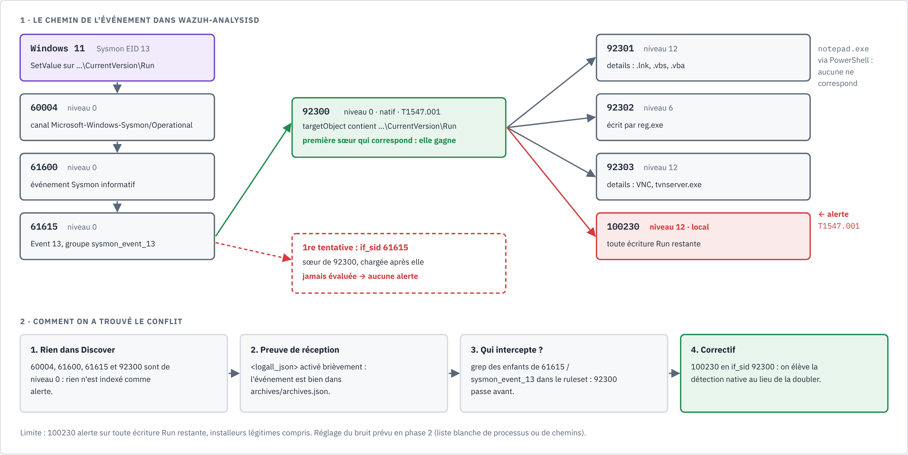
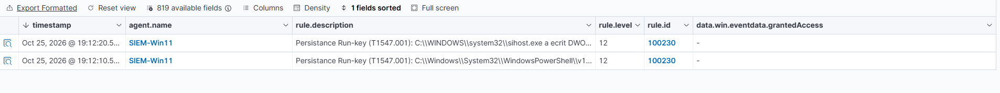

# Writeup 11 : persistance par clé Run, quand la règle native est muette

> Une valeur est ajoutée dans la clé Run de l'utilisateur sur Windows 11. Sysmon le voit
> (événement 13), Wazuh le reçoit et le reconnaît avec sa règle native **92300**… au niveau 0,
> donc sans alerte. Notre première règle locale ne se déclenchait jamais. Ce writeup raconte
> comment on l'a prouvé, pourquoi, et comment la règle **100230** élève la détection native au
> niveau 12. Fiche du scénario : [`docs/scenarios/persistance-run-key.md`](../scenarios/persistance-run-key.md).
>
> Versions : Wazuh 4.14.9, agent Windows 4.14.9, Sysmon v15.22 (configuration
> [`sysmon-lab.xml`](../../configs/agent-windows/sysmon-lab.xml)). Date : 2026-10-25.



*Source : [`persistance-run-key.html`](../diagrams/persistance-run-key.html).*

## 1. Comprendre

### 1.1 Qu'est-ce qu'une clé Run

Windows lance automatiquement, à chaque ouverture de session, les programmes listés dans
quelques clés de registre, dont :

| Clé | Portée | Droits pour écrire |
|---|---|---|
| `HKCU\Software\Microsoft\Windows\CurrentVersion\Run` | l'utilisateur courant | l'utilisateur lui-même, sans administration |
| `HKLM\Software\Microsoft\Windows\CurrentVersion\Run` | tous les utilisateurs | administrateur |

C'est un mécanisme légitime (messageries, utilitaires, pilotes d'imprimante s'y inscrivent).
C'est aussi l'une des techniques de **persistance** les plus répandues : un programme
malveillant s'y inscrit pour survivre au redémarrage. MITRE ATT&CK la nomme
**T1547.001** (Boot or Logon Autostart Execution: Registry Run Keys / Startup Folder).

### 1.2 Ce que voit Sysmon

L'événement Sysmon **13** (*RegistryEvent, Value Set*) est produit quand une valeur de registre
est écrite. Il donne :

| Champ Wazuh | Contenu |
|---|---|
| `win.eventdata.targetObject` | le chemin complet de la valeur écrite (`HKU\<SID>\Software\…\Run\<nom>`) |
| `win.eventdata.details` | la donnée écrite, ici le programme à lancer |
| `win.eventdata.image` | le processus qui a écrit (ici `powershell.exe`) |

Notre configuration Sysmon ne journalise que les écritures qui touchent `\CurrentVersion\Run`
(bloc `RegistryEvent onmatch="include"`), pour ne pas noyer le SIEM : le registre change sans
cesse.

### 1.3 L'arbre des règles Wazuh

Wazuh range ses règles en **arbre**. Un événement descend de parent en enfant tant qu'une règle
correspond ; l'alerte finale est celle de la règle la plus profonde atteinte. Pour un événement
Sysmon 13, le chemin natif est le suivant (vérifié dans le ruleset v4.14.0) :

| Règle | Fichier | Condition | Niveau |
|---|---|---|---|
| 60004 | `0575-win-base_rules.xml` | canal `Microsoft-Windows-Sysmon/Operational` | 0 |
| 61600 | `0595-win-sysmon_rules.xml` | événement informatif (enfant de 60004) | 0 |
| 61615 | `0595-win-sysmon_rules.xml` | `eventID` 13, ajoute le groupe `sysmon_event_13` | 0 |
| **92300** | `0860-sysmon_id_13.xml` | `if_group sysmon_event_13` + `targetObject` contient `…\CurrentVersion\Run` ; MITRE T1547.001 | **0** |
| 92301 | idem | enfant de 92300 : `details` contient `.lnk`, `.vbs` ou `.vba` | 12 |
| 92302 | idem | enfant de 92300 : écrit par `reg.exe` | 6 |
| 92303 | idem | enfant de 92300 : `details` contient `VNC` ou `tvnserver.exe` | 12 |

Lecture : Wazuh **sait** reconnaître une écriture Run (92300 porte même T1547.001), mais il la
laisse au **niveau 0**. Seules trois variantes jugées plus suspectes montent en alerte.

## 2. Le test

Sur la VM Windows 11 du lab (PowerShell de l'utilisateur, aucun droit d'administration
nécessaire), on ajoute une valeur inoffensive qui lance le Bloc-notes :

```powershell
New-ItemProperty -Path "HKCU:\Software\Microsoft\Windows\CurrentVersion\Run" -Name "LabTest" -Value "C:\Windows\System32\notepad.exe" -PropertyType String
```

Nettoyage après le test :

```powershell
Remove-ItemProperty -Path "HKCU:\Software\Microsoft\Windows\CurrentVersion\Run" -Name "LabTest"
```

*(Le nom `LabTest` est illustratif.)*

Aucune des règles 92301 à 92303 ne correspond : pas de `.lnk`/`.vbs`/`.vba`, pas de `reg.exe`,
pas de VNC. L'événement s'arrête donc à **92300, niveau 0** : rien dans le dashboard.

## 3. Le débogage : un événement invisible

### 3.1 Première tentative : une règle accrochée à 61615

La première règle locale était une enfant de **61615** (`<if_sid>61615</if_sid>`) avec un filtre
sur `targetObject`. Elle ne s'est **jamais** déclenchée.

### 3.2 Prouver que l'événement arrive

Problème : toute la chaîne native est de niveau 0. Le dashboard (*Discover*, *Threat Hunting*)
n'affiche que des **alertes**, donc rien ne montrait que l'événement arrivait.

L'outil pour trancher : l'**archivage** de tous les événements. Dans l'`ossec.conf` du manager,
dans `<global>` :

```xml
<logall_json>yes</logall_json>
```

puis redémarrage du manager. Wazuh écrit alors **chaque** événement reçu, alerte ou non, dans
`/var/ossec/logs/archives/archives.json`. On y a retrouvé l'événement Sysmon 13 : la collecte
fonctionnait, le problème était dans les règles.

> **À remettre à `no` après le diagnostic** : ce fichier grossit très vite (tous les
> événements de tous les agents). C'est un outil de débogage, pas un réglage permanent.

Autre outil pour la même question, sans toucher à la configuration : coller la ligne de
l'événement dans `wazuh-logtest`, qui affiche les trois phases (pré-décodage, décodage, règle
retenue) ; il aurait montré 92300.

### 3.3 Trouver qui intercepte

Recherche, dans le ruleset, de toutes les règles accrochées à 61615 ou à son groupe
`sysmon_event_13` : on tombe sur **92300**. Elle et notre première règle sont **sœurs** (même
parent). Ce qu'on a observé : quand plusieurs sœurs peuvent correspondre, **la première évaluée
gagne** et l'événement continue sous elle seule. Les fichiers natifs sont chargés avant
`local_rules.xml`, donc 92300 passait toujours avant notre règle (déduction sur l'ordre de
chargement, cohérente avec le comportement observé).

> **Leçon** : avant d'écrire une règle, chercher les règles natives qui partagent le même
> parent ou le même groupe. Une règle native de niveau 0 n'est pas « absente » : elle peut
> intercepter l'événement en silence.

## 4. Le correctif : étendre la native

Au lieu de doubler 92300, on s'accroche **sous** elle, comme le demandent les conventions du
projet (étendre par `if_sid` plutôt que redéfinir). Règle finale, en live et dans
[`configs/manager/local_rules.xml`](../../configs/manager/local_rules.xml) :

```xml
<group name="sysmon,windows,persistence,">
  <rule id="100230" level="12">
    <if_sid>92300</if_sid>
    <description>Persistance Run-key (T1547.001): $(win.eventdata.image) a ecrit $(win.eventdata.details) dans $(win.eventdata.targetObject)</description>
    <mitre><id>T1547.001</id></mitre>
  </rule>
</group>
```

- `<if_sid>92300</if_sid>` : seulement les écritures que la native a déjà reconnues comme Run.
- Pas de `<field>` : toute écriture Run qui n'est pas captée par une sœur plus précise monte au
  niveau 12.
- La description dit **qui** a écrit **quoi** et **où** : l'analyste a l'essentiel sans ouvrir
  l'événement.

Sœurs natives et 100230 : pour un `.vbs` ou une valeur VNC, c'est 92301 ou 92303 (chargées avant)
qui devraient l'emporter, avec leur propre niveau 12 ; pour une écriture par `reg.exe`, 92302
(niveau 6) l'emporterait sur 100230 (déduction par le même mécanisme, à valider).

Validation : `sudo /var/ossec/bin/wazuh-analysisd -t` puis `sudo systemctl restart wazuh-manager`.

## 5. Résultat

Nouvelle écriture dans la clé Run : la règle **100230** se déclenche au **niveau 12**, vérifiée
dans *Discover* et dans `/var/ossec/logs/alerts/alerts.json`.



*Capture 96 : deux alertes 100230 de niveau 12 sur SIEM-Win11, à dix secondes d'écart.*

| Heure | Processus écrivain | Cible | Verdict |
|---|---|---|---|
| 19:12:10 | `C:\Windows\System32\WindowsPowerShell\v1.0\powershell.exe` | `…\CurrentVersion\Run\WazuhLabTest5` (notre test) | **vrai positif** |
| 19:12:20 | `C:\WINDOWS\system32\sihost.exe` (écrit une valeur DWORD) | `…\CurrentVersion\RunNotification\…` | **faux positif** |

### 5.1 Pourquoi `RunNotification` déclenche

`sihost.exe` (Shell Infrastructure Host) est un processus normal de Windows. Il n'écrit pas
dans la clé Run, mais dans une clé **voisine** dont le nom commence par les mêmes lettres :
`RunNotification`. Deux filtres laissent passer ce nom, faute de borne après `Run` :

- le filtre Sysmon `TargetObject condition="contains"` `\CurrentVersion\Run` ;
- l'expression de la native 92300, qui se termine par `CURRENTVERSION\\\\(RUN|…)` sans `\\\\` ni
  fin de chaîne derrière (vérifié dans `0860-sysmon_id_13.xml`).

Le premier faux positif du scénario vient donc d'une expression régulière **trop ouverte**, pas
d'un comportement suspect. C'est un cas d'école de réglage.

## 6. Lecture de l'analyste SOC

1. **Qui a écrit ?** `win.eventdata.image` : un installeur signé dans `Program Files` n'a pas le
   même poids que `powershell.exe` ou un binaire dans `%TEMP%`.
2. **Quoi ?** `win.eventdata.details` : un chemin vers un programme connu, ou vers un script, un
   dossier utilisateur, un nom qui imite un composant Windows ?
3. **Où ?** `HKCU` (un seul utilisateur, pas besoin d'être administrateur) ou `HKLM` (tous les
   utilisateurs, droits administrateur : plus grave).
4. **Ensuite** : le programme visé existe-t-il, quel est son hash (VirusTotal,
   [scénario 3](09-scenario-fim-virustotal.md)), d'autres postes ont-ils la même valeur ?

## 7. Limite : le bruit

100230 alerte sur **toute** écriture Run qui reste après les sœurs natives, y compris celles
des installeurs légitimes. En production, ce serait bruyant. Pistes pour la phase 2
([roadmap](../roadmap.md)) :

- borner le nom de la clé : ajouter à 100230 un champ
  `<field name="win.eventdata.targetObject" type="pcre2">(?i)\\\\CURRENTVERSION\\\\RUN(ONCE)?\\\\</field>`
  (même échappement que 92300 : les valeurs Windows arrivent avec des `\\` doublés),
  qui exclut `RunNotification` (premier faux positif observé, capture 96 ; à valider avec
  `wazuh-logtest`, non appliqué) ;
- règle enfant de niveau 0 pour les processus ou chemins de confiance (liste blanche) ;
- ou, à l'inverse, ne garder au niveau 12 que les `details` suspects (dossiers utilisateur,
  `%TEMP%`, interpréteurs de scripts) et laisser le reste au niveau 3 pour l'historique.

Chaque exception devra être justifiée et testée, pour ne pas ouvrir d'angle mort.

## 8. Résultats dans notre lab

| Test | Attendu | Obtenu |
|---|---|---|
| Événement Sysmon 13 produit et collecté | présent dans les archives | ✅ vu dans `archives.json` (`logall_json`) |
| Règle native 92300 | reconnaît l'écriture Run | ✅ mais niveau 0 : aucune alerte |
| Sœurs natives 92301-92303 | ne correspondent pas (notepad via PowerShell) | ✅ aucune |
| 1re règle locale, enfant de 61615 | alerte | ❌ jamais évaluée (92300 passe avant) |
| Règle 100230, enfant de 92300 | niveau 12, T1547.001 | ✅ 19:12:10, PowerShell → `Run\WazuhLabTest5` (capture 96) |
| Faux positif | aucun pour un processus système | ❌ 19:12:20, `sihost.exe` → `RunNotification` (nom de clé non borné) |
| Bruit sur installeurs légitimes | à mesurer | ⏳ phase 2 |

Sources : voir la [fiche du scénario](../scenarios/persistance-run-key.md).
