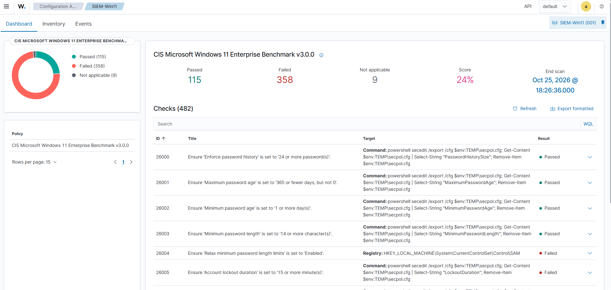

# Writeup 12 : mesurer le durcissement de Windows 11 avec le SCA (CIS)

> Changement de sujet : pas d'attaque cette fois. Le module SCA de Wazuh compare Windows 11
> au benchmark CIS et donne un score : **24 %**, normal pour un poste installé par défaut. On
> lit un check de bout en bout, on comprend son rattachement à sept référentiels, puis on joue
> la boucle du durcissement sur un check : mesurer, corriger, re-mesurer.
> Référence du module : [integrations/sca.md](../integrations/sca.md).
>
> Versions : Wazuh 4.14.9, agent SIEM-Win11, politique CIS Microsoft Windows 11 Enterprise
> Benchmark v3.0.0. Date : 2026-10-25.


*Source : [`sca-check-cis.html`](../diagrams/sca-check-cis.html).*

## 1. Comprendre

### 1.1 Détecter ou prévenir

Les scénarios 1 à 5 répondaient à « **que se passe-t-il ?** » (une attaque est-elle en cours ?).
Le SCA répond à « **à quel point sommes-nous exposés ?** ». C'est l'autre moitié du métier :
la **posture**. Un brute force (scénario 1) réussit plus vite contre des mots de passe courts ;
le SCA signale ces mots de passe courts **avant** l'attaque.

### 1.2 CIS, benchmark, politique

- Le **CIS** (Center for Internet Security) publie des **benchmarks** : des centaines de
  réglages recommandés par système, avec justification et procédure.
- Wazuh traduit chaque benchmark en **politique SCA** (fichier YAML) : un **check** par
  recommandation automatisable.
- L'agent exécute les checks localement, dans `wazuh-modulesd`, au démarrage puis toutes les
  12 heures (défauts de la documentation).

## 2. Ce qu'on a trouvé sur l'agent

Rien n'a été configuré : le module est actif par défaut et a choisi la politique Windows 11.

| Mesure | Valeur |
|---|---|
| Politique | CIS Microsoft Windows 11 Enterprise Benchmark v3.0.0 |
| Checks | 482 |
| Réussis | 115 |
| Échoués | 358 |
| Non applicables | 9 |
| Score | **24 %** (réussis / (réussis + échoués)) |

*Relevé du scan terminé à 18:26:36 (capture 95), où le check 26003 est déjà corrigé (§ 4).
Avant la correction, le décompte était donc vraisemblablement de 114 réussis et 359 échoués,
score toujours 24 % (déduit, relevé initial non capturé).*



*Capture 95 : tableau de bord SCA de l'agent SIEM-Win11 ; la colonne Target montre la commande
de chaque check, 26003 est Passed.*

Un score bas n'est pas une anomalie : un Windows installé par défaut privilégie la
compatibilité, et le benchmark vise un poste d'entreprise durci. Le score sert de **ligne de
base** : ce qui compte, c'est sa progression.

## 3. Lire un check : 26003

Le check **26003** (CIS 1.1.4) : *Ensure 'Minimum password length' is set to '14 or more
character(s)'*.

| Champ (dashboard) | Contenu | Ce qu'il apporte |
|---|---|---|
| Target / règle | `powershell secedit /export /cfg … \| Select-String "MinimumPasswordLength"` | **comment** l'agent mesure : il exporte la stratégie de sécurité locale et lit la valeur |
| Check condition | `MinimumPasswordLength = (\d+) compare >= 14` | **le seuil** : le nombre lu doit être au moins 14 |
| Result | Failed, puis Passed (voir § 4) | l'état |
| Rationale | attaques par dictionnaire et force brute | **pourquoi** c'est important |
| Remediation | GPO *Account Policies > Password Policy > Minimum password length* | **comment** corriger |
| Compliance | CIS 1.1.4 ; CIS Controls v8 5.2, v7 4.4 et 16.2 ; PCI DSS v4.0 2.2.2, 8.3.5, 8.3.6, 8.6.3 ; ISO 27001:2013 A.9.4.3 ; SOC 2 CC6.1 ; CMMC v2.0 IA.L2-3.5.7 | **à quoi** ça répond |

La ligne *Compliance* est la plus précieuse pour un SOC qui travaille avec des auditeurs : un
seul réglage, sept exigences. Corriger ce check fait avancer PCI DSS, ISO 27001 et SOC 2 en
même temps, et le dashboard en garde la preuve. Le détail du format YAML est dans
[integrations/sca.md](../integrations/sca.md#3-anatomie-dun-check).

## 4. La boucle de durcissement

Sur Windows 11, en PowerShell administrateur :

```powershell
net accounts /minpwlen:14        # corriger : longueur minimale à 14 caractères
Restart-Service WazuhSvc         # re-mesurer : scan_on_start relance un scan SCA
Get-Service WazuhSvc             # vérifier que l'agent est bien reparti (Running)
```

Résultat dans *Configuration Assessment* : le check **26003 passe de Failed à Passed** et le
score gagne un check. Le cycle complet tient en quelques minutes :

1. **Mesurer** : le scan dit ce qui ne va pas, avec la preuve (la valeur lue).
2. **Corriger** : un réglage, ici une commande ; en entreprise, une GPO.
3. **Re-mesurer** : un nouveau scan, sans attendre les 12 heures grâce à `scan_on_start`.
4. **Prouver** : le changement d'état est enregistré et horodaté.

> Dans le lab, la correction est locale (`net accounts`). En entreprise, elle passerait par la
> GPO de domaine indiquée dans la remédiation, pour s'appliquer à tous les postes et ne pas être
> écrasée.

## 5. Ce qu'on retient

- **Le SCA ne corrige rien** : il mesure et documente. La remédiation reste un acte humain ou
  automatisé ailleurs (GPO, script, outil de gestion de configuration).
- **Un score se pilote** : on trie les 358 échecs par impact et par référentiel, on corrige par
  lots, on suit la courbe.
- **Lien avec la détection** : plusieurs échecs CIS correspondent aux faiblesses exploitées dans
  nos scénarios (politique de mots de passe et brute force du scénario 1). Croiser posture et
  alertes est une bonne piste pour la phase 2.
- **Limites** : politique écrite pour un système en anglais (notre Windows est en français),
  benchmark *Enterprise* sur un poste hors domaine (voir [integrations/sca.md](../integrations/sca.md#6-limites)).

## 6. Résultats dans notre lab

| Test | Attendu | Obtenu |
|---|---|---|
| Module SCA actif sans configuration | oui | ✅ politique CIS Windows 11 v3.0.0 appliquée |
| Score initial d'un Windows 11 par défaut | bas | ✅ 24 % sur 482 checks (capture 95, après correction : 115 réussis, 358 échoués, 9 non applicables) |
| Lecture d'un check (26003) | cible, condition, remédiation, conformité | ✅ sept référentiels rattachés |
| Correction `net accounts /minpwlen:14` puis redémarrage de l'agent | 26003 Failed → Passed | ✅ 26003 Passed (capture 95) |
| Correction à grande échelle (GPO) | — | hors périmètre (poste hors domaine) |

Sources : voir [integrations/sca.md](../integrations/sca.md) et [docs/sources.md](../sources.md).
