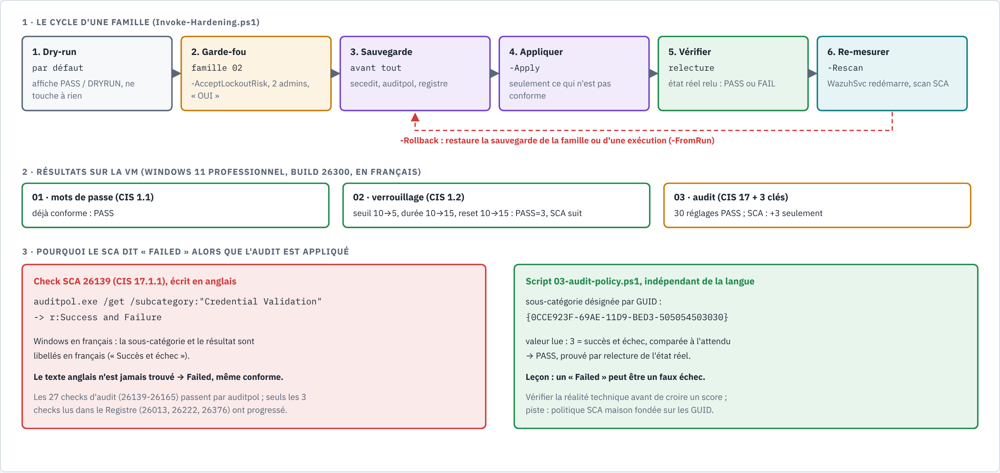

# Writeup 13 : durcissement CIS automatisé, et le jour où le score a menti

> Après la mesure (writeup 12), la correction. Une boîte à outils PowerShell applique le
> benchmark CIS de Windows 11 par **familles**, avec dry-run, sauvegarde, garde-fou, vérification
> et retour arrière, puis relance le scan SCA. Validée sur la VM le 2026-10-25, retour arrière
> validé le 2026-10-28. Résultat
> inattendu et instructif : des réglages d'audit **bien appliqués** restent « Failed » dans le
> SCA, parce que le check cherche un texte anglais sur un Windows français.
>
> Code : [`scripts/hardening/`](../../scripts/hardening/README.md) (PR #1). Versions : Wazuh
> 4.14.9, Windows 11 Professionnel build 26300 en français (DESKTOP-A2AMF2E, agent SIEM-Win11),
> politique CIS Microsoft Windows 11 Enterprise Benchmark v3.0.0.



*Source : [`durcissement-cis.html`](../diagrams/durcissement-cis.html).*

## 1. Comprendre

### 1.1 Mesurer ne suffit pas

Le SCA a dit : 358 checks en échec. Les corriger un par un à la main, comme le check 26003 du
writeup 12, ne passe pas à l'échelle et ne laisse pas de trace. En entreprise, on corrige avec
des **GPO** ou un outil de gestion de configuration. Dans le lab, hors domaine, on écrit des
scripts qui se comportent comme tels : reproductibles, réversibles, et qui **prouvent** ce
qu'ils ont fait.

### 1.2 Pourquoi par familles

Les réglages CIS n'ont pas tous le même risque. Changer la longueur des mots de passe ne casse
rien ; activer le **verrouillage de comptes** peut enfermer l'administrateur hors de sa propre
machine. Chaque famille a donc son propre niveau de risque et ses propres garde-fous :

| Famille | Section CIS | Contenu | Risque |
|---|---|---|---|
| 01 | 1.1 | politique de mots de passe | faible |
| 02 | 1.2 | verrouillage de comptes | **élevé** (garde-fou) |
| 03 | 17, plus 2.3.2.1, 18.9.3.1, 18.10.25.2.2 | stratégie d'audit avancé, ligne de commande dans 4688, taille du journal Security | faible |

Chaque réglage est décrit comme une **donnée** (référence CIS, id du check SCA Wazuh, valeur
attendue, opérateur repris du check) ; un moteur commun (`HardeningLib.psm1`) lit, compare,
sauvegarde, applique, vérifie et restaure.

## 2. Le cycle d'une exécution

| Étape | Ce qui se passe | Pourquoi |
|---|---|---|
| 1. Dry-run | mode par défaut : tableau `PASS` (déjà conforme) ou `DRYRUN` (serait modifié) | voir avant d'agir |
| 2. Garde-fou | famille 02 seulement : `-AcceptLockoutRisk`, deux administrateurs locaux actifs, procédure de déverrouillage affichée, saisie de `OUI` | ne pas s'enfermer dehors |
| 3. Sauvegarde | `secedit`, `auditpol /backup`, registre, avant toute modification ; arrêt si elle échoue | pouvoir revenir en arrière |
| 4. Appliquer | seulement les réglages non conformes (idempotent) | ne rien toucher inutilement |
| 5. Vérifier | relecture de l'état réel, pas des codes de retour : `PASS` ou `FAIL` | une preuve, pas une promesse |
| 6. Re-mesurer | `-Rescan` redémarre `WazuhSvc`, le SCA rescanne au démarrage, le script vérifie que l'agent tourne | boucler avec le SIEM |
| Retour arrière | `-Rollback` par famille, ou `-FromRun` pour annuler une exécution précise | réversibilité |

Chaque exécution laisse un dossier `C:\ProgramData\SIEM-Hardening\runs\<horodatage>\` avec
journal, rapport (`report.md`, `report.csv`) et sauvegardes. Aucun secret dedans.

## 3. Le garde-fou du verrouillage, en vrai

Avant la famille 02, un **compte de secours** administrateur a été créé sur la VM
(`admin-secours`, mot de passe saisi masqué avec `Read-Host -AsSecureString`, jamais écrit dans
le dépôt). Puis :

```powershell
.\Invoke-Hardening.ps1 -Families 02 -Apply -Rescan -AcceptLockoutRisk
```

Ce que montre la sortie (extraits) :

```
[INFO] Administrateurs locaux activés : admin-secours, analyste
================ AVANT D'APPLIQUER : PROCÉDURE DE DÉVERROUILLAGE ================
    net user analyste /active:yes        # réactive le compte
    net accounts /lockoutthreshold:0     # désactive le verrouillage (retour lab)
Tapez OUI (en majuscules) pour appliquer le verrouillage de comptes: OUI
[OK] [1.2.2] Seuil de verrouillage : PASS (5)
[OK] [1.2.4] Réinitialisation du compteur (minutes) : PASS (15)
[OK] [1.2.1] Durée de verrouillage (minutes) : PASS (15)
```

| CIS | Check SCA | Réglage | Avant | Après | Statut |
|---|---|---|---|---|---|
| 1.2.2 | 26006 | seuil de verrouillage | 10 | 5 | PASS |
| 1.2.4 | 26007 | réinitialisation du compteur (minutes) | 10 | 15 | PASS |
| 1.2.1 | 26005 | durée de verrouillage (minutes) | 10 | 15 | PASS |

La famille 02 a ensuite été **annulée** avec `-Rollback`. Le premier essai a échoué sur la
restauration du Registre (« Exists introuvable ») : sous Windows PowerShell 5.1,
`ConvertFrom-Json` renvoie un tableau JSON comme **un seul objet**, et `@(... | ConvertFrom-Json)`
sur un fichier `[]` produisait un tableau contenant un tableau vide (comportement observé dans le
lab). Correctif (PR #2) : désérialiser d'abord, forcer le tableau ensuite.

```powershell
$savedRegistry = Get-Content $regFile -Raw | ConvertFrom-Json
foreach ($r in @($savedRegistry)) { ... }
```

Rejoué le **2026-10-28 à 19:09** : bilan `ROLLBACK=3`, aucune `ERROR`, verrouillage revenu à
10 / 10 / 10. Le cycle complet **dry-run → apply → rollback** est donc validé sur la vraie VM.
Leçon : un retour arrière se **teste** ; tant qu'il n'a pas tourné, ce n'est qu'une promesse. Si on la réapplique, le
compte visé par le scénario 1 (brute force SMB) sera verrouillé au 5e échec : c'est l'effet
recherché en production, et l'événement 4740 deviendrait une détection de plus.

### 3.1 Au passage : la protection LSA était déjà là

Constat de configuration, hors familles CIS actuelles : la protection LSA (LSASS en processus
protégé, PPL) était **déjà active par défaut** sur ce Windows 11. Preuve : événement System 12 de
Wininit, « LSASS.exe a démarré en tant que processus protégé avec le niveau : 4 », présent dès le
2026-10-22. Cohérent avec la documentation Microsoft (activée par défaut sur une nouvelle
installation de Windows 11 22H2 ou ultérieur) :
https://learn.microsoft.com/en-us/windows-server/security/credentials-protection-and-management/configuring-additional-lsa-protection.

## 4. Le finding : un faux « Failed » dû à la langue

### 4.1 Le constat

Famille 03 appliquée : **30 réglages**, tous vérifiés `PASS` par le script. Dans le SCA, seuls
progressent les checks que la politique lit dans le **Registre** (26013 pour 2.3.2.1, 26222 pour
18.9.3.1, 26376 pour 18.10.25.2.2). Les checks d'audit 17.x restent « Failed ».

Score relevé après les familles 01 et 03 : **122 réussis, 351 échoués, 25 %** (contre 115 / 358,
24 % au writeup 12). Le détail des 7 checks gagnés n'a pas été relevé : les 3 checks Registre
ci-dessus en font partie, les 4 autres sont à identifier dans le dashboard.

### 4.2 L'explication

Les 27 checks d'audit de la politique (26139 à 26165, vérifié dans `cis_win11_enterprise.yml`
v4.14.0) ont tous la même forme :

```yaml
- 'c:auditpol.exe /get /subcategory:"Credential Validation" -> r:Success and Failure'
```

Ils interrogent `auditpol` avec le **nom anglais** de la sous-catégorie et cherchent le texte
anglais `Success and Failure`. Sur notre Windows **français**, les noms et la sortie sont
traduits (« Succès et échec ») : le motif n'est jamais trouvé, le check échoue, que l'audit soit
conforme ou non. La politique le dit d'ailleurs dans sa description : elle est écrite pour un
système en anglais et ses résultats sont moins précis dans une autre langue.

Le script, lui, désigne chaque sous-catégorie par son **GUID** (par exemple
`{0CCE923F-69AE-11D9-BED3-505054503030}` pour *Credential Validation*), identique dans toutes
les langues, et lit la valeur numérique (3 = succès et échec). C'est pourquoi il voit `PASS`
là où le SCA voit `Failed`.

Contre-exemple attendu : les checks de la famille 02 (26005 à 26007) lisent `secedit` et
comparent des **nombres** (`LockoutBadCount`, `LockoutDuration`, `ResetLockoutCount`, vérifié
dans la politique), sans texte traduit : ils ne devraient pas souffrir de la langue. Non mesuré
isolément dans le lab : la famille 02 a été annulée (rollback) avant un scan SCA dédié.

### 4.3 Comment l'appeler

Du point de vue de la conformité, c'est une **non-conformité signalée à tort** : un faux
« Failed ». Selon qu'on parle du constat (« écart trouvé ») ou du contrôle (« réglage conforme »),
on dira faux positif d'écart ou faux négatif du check. L'important est le fond : **le score
sous-estime la conformité réelle**.

### 4.4 La leçon

> Un score d'outil est une **mesure**, pas la vérité. Avant de conclure qu'un poste est non
> conforme, se demander comment le check mesure et si ses hypothèses (ici la langue) tiennent
> dans notre environnement. Puis vérifier la réalité technique par un autre moyen.

C'est une leçon de GRC autant que de SOC : présenter à un auditeur une vingtaine d'écarts d'audit qui
n'existent pas, ou au contraire « corriger » le score en contournant le check, seraient deux
erreurs. La bonne réponse : documenter le faux échec, prouver l'état réel (rapport du script,
`auditpol /get /subcategory:"{GUID}"`), et corriger l'**instrument**.

Pistes, pour la phase 2 :

- une **politique SCA maison** dont les checks d'audit interrogent `auditpol` par GUID (et donc
  activer l'exécution de commandes pour les politiques personnalisées sur l'agent, à valider) ;
- ou un système de lab en anglais pour comparer.

## 5. Bénéfice pour la détection

La famille 03 n'est pas que de la conformité : elle **ajoute de la télémétrie**. L'audit de la
création de processus (CIS 17.3.2) avec la **ligne de commande dans l'événement 4688**
(CIS 18.9.3.1) donne au journal Security une vue des processus lancés. Elle comble en partie ce
que la configuration Sysmon minimale du lab ne journalise plus (voir
[Windows et Sysmon](../integrations/windows-logs-sysmon.md)). Contrepartie à surveiller : plus
de volume vers le manager, et une ligne de commande peut contenir un secret tapé en clair.

## 6. Résultats dans notre lab

| Famille | Mode | Résultat du script | Effet dans le SCA | Remarques |
|---|---|---|---|---|
| Toutes | dry-run | bilan `PASS` / `DRYRUN` | — | rien de modifié |
| 01 mots de passe | `-Apply -Rescan` | déjà conforme : PASS | inchangé | 1.1.4 corrigé auparavant à la main (writeup 12) |
| 03 audit | `-Apply -Rescan` | 30 réglages PASS | cumul 01 + 03 : 122 réussis / 351 échoués, **25 %** ; dont les 3 checks Registre (26013, 26222, 26376) | checks 17.x restés Failed : faux échec dû à la langue |
| 02 verrouillage | `-Apply -Rescan -AcceptLockoutRisk` | PASS=3 (seuil 5, durée 15, reset 15) | non mesuré isolément | compte de secours `admin-secours` ; procédure de déverrouillage affichée ; `OUI` exigé |
| Rollback famille 02, 1er essai | `-Rollback` | erreur « Exists introuvable » (PowerShell 5.1) | — | corrigé par la PR #2 |
| Rollback famille 02, 2026-10-28 19:09 | `-Rollback` | `ROLLBACK=3`, aucune `ERROR` ; verrouillage revenu à 10 / 10 / 10 | — | cycle dry-run → apply → rollback validé ; état actuel : familles 01 et 03 appliquées, 02 annulée |

Sources : [`scripts/hardening/README.md`](../../scripts/hardening/README.md),
[integrations/sca.md](../integrations/sca.md), [docs/sources.md](../sources.md).
