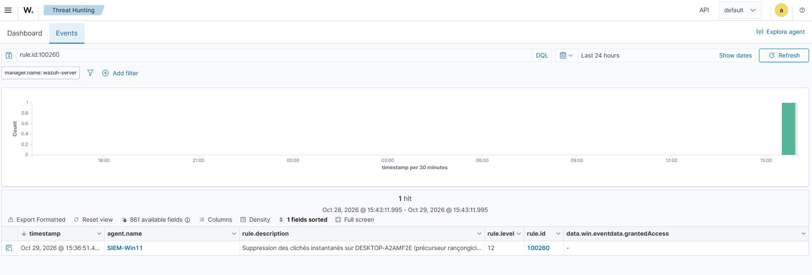

# Writeup 19 : suppression des clichés instantanés, le geste qui précède le rançongiciel (T1490)

> Scénario 8, joué le 2026-10-29. Sur Windows 11, un compte administrateur lance
> `vssadmin delete shadows /all /quiet`, la commande que la plupart des rançongiciels exécutent
> juste avant de chiffrer. **Aucune règle native de Wazuh ne la signale** : on écrit la règle
> locale **100260** (niveau 12), qui ouvre la tactique **Impact** dans la couverture du lab.
>
> Versions : Wazuh 4.14.9, Windows 11 en français (agent SIEM-Win11), Sysmon v15.22.

## 1. Comprendre

### 1.1 Les clichés instantanés

Le service **VSS** (Volume Shadow Copy Service) prend des « photos » du disque : points de
restauration, versions précédentes des fichiers, cohérence des sauvegardes. Pour une victime
de rançongiciel, c'est souvent **le dernier moyen de récupérer ses fichiers sans payer**.

### 1.2 Pourquoi l'attaquant les efface

Avant de chiffrer, le rançongiciel supprime ces copies pour rendre la restauration impossible.
MITRE ATT&CK : **T1490** *Inhibit System Recovery*, tactique **Impact** (TA0040). La fiche
cite notamment `vssadmin.exe delete shadows /all /quiet` et `wmic shadowcopy delete` ;
`vssadmin resize shadowstorage` est une variante documentée par les éditeurs (supposé, non
vérifié dans la fiche).
Source : https://attack.mitre.org/techniques/T1490/

Point clé pour un analyste : cette commande arrive **avant** le chiffrement. La détecter, c'est
avoir une chance d'isoler le poste à temps.

## 2. Existe-t-il déjà une règle ?

Avant d'écrire une règle, on cherche dans le ruleset livré (VM Wazuh) :

```bash
sudo grep -rn -i "delete.\{0,20\}shadow\|shadowcopy.\{0,20\}delete\|vssadmin" \
  /var/ossec/ruleset/rules/ | grep -v 0585
```

Résultat : **vide** (vérifié le 2026-10-29). Les seules correspondances sur « shadow » ou
« vssadmin » sont dans `0585-win-application_rules.xml`, qui décrit des **erreurs** du service
VSS (« VssAdmin: Unable to create a shadow copy », « service disabled »…) lues dans le journal
*Application*. Deux raisons pour lesquelles elles ne conviennent pas :

| | Règles 0585 | Ce qu'on veut |
|---|---|---|
| Événement | une panne de VSS | une suppression **réussie** |
| Source | journal Application, écrit par le service | création de processus (Sysmon EID 1) avec la ligne de commande |

Une suppression réussie ne produit aucune erreur VSS : sans règle locale, ce précurseur de
rançongiciel passe **en silence** dans une installation Wazuh par défaut.

## 3. Télémétrie

| Élément | Rôle |
|---|---|
| Sysmon EID 1 | création de processus : `image`, `commandLine`, `user`, `parentImage` |
| Règle native **61603** | regroupe les EID 1 au niveau 0 (enregistré, pas d'alerte) |
| 4688 avec ligne de commande | doublon côté journal Security, activé par la famille 03 ([writeup 13](13-durcissement-cis-automatise.md)) ; non utilisé par la règle |

## 4. La règle locale 100260

```xml
<rule id="100260" level="12">
  <if_sid>61603</if_sid>
  <field name="win.eventdata.commandLine" type="pcre2">(?i)vssadmin.*(delete\s+shadows|resize\s+shadowstorage)|shadowcopy.*delete|win32_shadowcopy</field>
  <description>Suppression des clichés instantanés sur $(win.system.computer) (précurseur rançongiciel)</description>
  <mitre>
    <id>T1490</id>
  </mitre>
</rule>
```

- **Fille de 61603** : elle n'est évaluée que sur les créations de processus Sysmon.
- **Sur la ligne de commande, pas sur l'exécutable** : `vssadmin list shadows` est légitime,
  seule la suppression nous intéresse. Les trois autres motifs couvrent les variantes connues
  (`resize shadowstorage` qui réduit l'espace à zéro et efface de fait, `wmic`, PowerShell
  via la classe WMI `Win32_ShadowCopy`).
- **Niveau 12** : sur un poste utilisateur, cette commande n'a presque aucune raison légitime.

Ajout en live : sauvegarde de `local_rules.xml`, ajout avec `tee -a`,
`wazuh-analysisd -t` sans erreur, redémarrage du manager, état `active`. Règle versionnée dans
[`configs/manager/local_rules.xml`](../../configs/manager/local_rules.xml).

## 5. Le test

Sur la VM Win11, PowerShell administrateur (après un snapshot VMware) :

```powershell
hostname; vssadmin list shadows; vssadmin delete shadows /all /quiet
```

Sortie : `DESKTOP-A2AMF2E`, puis deux fois « Il n'existe aucun élément correspondant à la
requête » : la VM n'avait **aucun cliché**. Ce n'est pas un problème pour le test : la règle
détecte **l'intention** (la commande lancée), pas son résultat. Un attaquant sur un poste qui
a des clichés produit exactement le même événement.

## 6. Résultat

Dans le dashboard (*Threat Hunting*, requête `rule.id:100260`, dernières 24 h) : **un seul hit**,
l'alerte du test, et aucune autre sur la journée. La règle n'a pas de faux positif connu.



*L'horodatage du dashboard est en heure locale (UTC+1), alors que `alerts.json` est en UTC.*

Détail de l'alerte, lu dans `/var/ossec/logs/alerts/alerts.json` :

| Champ | Valeur |
|---|---|
| `timestamp` | 2026-10-29T14:36:51.486+0000 |
| `rule.id` / `rule.level` | **100260** / **12** |
| `rule.description` | Suppression des clichés instantanés sur DESKTOP-A2AMF2E (précurseur rançongiciel) |
| `win.eventdata.image` | `C:\Windows\System32\vssadmin.exe` |
| `win.eventdata.commandLine` | `"C:\WINDOWS\system32\vssadmin.exe" delete shadows /all /quiet` |
| `win.eventdata.user` | `DESKTOP-A2AMF2E\analyste` |

Délai commande → alerte : quelques secondes. La règle s'est déclenchée du premier coup : aucune
règle native sœur sous 61603 n'a intercepté l'événement avant elle (piège rencontré au
[writeup 11](11-scenario-persistance-run-key.md)).

## 7. Limites et suites

- **Une seule source.** Si Sysmon est arrêté (ce que fait aussi un attaquant), la règle se tait.
  Une règle jumelle sous le 4688 du journal Security fermerait ce trou (à faire).
- **Contournements.** Un outil qui appelle l'API VSS directement, sans `vssadmin`, `wmic` ni
  PowerShell, échappe à une détection par ligne de commande. D'autres gestes de T1490
  (`bcdedit /set recoveryenabled no`, `wbadmin delete catalog`) ne sont pas encore couverts.
- **Réponse.** En production, ce niveau 12 mériterait une réponse active (isolement du poste),
  comme au [writeup 07](07-regles-et-reponse-active.md).

## 8. Lien SOC

Côté analyste, cette alerte se trie en priorité haute : qui (`user`), depuis quel parent
(`parentImage`), et y a-t-il eu, juste avant, un accès initial ou un mouvement latéral sur le
même poste ? Dans le lab, la chaîne T1110 → T1078 → T1021.002 → **T1490** raconte un
incident rançongiciel complet, vu par le SIEM à chaque étape.
