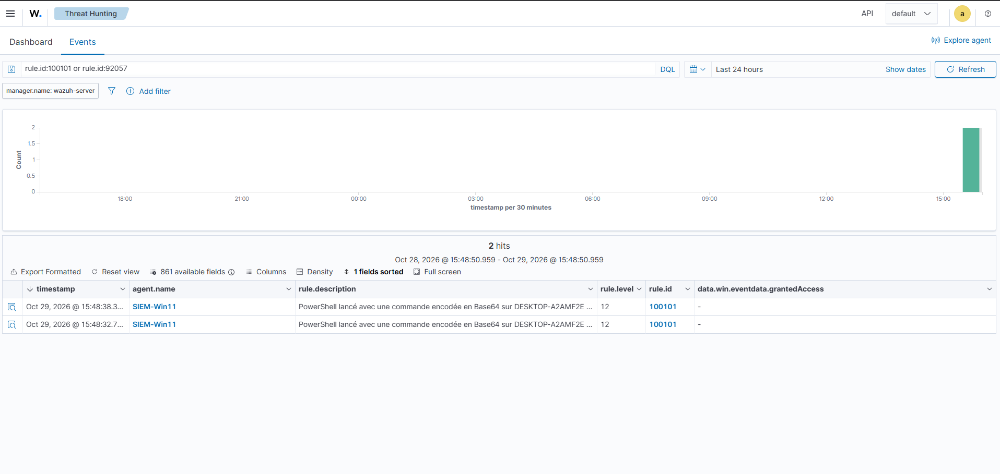

# Writeup 20 : PowerShell encodé, et la règle locale qui rendait les natives aveugles (T1059.001)

> Scénario 9, joué le 2026-10-29. Un PowerShell lancé avec une commande encodée en Base64
> (`-enc`), une fois depuis `cmd.exe`, une fois depuis PowerShell. Trois constats : les règles
> natives ne couvrent que certains parents ; Sysmon perd parfois le parent ; et surtout, **notre
> ancienne règle locale 100100 masquait les détections natives**. Résultat : 100100 supprimée,
> nouvelle règle **100101** (niveau 12), tactique **Execution** couverte.
>
> Versions : Wazuh 4.14.9, Windows 11 en français (agent SIEM-Win11), Sysmon v15.22.

## 1. Comprendre

`powershell.exe -EncodedCommand <Base64>` exécute un script passé en Base64 (UTF-16LE). Usage
légitime : éviter les problèmes de guillemets. Usage offensif : **cacher le contenu** de la
commande aux yeux d'un humain ou d'un filtre naïf. C'est le lanceur classique d'une macro
piégée (`cmd /c powershell -nop -w hidden -enc …`).

MITRE ATT&CK : **T1059.001** *Command and Scripting Interpreter: PowerShell* (Execution,
TA0002), et **T1027** *Obfuscated Files or Information* pour l'encodage.
Sources : https://attack.mitre.org/techniques/T1059/001/, https://attack.mitre.org/techniques/T1027/

PowerShell accepte toute abréviation non ambiguë du paramètre : `-e`, `-ec`, `-en`, `-enc`,
`-EncodedCommand`… Une détection sur la chaîne exacte `-EncodedCommand` est donc contournée
d'office.

## 2. Ce que Wazuh fournit déjà

Recherche dans `0800-sysmon_id_1.xml` (ruleset 4.14, vérifié le 2026-10-29) :

| Règle | Niveau | Condition | Angle mort |
|---|---|---|---|
| **92057** | 12 | commande encodée **et** `parentImage` = `powershell.exe` | lancé par `cmd.exe`, une macro, l'Explorateur |
| **92071** | 12 | commande encodée, enfant de 92070 (parent **WMI**) | idem |
| 92059 | 14 | `sdbinst.exe` dont le *parent* est un PowerShell encodé | cas très particulier |

Leçon de méthode : le premier `grep` ne montrait que la ligne de la condition sur la ligne de
commande. Il a fallu afficher les règles **en entier** (`sed -n`) pour voir la seconde condition,
celle sur le parent. Une règle ne se déclenche que si **toutes** ses conditions sont vraies.

## 3. La règle 100101 (première version)

Fille de notre ancienne 100100 (« tout PowerShell »), condition sur la ligne de commande :
un paramètre `-e…` **suivi d'un vrai bloc Base64** (16 caractères ou plus).

```
(?i)\s[-/]e(c|n\w*|a)?\s+[A-Za-z0-9+/=]{16,}
```

Exiger le bloc évite les faux positifs sur `-ExecutionPolicy Bypass` (testé hors ligne : correspond
à `-enc`, `-e`, `-EncodedCommand` ; ignore `-ExecutionPolicy`, `-Command`).

## 4. Le test

Commande encodée inoffensive : `Write-Output 'lab-scenario9'` en UTF-16LE, Base64
`VwByAGkAdABlAC0ATwB1AHQAcAB1AHQAIAAnAGwAYQBiAC0AcwBjAGUAbgBhAHIAaQBvADkAJwA=`.

```powershell
hostname
cmd /c "powershell -NoProfile -enc VwByAGkA…"   # A : parent cmd.exe
powershell -NoProfile -enc VwByAGkA…            # B : parent powershell.exe
```

Attendu : A → 100101 (trou des natives), B → 92057 (native).



## 5. Deux surprises

Alertes lues dans `alerts.json` (UTC) :

| Heure | Test | Parent | Règle |
|---|---|---|---|
| 14:48:32 | A | `cmd.exe` | **100101** (12) ✅ |
| 14:48:38 | B | *(absent)* | **100101** (12) |
| 14:51:00 | B, nouvelle fenêtre | `powershell.exe` | **100101** (12) ❌ 92057 attendue |

Chaque lancement produit aussi une **67027** (niveau 3) : le même processus vu par l'événement
4688 du journal Security. Doublon normal, deux capteurs.

### 5.1 Sysmon ne connaissait pas le parent

Pour 14:48:38, l'événement Sysmon contient `parentProcessId = 9376` mais
`parentProcessGuid = {00000000-0000-0000-0000-000000000000}` et **aucun** `parentImage`. Sysmon
n'avait pas vu naître la fenêtre PowerShell 9376 (hypothèse : ouverte avant un redémarrage ou
une recharge de Sysmon). Conséquence : **toute règle qui dépend du parent devient aveugle**, 92057
comprise. La 100101, qui ne regarde que la ligne de commande, a tenu.

### 5.2 Notre 100100 masquait les natives

Rejoué depuis une fenêtre neuve (14:51:00), le parent est bien `powershell.exe`, toutes les
conditions de 92057 sont remplies… et c'est encore notre règle qui sort.

Explication : sous 61603, les règles sœurs sont essayées dans un ordre donné et **la première
qui correspond gagne** ; l'analyse descend ensuite dans *ses* filles, jamais dans les sœurs
(même piège qu'au [writeup 11](11-scenario-persistance-run-key.md)). La 100100 (« image =
powershell.exe », sans autre condition) était essayée **avant** 92057. Elle prenait donc
**tous** les lancements de PowerShell, et toutes les natives de `0800-sysmon_id_1.xml` qui visent
un PowerShell lancé (déduit : pas testé une par une) ne pouvaient plus se déclencher.

Une règle « large » ajoutée pour voir quelque chose (writeup 04, 9 alertes sur de l'activité
normale) coûtait en réalité de la détection. C'est le constat le plus utile du scénario.

## 6. Correction

1. **Suppression de 100100** (sauvegarde de `local_rules.xml`, suppression du groupe par script
   avec garde-fou, `wazuh-analysisd -t`, redémarrage, `active`).
2. **100101 devient fille directe de 61603**, avec la condition d'image intégrée (PowerShell 5
   et 7) :

```xml
<rule id="100101" level="12">
  <if_sid>61603</if_sid>
  <field name="win.eventdata.image" type="pcre2">(?i)\\(powershell|pwsh)\.exe$</field>
  <field name="win.eventdata.commandLine" type="pcre2">(?i)\s[-/]e(c|n\w*|a)?\s+[A-Za-z0-9+/=]{16,}</field>
  <description>PowerShell lancé avec une commande encodée en Base64 sur $(win.system.computer) (parent : $(win.eventdata.parentImage))</description>
  <mitre>
    <id>T1059.001</id>
    <id>T1027</id>
  </mitre>
</rule>
```

Contre-test (14:53) :

| Heure | Parent | Règle |
|---|---|---|
| 14:53:13 | `cmd.exe` | **100101** (12) ✅ |
| 14:53:18 | `powershell.exe` | **100101** (12) |

La 100101, sœur de 92057, passe **encore** devant elle. Constat (vérifié deux fois, avec 100100
puis 100101) : dans ce manager, une règle locale sous 61603 est essayée avant la native 92057.
On l'accepte ici parce que :

- la 100101 couvre le cas de 92057 (même famille de paramètres, même niveau 12, même technique),
  et affiche le parent dans sa description ;
- elle est **étroite** (PowerShell + `-e…` + bloc Base64) : elle ne masque 92057 que sur les
  événements qu'elle signale elle-même, alors que la 100100 masquait tout PowerShell.

Règle de conception retenue : **une règle locale sous une règle de base partagée (61603) doit
être aussi étroite que possible**, sinon elle éteint les natives sœurs.

Versionné dans [`configs/manager/local_rules.xml`](../../configs/manager/local_rules.xml).

## 7. Limites et suites

- **Ordre d'évaluation non documenté ici.** Le constat « locale avant native » est observé, pas
  tiré de la documentation Wazuh. À vérifier avant de généraliser.
- **Natives libérées non testées.** On déduit que la suppression de 100100 rend la main aux
  autres natives PowerShell de `0800-sysmon_id_1.xml` ; aucun test individuel n'a été fait.
- **Contournements.** `-enc` caché derrière une variable d'environnement, PowerShell chargé dans
  un autre processus (sans `powershell.exe`), ou un script en clair téléchargé échappent à la
  100101. Le journal **4104** (Script Block Logging) verrait le script décodé : piste suivante.
- **Parent inconnu de Sysmon.** Phénomène observé une fois, cause supposée. À surveiller : il
  affaiblit toutes les règles qui s'appuient sur la filiation.

## 8. Lien SOC

Alerte à trier en priorité : décoder le Base64 (CyberChef, `From Base64` puis `Decode text
UTF-16LE`), regarder le parent (`cmd.exe` lancé par `WINWORD.EXE` = macro), l'utilisateur et
l'intégrité (`High` = session administrateur).
