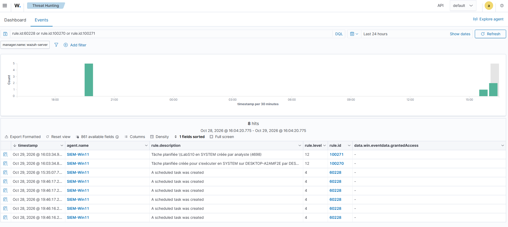

# Writeup 21 : tâche planifiée en SYSTEM, deux capteurs pour une élévation (T1053.005)

> Scénario 10, joué le 2026-10-29. Un administrateur local crée une tâche planifiée qui
> s'exécute sous **SYSTEM**, le compte le plus puissant de Windows. Wazuh a une native (60228)
> qui signale **toute** création de tâche au niveau 4 ; on ajoute deux règles locales étroites,
> **100270** (Sysmon) et **100271** (événement 4698), toutes deux de niveau 12. Tactique
> **Privilege Escalation** couverte.
>
> Versions : Wazuh 4.14.9, Windows 11 en français (agent SIEM-Win11), Sysmon v15.22.

## 1. Comprendre

Le Planificateur de tâches exécute un programme à une heure ou sur un déclencheur, sous le
compte qu'on lui indique. Un administrateur peut demander `SYSTEM` (`/ru SYSTEM`) : la commande
tourne alors avec plus de droits que l'administrateur lui-même (accès à LSASS, aux ruches SAM,
aux services). C'est aussi un moyen de **persistance** : la tâche survit au redémarrage.

MITRE ATT&CK : **T1053.005** *Scheduled Task/Job: Scheduled Task*, rangée sous Execution,
Persistence et **Privilege Escalation**. Ici, le test montre explicitement le passage
`analyste` → `SYSTEM` : on la compte pour Privilege Escalation.
Source : https://attack.mitre.org/techniques/T1053/005/

## 2. Ce que Wazuh fournit déjà

Recherche dans tout le ruleset (vérifié le 2026-10-29). Une première recherche, trop étroite
(`>4698<`, un seul fichier), était vide ; la recherche large a trouvé :

| Règle | Niveau | Ce qu'elle voit | Limite |
|---|---|---|---|
| **60228** | 4 | événement 4698 « A scheduled task was created », MITRE T1053 | **toute** création de tâche : 7 en 24 h sur la VM, toutes légitimes |
| règles `taskschd.dll` (`0820-sysmon_id_7.xml`) | — | chargement de la DLL du planificateur (Sysmon EID 7) | EID 7 non collecté par notre config Sysmon |
| `schtasks` dans `0800-sysmon_id_1.xml` | — | **aucune** | — |

Leçon de méthode (la même qu'au [writeup 19](19-scenario-suppression-cliches.md), dans l'autre
sens) : une recherche vide ne prouve rien si elle est trop étroite.

## 3. Télémétrie

| Capteur | Prérequis | Statut |
|---|---|---|
| Sysmon EID 1 (`schtasks.exe` et sa ligne de commande) | config Sysmon du lab | ✅ |
| 4698 (journal Security) | audit « Autres événements d'accès à l'objet » (GUID `{0CCE9227-69AE-11D9-BED3-505054503030}`) | ✅ déjà « Succès et échec » (famille 03 du [durcissement](13-durcissement-cis-automatise.md)) |

`auditpol` est interrogé par GUID : les libellés sont traduits sur un Windows en français (piège
déjà rencontré avec le SCA, [writeup 12](12-sca-cis-windows11.md)).

## 4. Les deux règles locales

```xml
<rule id="100270" level="12">
  <if_sid>61603</if_sid>
  <field name="win.eventdata.image" type="pcre2">(?i)\\schtasks\.exe$</field>
  <field name="win.eventdata.commandLine" type="pcre2">(?i)/create.+/ru\s+"?(nt\s*authority\\)?system\b</field>
  <description>Tâche planifiée créée pour s'exécuter en SYSTEM sur $(win.system.computer) par $(win.eventdata.user)</description>
  <mitre><id>T1053.005</id></mitre>
</rule>

<rule id="100271" level="12">
  <if_sid>60228</if_sid>
  <field name="win.eventdata.taskContent" type="pcre2">S-1-5-18</field>
  <field name="win.eventdata.subjectUserSid" type="pcre2" negate="yes">^S-1-5-18$</field>
  <description>Tâche planifiée $(win.eventdata.taskName) en SYSTEM créée par $(win.eventdata.subjectUserName) (4698)</description>
  <mitre><id>T1053.005</id></mitre>
</rule>
```

- **100270** voit la **commande** : qui a lancé `schtasks`, avec quels arguments. Étroite
  (image + `/create` + `/ru SYSTEM`), pour ne pas masquer d'autres règles sous 61603
  (leçon du [writeup 20](20-scenario-powershell-encode.md)).
- **100271** voit la **tâche elle-même** : le XML enregistré (`taskContent`) contient
  `<UserId>S-1-5-18</UserId>` quand elle tourne en SYSTEM. Indépendante de l'outil : elle
  attrape aussi une tâche créée par `Register-ScheduledTask`, l'API COM ou un malware.
- **Exclusion** : les tâches créées *par* SYSTEM (installeurs, mises à jour Edge/OneDrive) sont
  écartées par la condition négative sur `subjectUserSid`. On ne garde que la création par un
  compte humain.

## 5. Le test

PowerShell administrateur sur la VM Win11 :

```powershell
hostname; whoami
schtasks /create /tn LabS10 /tr "cmd.exe /c whoami > C:\Users\Public\s10.txt" /sc once /st 23:59 /ru SYSTEM /f
schtasks /run /tn LabS10; Start-Sleep 3; Get-Content C:\Users\Public\s10.txt
schtasks /delete /tn LabS10 /f
```

La tâche écrit l'identité sous laquelle elle tourne (attendu : `autorite nt\système`), puis
elle est supprimée.

## 6. Résultat



| Heure (UTC) | Règle | Niveau | Description |
|---|---|---|---|
| 15:03:34.864 | **100270** | 12 | Tâche planifiée créée pour s'exécuter en SYSTEM sur DESKTOP-A2AMF2E par DESKTOP-A2AMF2E\analyste |
| 15:03:34.945 | **100271** | 12 | Tâche planifiée `\LabS10` en SYSTEM créée par analyste (4698) |

Les deux capteurs ont vu l'action, à 81 ms d'écart. Pour `LabS10`, aucune 60228 n'apparaît : la
fille 100271 l'a remplacée, comme prévu.

**Faux positifs : pas encore mesurables.** Les sept autres 60228 des dernières 24 h (six le
2026-10-28 à 19:46, une le 2026-10-29 à 14:35) sont des tâches légitimes, mais elles sont
**antérieures** au chargement de 100271 (15:01) : leur absence de 100271 ne prouve rien.
On a donc rejoué la logique de la règle sur ces alertes (`alerts.json` du jour, et
`ossec-alerts-28.json.gz` de la veille, lu avec `zcat` : les jours passés sont compressés).

| Tâche (60228) | Créateur | Tourne en SYSTEM | 100271 ? |
|---|---|---|---|
| `\OneDrive Standalone Update Task-S-1-5-21-…-1001` (29/10 14:35) | `analyste` (`…-1001`) | non | non ✅ |
| 5 × `\SoftLanding\…\SoftLanding*Task-…` (28/10 18:46) | `analyste` (`…-1001`) | non | non ✅ |

**0 faux positif sur 6 tâches légitimes vérifiées** (la 7e de la capture n'a pas été retrouvée
dans les archives). Ces six tâches sont créées par l'utilisateur lui-même : avec la seule
condition « créateur ≠ SYSTEM », elles auraient **toutes** sonné. C'est la condition sur
`S-1-5-18` dans le XML qui les écarte : les deux conditions sont nécessaires.

## 7. Limites et suites

- **Créateur SYSTEM exclu.** Un attaquant déjà SYSTEM (ou passant par un service) qui crée une
  tâche n'est pas vu par 100271 : c'est le prix de l'exclusion des installeurs. 100270 le voit
  s'il utilise `schtasks.exe`.
- **Autres comptes puissants.** `LOCAL SERVICE` (S-1-5-19) ou `NETWORK SERVICE` (S-1-5-20) ne
  sont pas couverts ; un compte administrateur explicite non plus (`/ru Administrateur`).
- **Modification d'une tâche existante** (4702) : non couverte. Détourner une tâche légitime
  déjà en SYSTEM est plus discret que d'en créer une.
- **Échantillon de faux positifs réduit** : 6 tâches sur 2 jours de lab. À remesurer sur la durée.

## 8. Lien SOC

Tri : qui a créé la tâche (`subjectUserName`), que lance-t-elle (`<Command>` dans `taskContent`),
quand (`<Triggers>`), et l'a-t-on exécutée immédiatement (`schtasks /run`) ? Une tâche en
SYSTEM qui pointe vers `C:\Users\Public` ou `%TEMP%` est un signal fort.
