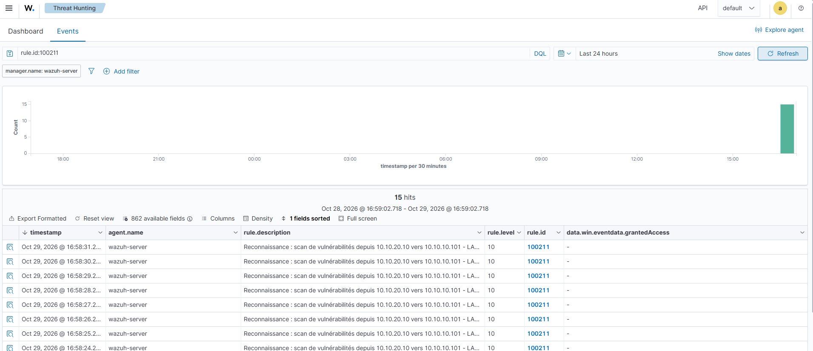

# Writeup 23 : scan de vulnérabilités, une signature Suricata maison et une alerte trop lourde pour syslog (T1595.002)

> Scénario 12, joué le 2026-10-29. Depuis Kali, `nmap --script vuln` interroge le SMB de
> Windows 11 à la recherche de failles connues. Trois surprises en chaîne : **les signatures ET
> Open ne voient rien**, on écrit donc **notre propre signature Suricata** (SMBv1 venu de
> l'extérieur) ; elle se déclenche sur pfSense… mais **l'alerte n'arrive jamais dans Wazuh**,
> trop lourde pour syslog ; et en cours de route, **Windows passe le réseau en « Public »** et
> ferme le port testé. Résultat final : règle **100211** (niveau 10), tactique **Reconnaissance**
> couverte.
>
> Versions : Wazuh 4.14.9, pfSense CE 2.9.0 + Suricata (ET Open), Windows 11 en français, Kali
> `10.10.20.10`, nmap 7.99.

## 1. Comprendre

Le scénario 2 cherchait des **ports ouverts** (T1046, découverte). Ici, l'attaquant, encore à
l'extérieur, interroge les services pour trouver une **faille connue** : c'est **T1595.002**
*Active Scanning: Vulnerability Scanning*, tactique **Reconnaissance** (TA0043).
Source : https://attack.mitre.org/techniques/T1595/002/

Le [document MITRE du lab](../mitre.md) notait déjà qu'un balayage venu d'un segment séparé, à
travers le pare-feu, relève plutôt de T1595 que de T1046 : ce scénario couvre Reconnaissance
avec un test dédié, sans requalifier les anciens.

## 2. Premier essai : rien

```bash
sudo nmap -Pn -sV -p 135,139,445 --script vuln 10.10.10.101
```

- 135 et 139 : `filtered` (pfSense ne laisse passer que le 445 vers Win11 depuis le segment
  d'attaque, comme prévu) ; 445 : `open`.
- Scripts : `smb-vuln-ms10-061` et `samba-vuln-cve-2012-1182` → « Could not negotiate a
  connection… Failed to receive bytes » ; `smb-vuln-ms10-054` → `false`. Win11 n'est
  vulnérable à rien de tout ça.
- Côté SIEM : **aucune alerte Suricata**. Diagnostic : Suricata est vivant (10 événements `dns`
  reçus dans la même fenêtre), donc ce n'est pas une panne de collecte. **Les signatures ET Open
  n'ont reconnu aucune sonde**, et 3 ports ne suffisent pas aux seuils `ET SCAN` du
  [scénario 4](10-scenario-suricata-nids.md).

Constat : **un scan de vulnérabilités ciblé et court passe sous les signatures par défaut.**

## 3. Une signature maison

Les scripts `smb-vuln-*` de nmap (et les scanners MS17-010) parlent **SMBv1**, que Windows 11
refuse (le « Failed to receive bytes » : Win11 raccroche). Une négociation SMBv1 venue de
l'extérieur du LAN n'a aucune raison légitime.

```
alert tcp $EXTERNAL_NET any -> $HOME_NET 445 (msg:"LAB RECON SMBv1 negotiate depuis l'exterieur (sonde de scanner de vulnerabilites)"; flow:to_server,established; content:"|FF|SMB|72|"; offset:4; depth:5; classtype:attempted-recon; priority:2; sid:1000010; rev:1;)
```

| Élément | Rôle |
|---|---|
| `offset:4; depth:5` | sauter l'en-tête NetBIOS (4 octets), lire `FF 53 4D 42` (« \xFFSMB ») + `72` (commande Negotiate) |
| `flow:to_server,established` | seulement après la poignée de main TCP, dans le sens client → serveur |
| `$EXTERNAL_NET` | tout ce qui n'est pas `HOME_NET` (alias `HOMENET_LAB` = `10.10.10.0/24`) |
| `priority:2` | sévérité 2 : la règle Wazuh 100200 (sévérité 1) ne l'intercepte pas |
| `sid:1000010` | plage locale |

Déployée dans **Services > Suricata > ATTACK > Rules > custom.rules**, interface redémarrée.
Versionnée dans [`configs/suricata/local.rules`](../../configs/suricata/local.rules).

Côté Wazuh, fille de la native 86601 :

```xml
<rule id="100211" level="10">
  <if_sid>86601</if_sid>
  <field name="alert.signature" type="pcre2">^LAB RECON</field>
  <description>Reconnaissance : scan de vulnérabilités depuis $(src_ip) vers $(dest_ip) - $(alert.signature)</description>
  <mitre><id>T1595.002</id></mitre>
</rule>
```

## 4. Deuxième essai : Suricata voit, Wazuh ne reçoit rien

Sur pfSense (SSH, `tail` de `/var/log/suricata/suricata_em042044/alerts.log`) : **5 alertes**
`[1:1000010:1] LAB RECON SMBv1…` `10.10.20.10 → 10.10.10.101:445` à 16:44 (heure pfSense), plus
la native Suricata `SURICATA SMB malformed request dialects` (sid 2225005). **La signature
fonctionne.** Dans Wazuh : ni 100211, ni même la ligne brute dans `archives.json`.

Écoute du port syslog sur le manager pendant un scan :

```bash
sudo timeout 90 tcpdump -i any -A -n -l udp port 514 | grep -o '"in_iface":"[a-z0-9]*","event_type":"[a-z]*"\|LAB RECON'
```

Résultat : des `"in_iface":"em0","event_type":"dns"`, **jamais** d'`alert`. Le transport
fonctionne pour certains événements EVE, pas pour les alertes.

Configuration EVE réelle de l'instance (`suricata.yaml`) :

```yaml
- alert:
    payload: yes              # payload en Base64, tampon de 4 ko
    payload-printable: yes    # le même, en texte
    packet: yes               # le paquet brut en Base64
    metadata: yes
```

Chaque alerte sur un flux qui **transporte des données** (SMB) embarque donc plusieurs ko ; une
ligne `dns` reste courte. Au scénario 4, les alertes `ET SCAN` portaient sur des SYN **sans
contenu** : lignes courtes, elles passaient, ce qui masquait le problème.

Correction (interface ATTACK, *EVE Output Settings*) : *EVE Log Alert Payload Data Formats* =
**NO**, décocher *Log a packet dump with alerts* et *Include App Layer metadata*.

## 5. Interlude : le port qui se ferme tout seul

Le test suivant donne `445/tcp filtered`. On élimine une à une les causes :

| Suspect | Vérification | Verdict |
|---|---|---|
| blocage par Suricata (*Block Offenders*) | `pfctl -t snort2c -T show` vide | ❌ |
| réponse active `block-ip-win` (scénario 1) | aucune 60122 / 60204 récente | ❌ |
| pfSense | `filterlog … em0,match,pass,in … 10.10.20.10` : laissé passer ; SYN répété = pas de réponse | ❌ |
| pare-feu Win11 | profil réseau **Public**, règle `FPS-SMB-In-TCP` (Private, Public) **désactivée** | ✅ |

Journal du pare-feu Windows : événement **2010** « Le profil réseau a changé sur une
interface » à 16:43:13 (heure locale), pendant nos manipulations sur pfSense. Correction :
`Set-NetConnectionProfile -NetworkCategory Private` et `Enable-NetFirewallRule -Name
FPS-SMB-In-TCP`. **Pourquoi** Windows a reclassé le réseau n'est pas établi (hypothèse : il a vu
un « nouveau réseau » pendant un redémarrage côté pfSense, à valider).

Leçon : **un changement de profil réseau Windows ferme des ports en silence et fausse un test.**
Vérifier que la cible est joignable (`open`) avant de conclure à un trou de détection.

Deuxième faux départ, d'un autre ordre : un script isolé (`smb-vuln-ms10-054`) ne négocie
**pas** en SMBv1 et ne déclenche pas la signature. Seul le scan complet (`-sV --script vuln`)
envoie les sondes SMBv1.

## 6. Résultat

Scan complet, port ouvert, alertes allégées :

```bash
sudo nmap -Pn -sV -p 445 --script vuln 10.10.10.101
```

- Écoute syslog : série de `"in_iface":"em0","event_type":"alert"` + `LAB RECON`. **Les
  alertes arrivent.**
- pfSense : `LAB RECON SMBv1…` à 16:58:29 et 16:58:30.
- Wazuh : **15 alertes 100211** niveau 10, de 15:58:24 à 15:58:31 UTC, « Reconnaissance : scan
  de vulnérabilités depuis 10.10.20.10 vers 10.10.10.101 - LAB RECON SMBv1… ».



Sur la cause du blocage syslog : l'avant/après est net (mêmes signature et cible, alertes
locales dans les deux cas, reçues seulement après allègement). **Fortement étayé**, pas prouvé à
100 % : les deux scans n'étaient pas strictement identiques, et la limite exacte (taille de
datagramme UDP, longueur de ligne de `syslogd`) n'a pas été mesurée.

## 7. Limites et suites

- **Une alerte par sonde** : 15 alertes pour un scan. Une règle de fréquence (comme 100303 pour
  `filterlog`) agrégerait en une alerte « scan de vulnérabilités en cours ».
- **SMBv1 seulement.** Un scanner qui négocie en SMB2/3, ou qui vise un autre service (HTTP,
  RDP), échappe à la signature.
- **Alertes allégées = moins de contexte.** Sans payload, l'analyste ne voit plus le contenu du
  paquet dans Wazuh ; il reste sur pfSense. Alternative : EVE vers fichier + collecte par agent
  (pas de limite syslog), à étudier.
- **Ressources** : pfSense a 1 Go de RAM pour Suricata.

## 8. Lien SOC

Trois leçons d'intégration, plus utiles que la règle elle-même :

1. Les **signatures par défaut** ne couvrent pas tout : savoir écrire une signature ciblée.
2. **L'IDS peut voir sans que le SIEM sache** : vérifier chaque maillon (alerte locale → trame
   syslog → archives → règle).
3. **Tester la cible avant le capteur** : un port fermé par un changement de profil donne un
   faux « non détecté ».
