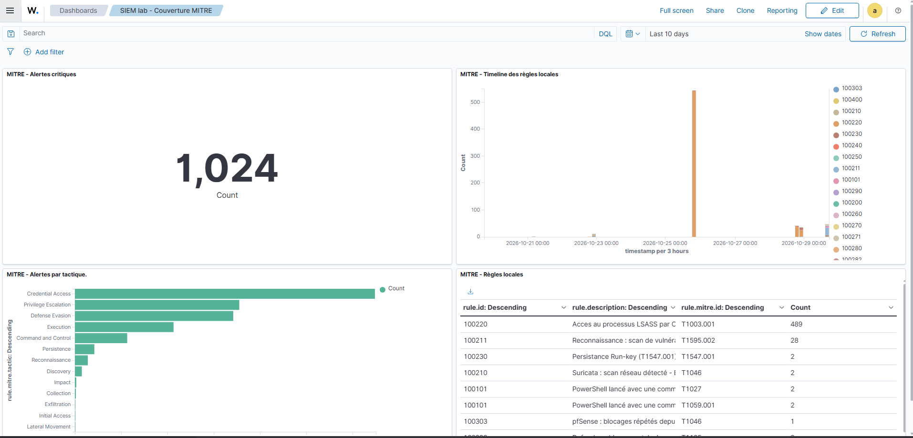

# Writeup 25 : un dashboard de couverture MITRE, et ce qu'il révèle sur nos propres règles

> Joué le 2026-10-29. Objectif : une vue d'ensemble des détections du lab dans le dashboard
> Wazuh (OpenSearch Dashboards), utile à un analyste et présentable. En chemin, le dashboard
> fait apparaître **un pic de 500 alertes LSASS** : l'enquête montre un artefact de mise au point,
> puis un bruit réel d'outils légitimes, traité par une liste blanche **100221**. Et une
> vérification préalable découvre que **l'archivage brut était coupé depuis 4 jours**.
>
> Versions : Wazuh 4.14.9 (dashboard OpenSearch), index `wazuh-alerts-*`.

## 1. Préalable : les archives étaient coupées

Avant de construire, on vérifie la piste ouverte au [writeup 24](24-scenario-telechargement-certutil.md)
(aucune ligne Defender dans `archives.json`) :

```bash
sudo grep -n "logall" /var/ossec/etc/ossec.conf        # <logall_json>no</logall_json>
sudo ls -la /var/ossec/logs/archives/                  # archives.json daté du 25 oct. 18:11
```

L'archivage de tous les événements reçus (`logall_json`) était désactivé depuis le
2026-10-25 18:11 : chaque « 0 dans les archives » relevé depuis ne prouvait rien. Corrigé
(`yes`, redémarrage, fichier de nouveau écrit), et les preuves des writeups 23 et 24 rectifiées.

**Leçon** : avant d'utiliser un zéro comme preuve d'absence, vérifier que la source est encore
alimentée (date du fichier).

## 2. Le dashboard « SIEM lab - Couverture MITRE »

Quatre visualisations (*Explore > Visualize*), source `wazuh-alerts-*`, période 10 jours,
assemblées dans un dashboard (`/app/dashboards#/create`) :

| Panneau | Type | Requête (DQL) | Agrégation | Ce qu'il montre |
|---|---|---|---|---|
| Alertes critiques | Metric | `rule.level >= 12` | Count | volume d'alertes à traiter en priorité (1 024 sur 10 jours) |
| Alertes par tactique | Horizontal Bar, échelle log | `rule.level >= 8` | Terms `rule.mitre.tactic`, 14 | les 13 tactiques couvertes |
| Timeline des règles locales | Vertical Bar, échelle log | `rule.id:100* and rule.level >= 8 and not rule.id:100100` | Date Histogram `timestamp` + Split series Terms `rule.id` | quand chaque détection maison a sonné |
| Règles locales | Data Table | idem | Terms `rule.id` / `rule.description` / `rule.mitre.id` | nombre d'alertes par règle maison |

Choix de requêtes, chacun issu d'un premier essai raté :

- **`rule.level >= 8`** : sans seuil, le bruit de bas niveau (connexions, Sysmon niveau 0-3)
  domine.
- **`rule.id:100*`** attrape aussi la native **1004** (le joker accepte « 1004 ») et la 100301
  (trafic pfSense autorisé, niveau 3 : un pic de 14 000 le 23/10). Le seuil de niveau règle les
  deux. **100100** (supprimée au [writeup 20](20-scenario-powershell-encode.md)) est exclue
  explicitement.
- **Échelle logarithmique** : Credential Access (~650, brute force) écrase Impact ou Lateral
  Movement (1 ou 2 alertes) en échelle linéaire.



## 3. Ce que le dashboard révèle : 489 alertes LSASS

La table et la timeline montrent un pic de la **100220** (accès LSASS, niveau 12) : **489**
alertes, surtout le 25/10. Le scénario 5 n'en justifie que quelques-unes.

Première hypothèse (agent Wazuh, faux positif connu) : **fausse**. La description commence par
`C:\WINDOWS\s…`, l'agent vit dans `Program Files (x86)`. On compte plutôt (fichiers d'alertes
tournés, compressés) :

```bash
sudo bash -c 'zcat -f /var/ossec/logs/alerts/2026/Oct/ossec-alerts-2[5-9].json* /var/ossec/logs/alerts/alerts.json' \
  | grep '"id":"100220"' | python3 -c "...compte par (sourceImage, grantedAccess)..."
```

(Piège : sans `sudo bash -c`, le joker est développé par l'utilisateur, qui ne peut pas lire le
dossier ; `zcat` reçoit le motif brut et l'erreur, masquée par `2>/dev/null`, donne un résultat
vide trompeur.)

| Alertes | Processus source | Masque |
|---|---|---|
| 484 | `C:\Windows\System32\taskmgr.exe` | 0x1000 |
| 68 | `C:\Windows\System32\wbem\wmiprvse.exe` | 0x1410 |
| 16 | `C:\Windows\System32\svchost.exe` | 0x1000 |
| 9 + 9 | `C:\Program Files (x86)\ossec-agent\wazuh-agent.exe` | 0x1fffff, 0x1410 |
| 4 + 3 | `MsMpEng.exe` (Defender, deux versions de plateforme) | 0x1410 |
| 3 | `vmtoolsd.exe` (VMware Tools) | 0x1410 |

Surprise : la 100220 **ne doit pas** réagir à 0x1000 (elle n'accepte que les masques avec
lecture mémoire, `0x1010|0x1410|0x1438|0x143a|0x1fffff`, [writeup 15](15-detection-acces-identifiants-lsass.md)).
Deux hypothèses : règle live différente du dépôt, ou alertes produites par une version de mise
au point. Vérification :

- la règle en place sur le manager est identique au dépôt ;
- répartition par heure : **les 501 alertes 0x1000 tombent toutes le 25/10 entre 17 h et 18 h
  UTC**, heure de la mise au point du scénario 5 (essais de dump par le Gestionnaire des tâches,
  bloqués par la protection PPL). Plus aucune ensuite.

**Conclusion (vérifiée)** : le pic est un **artefact de développement**, pas une attaque ni un
défaut de la règle actuelle. Un dashboard garde la mémoire des essais : à documenter plutôt
qu'à effacer.

## 4. Le bruit réel : liste blanche 100221

Après la mise au point, il reste ~60 alertes 0x1410 le 28/10 : `WmiPrvSE`, agent Wazuh,
Defender, VMware Tools, des outils légitimes qui inspectent LSASS. Règle **100221**, niveau 0,
enfant de 100220 (même principe que 100231 pour Edge, [writeup 18](18-tuning-faux-positifs.md)) :

```xml
<rule id="100221" level="0">
  <if_sid>100220</if_sid>
  <field name="win.eventdata.sourceImage" type="pcre2">(?i)^C:\\+Windows\\+System32\\+wbem\\+WmiPrvSE\.exe$|^C:\\+Program Files \(x86\)\\+ossec-agent\\+wazuh-agent\.exe$|^C:\\+ProgramData\\+Microsoft\\+Windows Defender\\+Platform\\+[0-9.-]+\\+MsMpEng\.exe$|^C:\\+Program Files\\+VMware\\+VMware Tools\\+vmtoolsd\.exe$</field>
  <description>Acces LSASS par un outil legitime connu ($(win.eventdata.sourceImage)) : ignore</description>
</rule>
```

Choix de conception :

- **Chemins complets ancrés** (`^…$`) : un `wmiprvse.exe` déposé ailleurs reste détecté.
- **`\\+`** : dans les champs eventchannel, Wazuh **double** les antislashs
  (`C:\\Windows\\…`). Une première version avec un seul `\\` n'aurait jamais correspondu, sans
  message d'erreur : liste blanche inopérante en silence. Repéré en relisant la sortie brute
  avant validation.
- **`taskmgr.exe` exclu** : un dump LSASS par le Gestionnaire des tâches est une technique
  réelle (T1003.001), il doit continuer à alerter.
- **Limite** : un attaquant capable d'injecter du code dans un de ces processus légitimes
  passerait la liste blanche (déduit).

Déployée le 2026-10-29 (`wazuh-analysisd -t` sans erreur, manager `active`). **Validation : à
faire** sur les prochains accès spontanés (attendu : plus de 100220 pour ces 4 sources).

## 5. Lien SOC

1. **Un dashboard sert d'abord à poser des questions** : le pic LSASS était invisible dans les
   alertes une à une.
2. **Enquêter avant de conclure** : la première explication (agent Wazuh) était fausse.
3. **Corréler avec le temps** : la répartition horaire a départagé deux hypothèses en une
   commande.
4. **Tester la liste blanche sur la forme réelle des données** : antislashs doublés.
